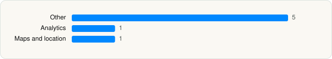

<picture><source media="(prefers-color-scheme: dark)" srcset="../../../../assets/logo/logo-dark.svg"></picture> [Tech Stack](../../../../README.md) / [Snap, Inc.](../../../../companies/snap-inc.md) / Snapchat

# Snapchat

<picture><source media="(prefers-color-scheme: dark)" srcset="../../../../assets/badges/ios-dark.svg"></picture> <picture><source media="(prefers-color-scheme: dark)" srcset="../../../../assets/badges/active-dark.svg"></picture> <picture><source media="(prefers-color-scheme: dark)" srcset="../../../../assets/badges/floor-dark.svg"></picture> <picture><source media="(prefers-color-scheme: dark)" srcset="../../../../assets/badges/encrypted-dark.svg"></picture>

[App Store](https://apps.apple.com/app/id447188370) · [latest.json](latest.json)

| | |
|---|---|
| Company | [Snap, Inc.](../../../../companies/snap-inc.md) |
| Store id | `447188370` |
| Bundle / package id | `com.toyopagroup.picaboo` |
| Latest version | 13.95.1 (analysed 2026-06-19) |
| Versions tracked | 1 |
| SDKs in latest version | 7 |
| Languages | C/C++, Metal (shaders), Objective-C, Swift |
| UI | SwiftUI, UIKit |
| Build | Swift Package Manager (SwiftPM) |
| Minimum OS | iOS 15.0 (built with Xcode 26.0.1, SDK iphoneos26.0) |
| Devices / ABIs | iPhone, iPad |
| Localisations | 42 |
| Capabilities | 16 |
| Declares tracking | No |
| Tracked | Yes |

## SDKs by category

<picture><source media="(prefers-color-scheme: dark)" srcset="../../../../assets/charts/apps/ios/snap-inc/snapchat-dark.svg"></picture>

- **Other** (5): AudioPresets, insights, NLPGeoParser, reactions, SCMemoriesSearch
- **Analytics** (1): Facebook SDK
- **Maps and location** (1): Mapbox 5.9.0

Frameworks (41)

ActivityKit (Live Activities), AdServices (Apple Search Ads attribution), AdSupport (IDFA), App Intents, App Tracking Transparency (ATT), ARKit, Authentication Services (Sign in with Apple / passkeys), AVFoundation (audio/video), AVKit, Background Tasks, CallKit (VoIP), Combine (reactive), Contacts, Core Bluetooth, Core Data, Core Image, Core Location, Core ML, Core Motion, CryptoKit, DeviceCheck / App Attest, Local Authentication (Face ID / Touch ID), MapKit, Media Player, MessageUI (mail / SMS compose), MetalKit, MetricKit (diagnostics), Natural Language, Network.framework, Photos, PhotosUI, PushKit (VoIP push), SafariServices, SiriKit (Intents), StoreKit (in-app purchase), SwiftUI, UIKit, User Notifications, Vision, Watch Connectivity, WidgetKit (widgets)

Capabilities (16)

App Groups, Associated Domains (Universal Links), Background App Refresh, Background Audio, Background Location, Background Processing, Background Push, Bluetooth (central), Communication Notifications, External Accessory, iCloud Key-Value Storage, Keychain Sharing, Push Notifications (APNs), Sign in with Apple, Time-Sensitive Notifications, VoIP

## Version history

| Version | Analysed | Store update | SDKs | Change | SDK list is a floor | Binary encrypted | File |
|---|---|---|---|---|---|---|---|
| 13.95.1 | 2026-06-19 |  | 7 |  | Yes | Yes | [13.95.1.json](13.95.1.json) |

## Model-written summary

> iOS Snapchat app with Swift/Objective-C, 163 Metal shaders, 9 app extensions, App Intents, and first-party backends

Written by a language model from the detected signals (`inferred[]`). It is commentary, not measurement.

---

Generated by `scripts/build_readme.py` from the JSON files. Do not edit by hand.
