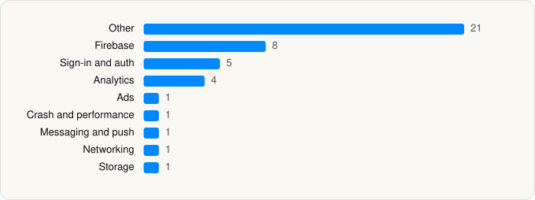

<picture><source media="(prefers-color-scheme: dark)" srcset="../../../../assets/logo/logo-dark.svg"></picture> [Tech Stack](../../../../README.md) / [Sonauto, inc.](../../../../companies/sonauto-inc.md) / Treblo

# Treblo - AI Music

<picture><source media="(prefers-color-scheme: dark)" srcset="../../../../assets/badges/ios-dark.svg"></picture> <picture><source media="(prefers-color-scheme: dark)" srcset="../../../../assets/badges/inactive-dark.svg"></picture> <picture><source media="(prefers-color-scheme: dark)" srcset="../../../../assets/badges/floor-dark.svg"></picture> <picture><source media="(prefers-color-scheme: dark)" srcset="../../../../assets/badges/encrypted-dark.svg"></picture>

[App Store](https://apps.apple.com/app/id6757288408) · [latest.json](latest.json)

| | |
|---|---|
| Company | [Sonauto, inc.](../../../../companies/sonauto-inc.md) |
| Store id | `6757288408` |
| Bundle / package id | `ai.sonauto.app` |
| Latest version | 1.6.0 (analysed 2026-11-09) |
| Versions tracked | 1 |
| SDKs in latest version | 43 |
| Languages | C/C++, Objective-C, Swift |
| UI | SwiftUI, UIKit |
| Build | Swift Package Manager (SwiftPM) |
| Minimum OS | iOS 15.6 (built with Xcode 27.0, SDK iphoneos27.0) |
| Devices / ABIs | iPhone, iPad |
| Localisations | 0 |
| Capabilities | 4 |
| Declares tracking | No |
| Tracked | No. Kept for history. |

## SDKs by category

<picture><source media="(prefers-color-scheme: dark)" srcset="../../../../assets/charts/apps/ios/sonauto-inc/treblo-dark.svg"></picture>

- **Other** (21): BigInt 5.2.0, Capacitor 8.5.2, CapacitorApp 8.0.0, CapacitorBrowser 8.0.0, CapacitorCommunityInAppReview 8.0.0, CapacitorDevice 8.0.2, CapacitorFilesystem 8.0.0, CapacitorFileTransfer 2.0.2, CapacitorPreferences 8.0.0, CapacitorShare 8.0.0, CapacitorSplashScreen 8.0.0, CapawesomeCapacitorAppUpdate 8.0.0, CapgoCapacitorNativeNavigation 8.2.7, CapgoCapacitorPersistentAccount 8.0.6, CapgoCapacitorUpdater 8.41.5, Cordova 8.5.2, Crypto, IONFilesystemLib 1.0.1, IONFileTransferLib 1.0.1, Lodash, Version 0.8.0
- **Firebase** (8): AppCheck 11.2.0, FBLPromises, FirebaseCore, FirebaseCoreInternal, FirebaseInstallations, GoogleDataTransport, GoogleUtilities 8.1.0, nanopb
- **Sign-in and auth** (5): AppAuth 2.0.0, CapgoCapacitorSocialLogin 8.3.1, GoogleSignIn 9.0.0, GTMAppAuth 5.0.0, GTMSessionFetcher 3.5.0
- **Analytics** (4): FirebaseAnalytics 12.12.1, GoogleAppMeasurement 12.12.1, GoogleAppMeasurementIdentitySupport 12.12.1, PostHog
- **Ads** (1): GoogleAdsOnDeviceConversion 3.5.0
- **Crash and performance** (1): Sentry 8.56.2
- **Messaging and push** (1): FirebaseMessaging
- **Networking** (1): Alamofire 5.10.2
- **Storage** (1): ZIPFoundation 0.9.20

Frameworks (16)

Authentication Services (Sign in with Apple / passkeys), AVFoundation (audio/video), Combine (reactive), Core Data, CryptoKit, DeviceCheck / App Attest, Local Authentication (Face ID / Touch ID), Media Player, MetricKit (diagnostics), Network.framework, PDFKit, SafariServices, StoreKit (in-app purchase), SwiftUI, UIKit, User Notifications

Capabilities (4)

Associated Domains (Universal Links), Background Audio, Push Notifications (APNs), Sign in with Apple

## Version history

| Version | Analysed | Store update | SDKs | Change | SDK list is a floor | Binary encrypted | File |
|---|---|---|---|---|---|---|---|
| 1.6.0 | 2026-11-09 |  | 43 |  | Yes | Yes | [1.6.0.json](1.6.0.json) |

---

Generated by `scripts/build_readme.py` from the JSON files. Do not edit by hand.
