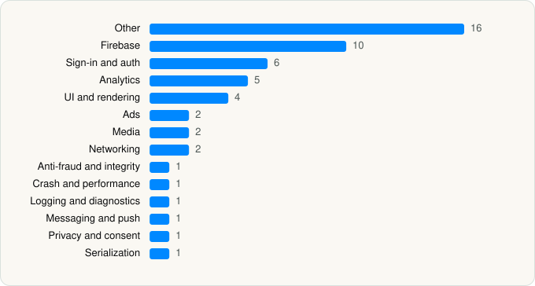

<picture><source media="(prefers-color-scheme: dark)" srcset="../../../../assets/logo/logo-dark.svg"></picture> [Tech Stack](../../../../README.md) / [SONY PICTURES NETWORKS INDIA PVT LTD](../../../../companies/sony-pictures-networks-india-pvt-ltd.md) / Sony LIV

# Sony LIV

<picture><source media="(prefers-color-scheme: dark)" srcset="../../../../assets/badges/ios-dark.svg"></picture> <picture><source media="(prefers-color-scheme: dark)" srcset="../../../../assets/badges/active-dark.svg"></picture> <picture><source media="(prefers-color-scheme: dark)" srcset="../../../../assets/badges/floor-dark.svg"></picture> <picture><source media="(prefers-color-scheme: dark)" srcset="../../../../assets/badges/encrypted-dark.svg"></picture>

[App Store](https://apps.apple.com/app/id587794258) · [latest.json](latest.json)

| | |
|---|---|
| Company | [SONY PICTURES NETWORKS INDIA PVT LTD](../../../../companies/sony-pictures-networks-india-pvt-ltd.md) |
| Store id | `587794258` |
| Bundle / package id | `com.msmpl.sonyliviphone` |
| Latest version | 9.2.6 (analysed 2026-11-05) |
| Versions tracked | 1 |
| SDKs in latest version | 53 |
| Languages | C/C++, Objective-C, Swift |
| UI | SwiftUI, UIKit |
| Build | Swift Package Manager (SwiftPM) |
| Minimum OS | iOS 15 (built with Xcode 27.1, SDK iphoneos27.1) |
| Devices / ABIs | iPhone, iPad |
| Localisations | 1 |
| Capabilities | 10 |
| Declares tracking | Yes |
| Tracked | Yes |

## SDKs by category

<picture><source media="(prefers-color-scheme: dark)" srcset="../../../../assets/charts/apps/ios/sony-pictures-networks-india-pvt-ltd/sony-liv-dark.svg"></picture>

- **Other** (16): CTNotificationContent 1.0, CTNotificationService, EMS 4.2, GodavariUnicoresdk 1.0, LivDebug, LivUICommon, LivUIiOS, OpenSSL 3.6.3000, SPNPlayer, TennisSDK 1.0, Toast, UPISDK 1.0, Usabilla 6.12.1, UXCam 3.7.1, VOSDKAdapter 1.0, VOSSAIManager 1.0
- **Firebase** (10): FBLPromises, Firebase, FirebaseCore, FirebaseCoreInternal, FirebaseInstallations, FirebaseRemoteConfig, GoogleDataTransport, GoogleUtilities 7.13.3, nanopb, Promises
- **Sign-in and auth** (6): AppAuth, FacebookLogin, FBSDKLoginKit 1.0, GoogleSignIn, GTMAppAuth, GTMSessionFetcher
- **Analytics** (5): AppsFlyerLib 1.0, FacebookAEM, FacebookCore, FBAEMKit 1.0, FBSDKCoreKit 1.0
- **UI and rendering** (4): DGCharts, MaterialDialogs, SDWebImage, SkeletonView
- **Ads** (2): Google Mobile Ads (AdMob), GoogleMobileAds 11.13.0
- **Media** (2): GoogleCast 4.8.4, GoogleInteractiveMediaAds 3.32.0
- **Networking** (2): Alamofire, Starscream
- **Anti-fraud and integrity** (1): RecaptchaEnterprise 1.0
- **Crash and performance** (1): FirebaseCrashlytics
- **Logging and diagnostics** (1): CocoaLumberjack
- **Messaging and push** (1): CleverTap 1.0
- **Privacy and consent** (1): UserMessagingPlatform 2.7.0
- **Serialization** (1): Protobuf 3.29.6

Frameworks (30)

ActivityKit (Live Activities), AdSupport (IDFA), App Intents, App Tracking Transparency (ATT), Authentication Services (Sign in with Apple / passkeys), AVFoundation (audio/video), AVKit, CallKit (VoIP), Combine (reactive), Core Bluetooth, Core Data, Core Image, Core Location, Core Motion, CryptoKit, DeviceCheck / App Attest, Local Authentication (Face ID / Touch ID), MapKit, Media Player, MessageUI (mail / SMS compose), MetricKit (diagnostics), Network.framework, Photos, SafariServices, SiriKit (Intents), StoreKit (in-app purchase), SwiftUI, UIKit, User Notifications, Vision

Capabilities (10)

App Attest, App Groups, Associated Domains (Universal Links), Background App Refresh, Background Audio, Background Processing, Background Push, Keychain Sharing, Push Notifications (APNs), Sign in with Apple

## Version history

| Version | Analysed | Store update | SDKs | Change | SDK list is a floor | Binary encrypted | File |
|---|---|---|---|---|---|---|---|
| 9.2.6 | 2026-11-05 |  | 53 |  | Yes | Yes | [9.2.6.json](9.2.6.json) |

---

Generated by `scripts/build_readme.py` from the JSON files. Do not edit by hand.
