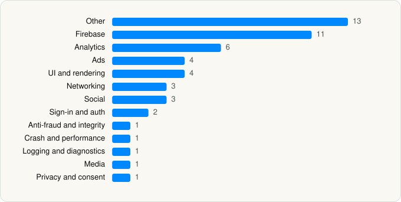

<picture><source media="(prefers-color-scheme: dark)" srcset="../../../../assets/logo/logo-dark.svg"></picture> [Tech Stack](../../../../README.md) / [SoundCloud Global Limited & Co KG](../../../../companies/soundcloud-global-limited-co-kg.md) / SoundCloud

# SoundCloud: The Music You Love

<picture><source media="(prefers-color-scheme: dark)" srcset="../../../../assets/badges/ios-dark.svg"></picture> <picture><source media="(prefers-color-scheme: dark)" srcset="../../../../assets/badges/active-dark.svg"></picture> <picture><source media="(prefers-color-scheme: dark)" srcset="../../../../assets/badges/floor-dark.svg"></picture> <picture><source media="(prefers-color-scheme: dark)" srcset="../../../../assets/badges/encrypted-dark.svg"></picture>

[App Store](https://apps.apple.com/app/id336353151) · [latest.json](latest.json)

| | |
|---|---|
| Company | [SoundCloud Global Limited & Co KG](../../../../companies/soundcloud-global-limited-co-kg.md) |
| Store id | `336353151` |
| Bundle / package id | `com.soundcloud.TouchApp` |
| Latest version | 8.63.1 (analysed 2026-06-19) |
| Versions tracked | 1 |
| SDKs in latest version | 51 |
| Languages | C/C++, Kotlin Multiplatform, Metal (shaders), Objective-C, React Native / JavaScript, Swift |
| UI | Lottie (animations), SwiftUI, UIKit |
| Build | Swift Package Manager (SwiftPM) |
| Minimum OS | iOS 16.4 (built with Xcode 26.0.1, SDK iphoneos26.0) |
| Devices / ABIs | iPhone, iPad |
| Localisations | 17 |
| Capabilities | 10 |
| Declares tracking | Yes |
| Tracked | Yes |

## SDKs by category

<picture><source media="(prefers-color-scheme: dark)" srcset="../../../../assets/charts/apps/ios/soundcloud-global-limited-co-kg/soundcloud-dark.svg"></picture>

- **Other** (13): Atomics 1.0, Crypto 1.0, MoEngageCampaignsCore 1.1.5, MoEngageCore 10.8.1, MoEngageInApps 7.5.4, MoEngageKMMConditionEvaluator 1.0, MoEngageMessaging 5.2.1, MoEngageRichNotification 8.1.7, MoEngageSDK 10.1.4, MoEngageSecurity 2.0.3, MoEngageTriggerEvaluator 2.0.5, Prebidorg 1.5.5, Tude 1.0
- **Firebase** (11): FBLPromises, Firebase, FirebaseAuth, FirebaseCore, FirebaseCoreInternal, FirebaseInstallations, FirebaseRemoteConfig, GoogleDataTransport, GoogleUtilities 1.0, nanopb, Promises
- **Analytics** (6): FacebookAEM, FacebookCore, FBAEMKit 1.0, FBSDKCoreKit 1.0, SCSDKCoreKit 2.5.0, Segment
- **Ads** (4): DTBiOSSDK 1.0, Google Mobile Ads (AdMob), PrebidMobile 3.2.1, ProgrammaticAccessLibrary 2.8.1
- **UI and rendering** (4): Kingfisher, Lottie 4.4.3, RiveRuntime 6.11.4, SDWebImage
- **Networking** (3): GCDWebServer, NIOPosix 1.0, NIOSSL 1.0
- **Social** (3): FacebookShare, FBSDKShareKit 1.0, SCSDKCreativeKit 2.5.0
- **Sign-in and auth** (2): GTMSessionFetcher, SCSDKLoginKit 2.5.0
- **Anti-fraud and integrity** (1): DataDomeSDK 3.1.0
- **Crash and performance** (1): FirebaseCrashlytics
- **Logging and diagnostics** (1): Pulse 4.2.3
- **Media** (1): GoogleCast 4.7.1
- **Privacy and consent** (1): OTPublishersHeadlessSDK 202512.1.0

Frameworks (32)

AdServices (Apple Search Ads attribution), AdSupport (IDFA), App Intents, App Tracking Transparency (ATT), Authentication Services (Sign in with Apple / passkeys), AVFoundation (audio/video), AVKit, Background Tasks, Combine (reactive), Core Data, Core Image, Core Location, Core Motion, CryptoKit, Media Player, MessageUI (mail / SMS compose), MetalKit, MetricKit (diagnostics), Network.framework, PDFKit, Photos, PhotosUI, SafariServices, SiriKit (Intents), SpriteKit, StoreKit (in-app purchase), Swift Charts, SwiftUI, UIKit, User Notifications, Watch Connectivity, WidgetKit (widgets)

Capabilities (10)

App Groups, Associated Domains (Universal Links), Background App Refresh, Background Audio, Background Processing, Background Push, CarPlay, Push Notifications (APNs), Sign in with Apple, SiriKit

## Version history

| Version | Analysed | Store update | SDKs | Change | SDK list is a floor | Binary encrypted | File |
|---|---|---|---|---|---|---|---|
| 8.63.1 | 2026-06-19 |  | 51 |  | Yes | Yes | [8.63.1.json](8.63.1.json) |

## Model-written summary

> SwiftUI/UIKit iOS music app with App Intents, 8 Metal shaders, Kotlin Multiplatform, 52 third-party SDKs and Firebase

Written by a language model from the detected signals (`inferred[]`). It is commentary, not measurement.

---

Generated by `scripts/build_readme.py` from the JSON files. Do not edit by hand.
