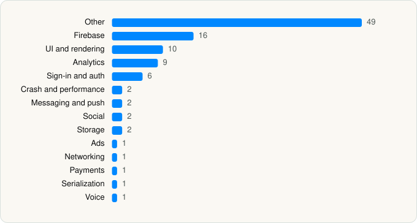

<picture><source media="(prefers-color-scheme: dark)" srcset="../../../../assets/logo/logo-dark.svg"></picture> [Tech Stack](../../../../README.md) / [Speechify Inc.](../../../../companies/speechify-inc.md) / Speechify

# Speechify – Text to Speech PDF

<picture><source media="(prefers-color-scheme: dark)" srcset="../../../../assets/badges/ios-dark.svg"></picture> <picture><source media="(prefers-color-scheme: dark)" srcset="../../../../assets/badges/inactive-dark.svg"></picture> <picture><source media="(prefers-color-scheme: dark)" srcset="../../../../assets/badges/floor-dark.svg"></picture> <picture><source media="(prefers-color-scheme: dark)" srcset="../../../../assets/badges/encrypted-dark.svg"></picture>

[App Store](https://apps.apple.com/app/id1209815023) · [latest.json](latest.json)

| | |
|---|---|
| Company | [Speechify Inc.](../../../../companies/speechify-inc.md) |
| Store id | `1209815023` |
| Bundle / package id | `com.cliffweitzman.speechifyMobile2` |
| Latest version | 5.5.17 (analysed 2026-10-24) |
| Versions tracked | 1 |
| SDKs in latest version | 103 |
| Languages | C/C++, Metal (shaders), Objective-C, Swift |
| UI | Intercom UI, Lottie (animations), SwiftUI, UIKit |
| Build | Swift Package Manager (SwiftPM) |
| Minimum OS | iOS 18.0 (built with Xcode 27.0, SDK iphoneos27.0) |
| Devices / ABIs | iPhone, iPad |
| Localisations | 43 |
| Capabilities | 10 |
| Declares tracking | Yes |
| Tracked | No. Kept for history. |

## SDKs by category

<picture><source media="(prefers-color-scheme: dark)" srcset="../../../../assets/charts/apps/ios/speechify-inc/speechify-dark.svg"></picture>

- **Other** (49): absl 1.20240722.0, abslWrapper, AIVoices, AssistantFlow, AudioBrowserFlow, Autocorrect, AxonSDK 1.3.3, BooksFlow, CioDataPipelines, CioMessagingInApp, CioMessagingPushFCM, CreateNoteFlow, DictationService, EnigmaSDK 1.0, FacebookBasics, Factory, FactoryKit, GoogleAPIClientForRESTCore, KindleFlow, LibraryFlow, LifetimeTracker, Lodash, NewHomeFlow, NewImportFlow, NewScanFlow, OnboardingFlow, onnxruntime 1.20.0, opensslWrapper, PaywallFlow, PodcastPlayer, PodcastSourcesKit, ProfileFlow, RaTeX, RustLiveKitUniFFI 1.0, ScanFlow, SettingsFlow, SleepTimerFlow, SPLComponents, SSML 1.0, SwiftPhonemizer, SwiftUIIntrospect 1.0, Then 1.0, UserFlow, VMS, VMSCore, VoiceKeyboardHost, VoiceLibrary, VoiceWizardFlow, WidgetFlow
- **Firebase** (16): abseil, FBLPromises, Firebase, FirebaseAuth, FirebaseCore, FirebaseCoreInternal, FirebaseDynamicLinks, FirebaseFirestore, FirebaseInstallations, FirebaseRemoteConfig, GoogleDataTransport, GoogleUtilities, gRPC, leveldb, nanopb, Promises
- **UI and rendering** (10): Highlight.js 11.9.0, HighlightSwift, Kingfisher, Lottie, PSPDFKit 14.3.0, PSPDFKitUI 0, React Native, SDWebImage, SDWebImageSwiftUI, SwiftMessages
- **Analytics** (9): Branch, FacebookAEM, FacebookCore, FBAEMKit 1.0, FBSDKCoreKit 1.0, FirebaseAnalytics 11.15.0, GoogleAppMeasurement 11.15.0, GoogleAppMeasurementIdentitySupport 11.15.0, Segment
- **Sign-in and auth** (6): AppAuth, FacebookLogin, FBSDKLoginKit 1.0, GoogleSignIn, GTMSessionFetcher, NewAuthenticationFlow
- **Crash and performance** (2): FirebaseCrashlytics, Sentry 8.58.4
- **Messaging and push** (2): FirebaseMessaging, Intercom 19.6.5
- **Social** (2): FacebookShare, FBSDKShareKit 1.0
- **Storage** (2): GRDB, ZIPFoundation
- **Ads** (1): GoogleAdsOnDeviceConversion 2.3.0
- **Networking** (1): Alamofire
- **Payments** (1): SubscriptionsService 1.0
- **Serialization** (1): SwiftProtobuf
- **Voice** (1): LiveKit

Frameworks (38)

ActivityKit (Live Activities), AdServices (Apple Search Ads attribution), AdSupport (IDFA), App Intents, App Tracking Transparency (ATT), Authentication Services (Sign in with Apple / passkeys), AVFoundation (audio/video), AVKit, Combine (reactive), Contacts, Core Data, Core Image, Core Location, Core ML, Core Motion, CryptoKit, DeviceCheck / App Attest, Local Authentication (Face ID / Touch ID), Media Player, MessageUI (mail / SMS compose), MetalKit, MetricKit (diagnostics), Natural Language, Network.framework, PassKit (Wallet / Apple Pay), PDFKit, Photos, PhotosUI, SafariServices, SiriKit (Intents), StoreKit (in-app purchase), Swift Charts, SwiftData (persistence), SwiftUI, UIKit, User Notifications, Vision, WidgetKit (widgets)

Capabilities (10)

App Attest, App Groups, Associated Domains (Universal Links), Background Audio, Background Push, CloudKit, iCloud, Keychain Sharing, Push Notifications (APNs), Sign in with Apple

## Version history

| Version | Analysed | Store update | SDKs | Change | SDK list is a floor | Binary encrypted | File |
|---|---|---|---|---|---|---|---|
| 5.5.17 | 2026-10-24 | 2026-10-20 | 103 |  | Yes | Yes | [5.5.17.json](5.5.17.json) |

---

Generated by `scripts/build_readme.py` from the JSON files. Do not edit by hand.
