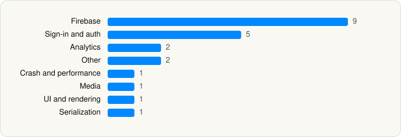

<picture><source media="(prefers-color-scheme: dark)" srcset="../../../../assets/logo/logo-dark.svg"></picture> [Tech Stack](../../../../README.md) / [Spotify](../../../../companies/spotify.md) / Spotify

# Spotify: Music and Podcasts

<picture><source media="(prefers-color-scheme: dark)" srcset="../../../../assets/badges/ios-dark.svg"></picture> <picture><source media="(prefers-color-scheme: dark)" srcset="../../../../assets/badges/inactive-dark.svg"></picture> <picture><source media="(prefers-color-scheme: dark)" srcset="../../../../assets/badges/floor-dark.svg"></picture> <picture><source media="(prefers-color-scheme: dark)" srcset="../../../../assets/badges/encrypted-dark.svg"></picture>

[App Store](https://apps.apple.com/app/id324684580) · [latest.json](latest.json)

| | |
|---|---|
| Company | [Spotify](../../../../companies/spotify.md) |
| Store id | `324684580` |
| Bundle / package id | `com.spotify.client` |
| Latest version | 9.1.92 (analysed 2026-10-23) |
| Versions tracked | 2 |
| SDKs in latest version | 22 |
| Languages | C/C++, Objective-C, Swift |
| UI | Lottie (animations), SwiftUI, UIKit |
| Build | Swift Package Manager (SwiftPM) |
| Minimum OS | iOS 16.1 (built with Xcode 27.0, SDK iphoneos27.0) |
| Devices / ABIs | iPhone, iPad |
| Localisations | 74 |
| Capabilities | 18 |
| Declares tracking | Yes |
| Tracked | No. Kept for history. |

## SDKs by category

<picture><source media="(prefers-color-scheme: dark)" srcset="../../../../assets/charts/apps/ios/spotify/spotify-dark.svg"></picture>

- **Firebase** (9): FBLPromises 2.4.0, FirebaseCore 10.22.0, FirebaseCoreInternal 10.22.0, FirebaseInstallations 10.22.0, GoogleDataTransport 9.4.0, GoogleUtilities 7.13.0, leveldb, nanopb 2.30910.0, Promises 2.4.0
- **Sign-in and auth** (5): AppAuth 1.7.3, FBSDKLoginKit, GoogleSignIn 7.1.0, GTMAppAuth 4.1.1, GTMSessionFetcher 3.3.2
- **Analytics** (2): Branch, Facebook SDK
- **Other** (2): BMWAppKitIdentities, MetaSmartGlassesKit 1.0
- **Crash and performance** (1): FirebaseCrashlytics 10.22.0
- **Media** (1): GoogleCast
- **UI and rendering** (1): RiveRuntime 6.27.0
- **Serialization** (1): Protobuf

Frameworks (41)

AdServices (Apple Search Ads attribution), AdSupport (IDFA), App Intents, App Tracking Transparency (ATT), Authentication Services (Sign in with Apple / passkeys), AVFoundation (audio/video), AVKit, Background Tasks, CallKit (VoIP), Combine (reactive), Core Bluetooth, Core Data, Core Image, Core Location, Core Motion, CryptoKit, DeviceCheck / App Attest, EventKit (Calendar / Reminders), Group Activities (SharePlay), Local Authentication (Face ID / Touch ID), MapKit, Media Player, MessageUI (mail / SMS compose), MetalKit, MetricKit (diagnostics), Natural Language, Network.framework, PDFKit, Photos, PhotosUI, SafariServices, SceneKit, SiriKit (Intents), SpriteKit, StoreKit (in-app purchase), SwiftUI, UIKit, User Notifications, Vision, Watch Connectivity, WidgetKit (widgets)

Capabilities (18)

App Groups, Associated Domains (Universal Links), Background App Refresh, Background Audio, Background Processing, Background Push, Bluetooth (central), Bluetooth (peripheral), CarPlay, Communication Notifications, External Accessory, Game Center, HealthKit, iCloud Key-Value Storage, Keychain Sharing, Push Notifications (APNs), Sign in with Apple, SiriKit

## Version history

| Version | Analysed | Store update | SDKs | Change | SDK list is a floor | Binary encrypted | File |
|---|---|---|---|---|---|---|---|
| 9.1.92 | 2026-10-23 | 2026-10-19 | 22 | +1 / −2 | Yes | Yes | [9.1.92.json](9.1.92.json) |
| 9.1.48 | 2026-06-23 |  | 23 |  | Yes | Yes | [9.1.48.json](9.1.48.json) |

### SDK changes between versions

- 9.1.48 → 9.1.92: added RiveRuntime; removed Lottie, SPTPersistentCache

---

Generated by `scripts/build_readme.py` from the JSON files. Do not edit by hand.
