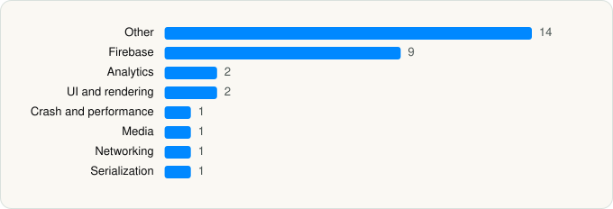

<picture><source media="(prefers-color-scheme: dark)" srcset="../../../../assets/logo/logo-dark.svg"></picture> [Tech Stack](../../../../README.md) / [STC](../../../../companies/stc.md) / mystc SA

# mystc SA

<picture><source media="(prefers-color-scheme: dark)" srcset="../../../../assets/badges/ios-dark.svg"></picture> <picture><source media="(prefers-color-scheme: dark)" srcset="../../../../assets/badges/inactive-dark.svg"></picture> <picture><source media="(prefers-color-scheme: dark)" srcset="../../../../assets/badges/floor-dark.svg"></picture> <picture><source media="(prefers-color-scheme: dark)" srcset="../../../../assets/badges/encrypted-dark.svg"></picture>

[App Store](https://apps.apple.com/app/id6786701577) · [latest.json](latest.json)

| | |
|---|---|
| Company | [STC](../../../../companies/stc.md) |
| Store id | `6786701577` |
| Bundle / package id | `sa.com.stc.mystc5-prod` |
| Latest version | 5.0.19 (analysed 2026-11-20) |
| Versions tracked | 1 |
| SDKs in latest version | 31 |
| Languages | C/C++, Objective-C, Swift |
| UI | Lottie (animations), SwiftUI, UIKit |
| Build | Swift Package Manager (SwiftPM) |
| Minimum OS | iOS 16.6 (built with Xcode 27.1, SDK iphoneos27.1) |
| Devices / ABIs | iPhone |
| Localisations | 2 |
| Capabilities | 5 |
| Declares tracking | Yes |
| Tracked | No. Kept for history. |

## SDKs by category

<picture><source media="(prefers-color-scheme: dark)" srcset="../../../../assets/charts/apps/ios/stc/mystc-sa-dark.svg"></picture>

- **Other** (14): ContentsquareCore 0.1.4, ContentsquareModule 4.51.0, ContentsquareModuleWrapper, ContentsquareSDK, CSCrashReporter 1.0, IQKeyboardCore, IQKeyboardManagerSwift, IQKeyboardNotification, IQKeyboardReturnManager, IQKeyboardToolbar, IQKeyboardToolbarManager, IQTextInputViewNotification, IQTextView, STCUIComponents
- **Firebase** (9): FBLPromises, Firebase, FirebaseCore, FirebaseCoreInternal, FirebaseInstallations, GoogleDataTransport, GoogleUtilities, nanopb, Promises
- **Analytics** (2): Branch, Heap
- **UI and rendering** (2): Kingfisher, Lottie
- **Crash and performance** (1): FirebaseCrashlytics
- **Media** (1): YouTubeiOSPlayerHelper
- **Networking** (1): Alamofire
- **Serialization** (1): CSSwiftProtobuf

Frameworks (23)

AdServices (Apple Search Ads attribution), App Tracking Transparency (ATT), AVFoundation (audio/video), AVKit, Combine (reactive), Contacts, Core Image, Core Location, CryptoKit, Local Authentication (Face ID / Touch ID), MapKit, MessageUI (mail / SMS compose), MetricKit (diagnostics), Network.framework, PassKit (Wallet / Apple Pay), Photos, SafariServices, Speech (recognition), StoreKit (in-app purchase), Swift Charts, SwiftUI, UIKit, User Notifications

Capabilities (5)

App Groups, Apple Pay, Associated Domains (Universal Links), Background Push, Push Notifications (APNs)

## Version history

| Version | Analysed | Store update | SDKs | Change | SDK list is a floor | Binary encrypted | File |
|---|---|---|---|---|---|---|---|
| 5.0.19 | 2026-11-20 |  | 31 |  | Yes | Yes | [5.0.19.json](5.0.19.json) |

---

Generated by `scripts/build_readme.py` from the JSON files. Do not edit by hand.
