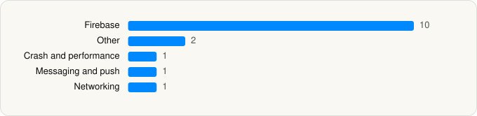

<picture><source media="(prefers-color-scheme: dark)" srcset="../../../../assets/logo/logo-dark.svg"></picture> [Tech Stack](../../../../README.md) / [Stichting Zevenheuvelenloop](../../../../companies/stichting-zevenheuvelenloop.md) / Stichting Zevenheuvelenloop

# Stichting Zevenheuvelenloop

<picture><source media="(prefers-color-scheme: dark)" srcset="../../../../assets/badges/ios-dark.svg"></picture> <picture><source media="(prefers-color-scheme: dark)" srcset="../../../../assets/badges/inactive-dark.svg"></picture> <picture><source media="(prefers-color-scheme: dark)" srcset="../../../../assets/badges/floor-dark.svg"></picture> <picture><source media="(prefers-color-scheme: dark)" srcset="../../../../assets/badges/encrypted-dark.svg"></picture>

[App Store](https://apps.apple.com/app/id6741806791) · [latest.json](latest.json)

| | |
|---|---|
| Company | [Stichting Zevenheuvelenloop](../../../../companies/stichting-zevenheuvelenloop.md) |
| Store id | `6741806791` |
| Bundle / package id | `nl.7h.zevenheuvelenloop` |
| Latest version | 2.0.6 (analysed 2026-11-14) |
| Versions tracked | 1 |
| SDKs in latest version | 15 |
| Languages | C/C++, Objective-C, Swift |
| UI | SwiftUI, UIKit |
| Build | Swift Package Manager (SwiftPM) |
| Minimum OS | iOS 15.0 (built with Xcode 27.1, SDK iphoneos27.1) |
| Devices / ABIs | iPhone |
| Localisations | 0 |
| Capabilities | 2 |
| Declares tracking | No |
| Tracked | No. Kept for history. |

## SDKs by category

<picture><source media="(prefers-color-scheme: dark)" srcset="../../../../assets/charts/apps/ios/stichting-zevenheuvelenloop/stichting-zevenheuvelenloop-dark.svg"></picture>

- **Firebase** (10): FBLPromises 2.4.0, Firebase 12.10.0, FirebaseCore 12.10.0, FirebaseCoreInternal 12.10.0, FirebaseInstallations 12.10.0, FirebaseRemoteConfig 12.10.0, GoogleDataTransport 10.1.0, GoogleUtilities 8.1.0, nanopb 3.30910.0, Promises 2.4.0
- **Other** (2): InAppSettingsKit 3.9.2, MWPhotoBrowser 2.1.2
- **Crash and performance** (1): FirebaseCrashlytics 12.10.0
- **Messaging and push** (1): FirebaseMessaging 12.10.0
- **Networking** (1): ReachabilitySwift 5.2.4

Frameworks (15)

AVFoundation (audio/video), AVKit, Combine (reactive), Core Location, EventKit (Calendar / Reminders), MapKit, Media Player, MessageUI (mail / SMS compose), MetricKit (diagnostics), Photos, SafariServices, StoreKit (in-app purchase), SwiftUI, UIKit, User Notifications

Capabilities (2)

Background Push, Push Notifications (APNs)

## Version history

| Version | Analysed | Store update | SDKs | Change | SDK list is a floor | Binary encrypted | File |
|---|---|---|---|---|---|---|---|
| 2.0.6 | 2026-11-14 |  | 15 |  | Yes | Yes | [2.0.6.json](2.0.6.json) |

---

Generated by `scripts/build_readme.py` from the JSON files. Do not edit by hand.
