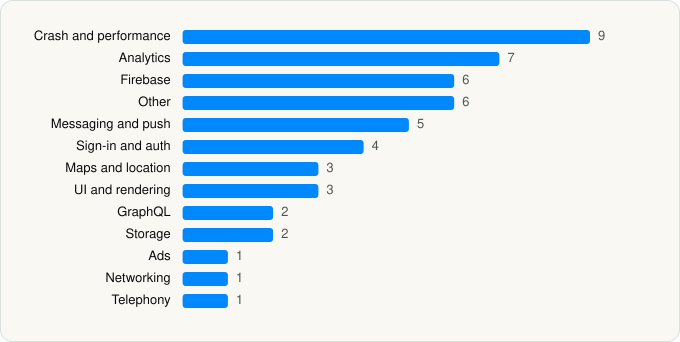

<picture><source media="(prefers-color-scheme: dark)" srcset="../../../../assets/logo/logo-dark.svg"></picture> [Tech Stack](../../../../README.md) / [Strava, Inc.](../../../../companies/strava-inc.md) / Strava

# Strava: Run, Bike, Walk

<picture><source media="(prefers-color-scheme: dark)" srcset="../../../../assets/badges/ios-dark.svg"></picture> <picture><source media="(prefers-color-scheme: dark)" srcset="../../../../assets/badges/inactive-dark.svg"></picture> <picture><source media="(prefers-color-scheme: dark)" srcset="../../../../assets/badges/floor-dark.svg"></picture> <picture><source media="(prefers-color-scheme: dark)" srcset="../../../../assets/badges/encrypted-dark.svg"></picture>

[App Store](https://apps.apple.com/app/id426826309) · [latest.json](latest.json)

| | |
|---|---|
| Company | [Strava, Inc.](../../../../companies/strava-inc.md) |
| Store id | `426826309` |
| Bundle / package id | `com.strava.stravaride` |
| Latest version | 466.0.0 (analysed 2026-06-19) |
| Versions tracked | 1 |
| SDKs in latest version | 50 |
| Languages | C/C++, Objective-C, Swift |
| UI | SwiftUI, UIKit |
| Build | Swift Package Manager (SwiftPM) |
| Minimum OS | iOS 17.0 (built with Xcode 26.3, SDK iphoneos26.2) |
| Devices / ABIs | iPhone |
| Localisations | 24 |
| Capabilities | 12 |
| Declares tracking | Yes |
| Tracked | No. Kept for history. |

## SDKs by category

<picture><source media="(prefers-color-scheme: dark)" srcset="../../../../assets/charts/apps/ios/strava-inc/strava-dark.svg"></picture>

- **Crash and performance** (9): DemangleFilter 1.0, Embrace 1.0, EmbraceConfigInternal 1.0, EmbraceCore, EmbraceIO 1.0, EmbraceOTelInternal 1.0, KSCrash, opentelemetry 1.0, Sentry 8.53.2
- **Analytics** (7): Branch, Facebook SDK, FirebaseAnalytics 12.10.0, GoogleAppMeasurement 12.10.0, GoogleAppMeasurementIdentitySupport 12.10.0, TikTokOpenSDK, TikTokOpenShareSDK
- **Firebase** (6): FBLPromises, FirebaseCore, FirebaseCoreInternal, FirebaseInstallations, GoogleUtilities, nanopb
- **Other** (6): ForceUpdateFeature, OnboardingFeature, RecordingFeature, SDKConfigurations 4.0.1, SettingsFeature, Spandex
- **Messaging and push** (5): MessagingAPI 6.0.2, MessagingSDK 6.3.0, SupportProvidersSDK 9.0.0, SupportSDK 9.3.0, ZendeskCoreSDK 5.0.5
- **Sign-in and auth** (4): AppAuth, GoogleSignIn, GTMAppAuth, GTMSessionFetcher
- **Maps and location** (3): FatmapSDK 24.0.0, Mapbox 24.7.0, MapboxMaps
- **UI and rendering** (3): CommonUISDK 9.3.0, IGListKit 3.4.0, RiveRuntime 6.11.4
- **GraphQL** (2): Apollo, ApolloAPI
- **Storage** (2): GRDB, ZIPFoundation
- **Ads** (1): GoogleAdsOnDeviceConversion 3.3.0
- **Networking** (1): GCDWebServer
- **Telephony** (1): PhoneNumberKit

Frameworks (37)

ActivityKit (Live Activities), AdServices (Apple Search Ads attribution), AdSupport (IDFA), App Tracking Transparency (ATT), Authentication Services (Sign in with Apple / passkeys), AVFoundation (audio/video), AVKit, Combine (reactive), Contacts, Core Bluetooth, Core Data, Core Image, Core Location, Core Motion, CryptoKit, DeviceCheck / App Attest, EventKit (Calendar / Reminders), HealthKit, Local Authentication (Face ID / Touch ID), MapKit, MessageUI (mail / SMS compose), MetalKit, MetricKit (diagnostics), Network.framework, Photos, PhotosUI, SafariServices, SiriKit (Intents), SpriteKit, StoreKit (in-app purchase), Swift Charts, SwiftUI, UIKit, User Notifications, Vision, Watch Connectivity, WidgetKit (widgets)

Capabilities (12)

App Groups, Associated Domains (Universal Links), Background Audio, Background Location, Background Push, Bluetooth (central), External Accessory, HealthKit, Keychain Sharing, Push Notifications (APNs), Sign in with Apple, SiriKit

## Version history

| Version | Analysed | Store update | SDKs | Change | SDK list is a floor | Binary encrypted | File |
|---|---|---|---|---|---|---|---|
| 466.0.0 | 2026-06-19 |  | 50 |  | Yes | Yes | [466.0.0.json](466.0.0.json) |

---

Generated by `scripts/build_readme.py` from the JSON files. Do not edit by hand.
