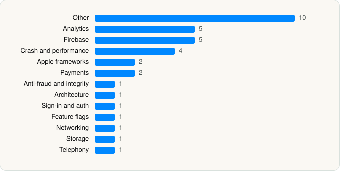

<picture><source media="(prefers-color-scheme: dark)" srcset="../../../../assets/logo/logo-dark.svg"></picture> [Tech Stack](../../../../README.md) / [Suno, Inc.](../../../../companies/suno-inc.md) / Suno

# Suno - AI Songs, Music, Lyrics

<picture><source media="(prefers-color-scheme: dark)" srcset="../../../../assets/badges/ios-dark.svg"></picture> <picture><source media="(prefers-color-scheme: dark)" srcset="../../../../assets/badges/active-dark.svg"></picture> <picture><source media="(prefers-color-scheme: dark)" srcset="../../../../assets/badges/floor-dark.svg"></picture> <picture><source media="(prefers-color-scheme: dark)" srcset="../../../../assets/badges/encrypted-dark.svg"></picture>

[App Store](https://apps.apple.com/app/id6480136315) · [latest.json](latest.json)

| | |
|---|---|
| Company | [Suno, Inc.](../../../../companies/suno-inc.md) |
| Store id | `6480136315` |
| Bundle / package id | `ai.suno.ios` |
| Latest version | 1.93.0 (analysed 2026-10-24) |
| Versions tracked | 1 |
| SDKs in latest version | 35 |
| Languages | C/C++, Metal (shaders), Objective-C, Swift |
| UI | SwiftUI, UIKit |
| Build | Swift Package Manager (SwiftPM) |
| Minimum OS | iOS 18.0 (built with Xcode 26.4.1, SDK iphoneos26.4) |
| Devices / ABIs | iPhone |
| Localisations | 11 |
| Capabilities | 9 |
| Declares tracking | No |
| Tracked | Yes |

## SDKs by category

<picture><source media="(prefers-color-scheme: dark)" srcset="../../../../assets/charts/apps/ios/suno-inc/suno-dark.svg"></picture>

- **Other** (10): BackendEnvironmentClient, ComponentLibrary, FeatureUnifiedFeed, FeatureVoices, Glur, Harmonic, MemoriesEngine, PreludeCore 1.0, RealFlags, Vibranium
- **Analytics** (5): BrazeKit, FirebaseAnalytics, Segment, TikTokOpenSDK, TikTokOpenShareSDK
- **Firebase** (5): FBLPromises, Firebase, FirebaseCore, FirebaseCoreInternal, FirebaseInstallations
- **Crash and performance** (4): DatadogCore, DatadogCrashReporting, DatadogRUM, KSCrash
- **Apple frameworks** (2): InternalCollectionsUtilities, OrderedCollections
- **Payments** (2): RevenueCat, Stripe
- **Anti-fraud and integrity** (1): HCaptcha
- **Architecture** (1): ComposableArchitecture
- **Sign-in and auth** (1): Auth0
- **Feature flags** (1): Statsig
- **Networking** (1): APIClient
- **Storage** (1): GRDB
- **Telephony** (1): PhoneNumberKit

Frameworks (36)

ActivityKit (Live Activities), AdServices (Apple Search Ads attribution), AdSupport (IDFA), App Intents, App Tracking Transparency (ATT), Authentication Services (Sign in with Apple / passkeys), AVFoundation (audio/video), AVKit, Combine (reactive), Contacts, Core Image, Core Location, Core ML, Core Motion, CryptoKit, DeviceCheck / App Attest, Local Authentication (Face ID / Touch ID), MapKit, Media Player, MessageUI (mail / SMS compose), MetalKit, Network.framework, PassKit (Wallet / Apple Pay), PencilKit, Photos, PhotosUI, SafariServices, SiriKit (Intents), Speech (recognition), StoreKit (in-app purchase), Swift Charts, SwiftUI, UIKit, User Notifications, Vision, WidgetKit (widgets)

Capabilities (9)

App Attest, App Groups, Associated Domains (Universal Links), Background Audio, Background Push, CarPlay, Keychain Sharing, Push Notifications (APNs), Sign in with Apple

## Version history

| Version | Analysed | Store update | SDKs | Change | SDK list is a floor | Binary encrypted | File |
|---|---|---|---|---|---|---|---|
| 1.93.0 | 2026-10-24 | 2026-10-14 | 35 |  | Yes | Yes | [1.93.0.json](1.93.0.json) |

---

Generated by `scripts/build_readme.py` from the JSON files. Do not edit by hand.
