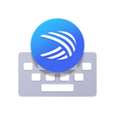
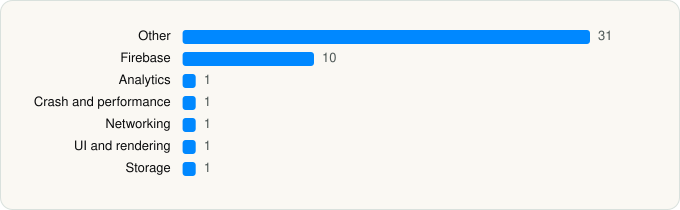

<picture><source media="(prefers-color-scheme: dark)" srcset="../../../../assets/logo/logo-dark.svg"></picture> [Tech Stack](../../../../README.md) / [SwiftKey](../../../../companies/swiftkey.md) / Microsoft SwiftKey AI Keyboard

# Microsoft SwiftKey AI Keyboard

<picture><source media="(prefers-color-scheme: dark)" srcset="../../../../assets/badges/ios-dark.svg"></picture> <picture><source media="(prefers-color-scheme: dark)" srcset="../../../../assets/badges/inactive-dark.svg"></picture> <picture><source media="(prefers-color-scheme: dark)" srcset="../../../../assets/badges/floor-dark.svg"></picture> <picture><source media="(prefers-color-scheme: dark)" srcset="../../../../assets/badges/encrypted-dark.svg"></picture>

[App Store](https://apps.apple.com/app/id911813648) · [latest.json](latest.json)

| | |
|---|---|
| Company | [SwiftKey](../../../../companies/swiftkey.md) |
| Store id | `911813648` |
| Bundle / package id | `com.swiftkey.SwiftKeyApp` |
| Latest version | 4.3.2 (analysed 2026-06-19) |
| Versions tracked | 1 |
| SDKs in latest version | 46 |
| Languages | C/C++, Metal (shaders), Objective-C, Swift |
| UI | Lottie (animations), SwiftUI, UIKit |
| Build | Swift Package Manager (SwiftPM) |
| Minimum OS | iOS 14.0 (built with Xcode 26.0.1, SDK iphoneos26.0) |
| Devices / ABIs | iPhone, iPad |
| Localisations | 9 |
| Capabilities | 7 |
| Declares tracking | No |
| Tracked | No. Kept for history. |

## SDKs by category

<picture><source media="(prefers-color-scheme: dark)" srcset="../../../../assets/charts/apps/ios/swiftkey/microsoft-swiftkey-ai-keyboard-dark.svg"></picture>

- **Other** (31): CameraCommon 1.20.5, CameraDevice 1.20.5, CameraIO 1.20.5, CameraTelemetry 1.20.5, Clarity 1.0, DefaultBoards 1.20.5, DefaultFilter 1.20.5, EffectBackdrop 1.20.5, EffectBackground 1.20.5, EffectBitmapOverlay 1.20.5, EffectBoard 1.20.5, EffectCommon 1.20.5, EffectFilter 1.20.5, EffectLens 1.20.5, EffectPen 1.20.5, EffectPhoto 1.20.5, EffectSticker 1.20.5, EffectText 1.20.5, InterfaceCommon 1.20.5, InterfaceEdit 1.20.5, InterfaceRecord 1.20.5, Keys 1.0.1, layouts, MicrosoftCognitiveServicesSpeech 1.30.0, OCDefaultImplementation 1.20.5, OneCamera 1.20.5, OneCameraGradientFilter 1.20.5, OneCameraMediaImporter 1.20.5, OneCameraNGE 1.20.5, OneCameraTeleprompter 1.20.5, SCSDKCameraKit 1.25.0
- **Firebase** (10): FBLPromises 2.4.0, Firebase 11.13.0, FirebaseCore 11.13.0, FirebaseCoreInternal 11.13.0, FirebaseInstallations 11.13.0, FirebaseRemoteConfig 11.13.0, GoogleDataTransport 10.1.0, GoogleUtilities 8.1.0, nanopb 3.30910.0, Promises 2.4.0
- **Analytics** (1): Facebook SDK
- **Crash and performance** (1): FirebaseCrashlytics 11.13.0
- **Networking** (1): OneCameraNetworking 1.20.5
- **UI and rendering** (1): Lottie 4.5.2
- **Storage** (1): CameraTransform 1.20.5

Frameworks (26)

AdSupport (IDFA), ARKit, Authentication Services (Sign in with Apple / passkeys), AVFoundation (audio/video), Background Tasks, CallKit (VoIP), Combine (reactive), Core Image, Core Location, Core ML, Core Motion, CryptoKit, Media Player, MessageUI (mail / SMS compose), MetalKit, MetricKit (diagnostics), Network.framework, Photos, PhotosUI, SafariServices, Speech (recognition), StoreKit (in-app purchase), SwiftUI, UIKit, User Notifications, Vision

Capabilities (7)

App Groups, Background App Refresh, Background Audio, Background Push, Keychain Sharing, Push Notifications (APNs), Sign in with Apple

## Version history

| Version | Analysed | Store update | SDKs | Change | SDK list is a floor | Binary encrypted | File |
|---|---|---|---|---|---|---|---|
| 4.3.2 | 2026-06-19 |  | 46 |  | Yes | Yes | [4.3.2.json](4.3.2.json) |

## Model-written summary

> SwiftUI iOS keyboard extension bundling Firebase, Microsoft Cognitive Services Speech, Lottie, Metal shaders and MS app integrations

Written by a language model from the detected signals (`inferred[]`). It is commentary, not measurement.

---

Generated by `scripts/build_readme.py` from the JSON files. Do not edit by hand.
