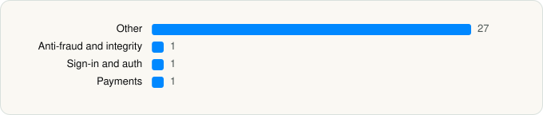

<picture><source media="(prefers-color-scheme: dark)" srcset="../../../../assets/logo/logo-dark.svg"></picture> [Tech Stack](../../../../README.md) / [Temu](../../../../companies/temu.md) / Temu

# Temu: Shop Like a Billionaire

<picture><source media="(prefers-color-scheme: dark)" srcset="../../../../assets/badges/ios-dark.svg"></picture> <picture><source media="(prefers-color-scheme: dark)" srcset="../../../../assets/badges/active-dark.svg"></picture> <picture><source media="(prefers-color-scheme: dark)" srcset="../../../../assets/badges/floor-dark.svg"></picture> <picture><source media="(prefers-color-scheme: dark)" srcset="../../../../assets/badges/encrypted-dark.svg"></picture>

[App Store](https://apps.apple.com/app/id1641486558) · [latest.json](latest.json)

| | |
|---|---|
| Company | [Temu](../../../../companies/temu.md) |
| Store id | `1641486558` |
| Bundle / package id | `com.einnovation.temu` |
| Latest version | 4.92.0 (analysed 2026-10-24) |
| Versions tracked | 1 |
| SDKs in latest version | 30 |
| Languages | C/C++, Metal (shaders), Objective-C, Swift |
| UI | SwiftUI, UIKit |
| Build | Unknown / Xcode native |
| Minimum OS | iOS 15.0 (built with Xcode 27.1, SDK iphoneos27.1) |
| Devices / ABIs | iPhone, iPad |
| Localisations | 52 |
| Capabilities | 8 |
| Declares tracking | No |
| Tracked | Yes |

## SDKs by category

<picture><source media="(prefers-color-scheme: dark)" srcset="../../../../assets/charts/apps/ios/temu/temu-dark.svg"></picture>

- **Other** (27): BGAddressScene 4.91.4, BGBizUIKit 4.92.10, BGCategoryScene 4.91.5, BGGoodsDetailScene 4.92.14, BGGoodsSku 4.92.6, BGHomeScene 4.92.6, BGMediaDisplay 4.92.1, BGOrderConfirmScene 4.92.9, BGOrderService 4.92.4, BGPay 4.92.1, BGPayScene 4.91.4, BGPersonalScene 4.92.4, BGPlayEngine 4.92.1, BGRecommendServiceKit 4.92.12, BGRegionService 4.92.5, BGSearch 4.91.3, BGShare 1.0.144, BGShopScene 4.91.6, BGTransactionLink 4.92.2, MEXPlayerMetal 4.91.9, MEXVideoUIKit 4.90.1, PayPalDataCollector 5.26.0, TMExtensionCommon 0.1.66, TMMessages 4.92.1, TMNavigation 0.0.174, TMWebContainer 0.0.753, WHWebFoundation 0.0.151
- **Anti-fraud and integrity** (1): Forter 2.3.1
- **Sign-in and auth** (1): BGLogin 4.92.7
- **Payments** (1): Braintree 5.26.0

Frameworks (27)

ActivityKit (Live Activities), AdServices (Apple Search Ads attribution), App Intents, Authentication Services (Sign in with Apple / passkeys), AVFoundation (audio/video), AVKit, CallKit (VoIP), Core Image, Core Location, Core Motion, DeviceCheck / App Attest, Local Authentication (Face ID / Touch ID), Media Player, MessageUI (mail / SMS compose), MetalKit, MetricKit (diagnostics), Network.framework, PassKit (Wallet / Apple Pay), Photos, PhotosUI, SafariServices, SiriKit (Intents), StoreKit (in-app purchase), SwiftUI, UIKit, User Notifications, WidgetKit (widgets)

Capabilities (8)

App Groups, Apple Pay, Associated Domains (Universal Links), Background Push, Keychain Sharing, Push Notifications (APNs), Sign in with Apple, Time-Sensitive Notifications

## Version history

| Version | Analysed | Store update | SDKs | Change | SDK list is a floor | Binary encrypted | File |
|---|---|---|---|---|---|---|---|
| 4.92.0 | 2026-10-24 | 2026-10-22 | 30 |  | Yes | Yes | [4.92.0.json](4.92.0.json) |

---

Generated by `scripts/build_readme.py` from the JSON files. Do not edit by hand.
