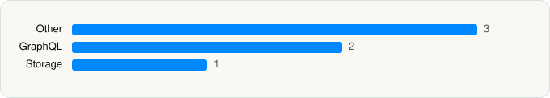

<picture><source media="(prefers-color-scheme: dark)" srcset="../../../../assets/logo/logo-dark.svg"></picture> [Tech Stack](../../../../README.md) / [The College Board](../../../../companies/the-college-board.md) / BigFuture School

# BigFuture School

<picture><source media="(prefers-color-scheme: dark)" srcset="../../../../assets/badges/ios-dark.svg"></picture> <picture><source media="(prefers-color-scheme: dark)" srcset="../../../../assets/badges/inactive-dark.svg"></picture> <picture><source media="(prefers-color-scheme: dark)" srcset="../../../../assets/badges/floor-dark.svg"></picture> <picture><source media="(prefers-color-scheme: dark)" srcset="../../../../assets/badges/encrypted-dark.svg"></picture>

[App Store](https://apps.apple.com/app/id6462904878) · [latest.json](latest.json)

| | |
|---|---|
| Company | [The College Board](../../../../companies/the-college-board.md) |
| Store id | `6462904878` |
| Bundle / package id | `org.collegeboard.bigfutureschool` |
| Latest version | 3.1.0 (analysed 2026-11-06) |
| Versions tracked | 1 |
| SDKs in latest version | 6 |
| Languages | C/C++, Objective-C, Swift |
| UI | SwiftUI, UIKit |
| Build | Swift Package Manager (SwiftPM) |
| Minimum OS | iOS 17.1 (built with Xcode 26.6, SDK iphoneos26.5) |
| Devices / ABIs | iPhone |
| Localisations | 0 |
| Capabilities | 2 |
| Declares tracking | No |
| Tracked | No. Kept for history. |

## SDKs by category

<picture><source media="(prefers-color-scheme: dark)" srcset="../../../../assets/charts/apps/ios/the-college-board/bigfuture-school-dark.svg"></picture>

- **Other** (3): MobileProtect 25.7.0, PivotFakes, PivotShared
- **GraphQL** (2): Apollo, ApolloAPI
- **Storage** (1): SQLite

Frameworks (15)

AVFoundation (audio/video), AVKit, Combine (reactive), Core Image, Core Location, CryptoKit, DeviceCheck / App Attest, EventKit (Calendar / Reminders), Network.framework, SafariServices, StoreKit (in-app purchase), Swift Charts, SwiftUI, UIKit, User Notifications

Capabilities (2)

Associated Domains (Universal Links), Push Notifications (APNs)

## Version history

| Version | Analysed | Store update | SDKs | Change | SDK list is a floor | Binary encrypted | File |
|---|---|---|---|---|---|---|---|
| 3.1.0 | 2026-11-06 |  | 6 |  | Yes | Yes | [3.1.0.json](3.1.0.json) |

---

Generated by `scripts/build_readme.py` from the JSON files. Do not edit by hand.
