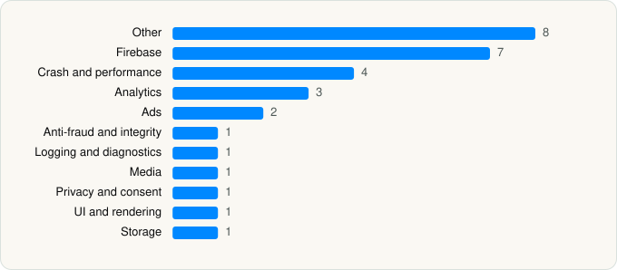

<picture><source media="(prefers-color-scheme: dark)" srcset="../../../../assets/logo/logo-dark.svg"></picture> [Tech Stack](../../../../README.md) / [The New York Times Company](../../../../companies/the-new-york-times-company.md) / NYTimes

# NYTimes: Breaking World News

<picture><source media="(prefers-color-scheme: dark)" srcset="../../../../assets/badges/ios-dark.svg"></picture> <picture><source media="(prefers-color-scheme: dark)" srcset="../../../../assets/badges/inactive-dark.svg"></picture> <picture><source media="(prefers-color-scheme: dark)" srcset="../../../../assets/badges/floor-dark.svg"></picture> <picture><source media="(prefers-color-scheme: dark)" srcset="../../../../assets/badges/encrypted-dark.svg"></picture>

[App Store](https://apps.apple.com/app/id284862083) · [latest.json](latest.json)

| | |
|---|---|
| Company | [The New York Times Company](../../../../companies/the-new-york-times-company.md) |
| Store id | `284862083` |
| Bundle / package id | `com.nytimes.NYTimes` |
| Latest version | 11.98.0 (analysed 2026-11-04) |
| Versions tracked | 1 |
| SDKs in latest version | 30 |
| Languages | C/C++, Objective-C, Swift |
| UI | Lottie (animations), SwiftUI, UIKit |
| Build | Swift Package Manager (SwiftPM) |
| Minimum OS | iOS 18.0 (built with Xcode 27.0, SDK iphoneos27.0) |
| Devices / ABIs | iPhone, iPad |
| Localisations | 0 |
| Capabilities | 10 |
| Declares tracking | Yes |
| Tracked | No. Kept for history. |

## SDKs by category

<picture><source media="(prefers-color-scheme: dark)" srcset="../../../../assets/charts/apps/ios/the-new-york-times-company/nytimes-dark.svg"></picture>

- **Other** (8): AppFeature, Chartbeat 1.0, Iterate, NotificationUIFeature, SwiftPackageList, threeAcross, TPL, WidgetFeature
- **Firebase** (7): FBLPromises, Firebase, FirebaseCore, FirebaseCoreInternal, FirebaseInstallations, FirebaseRemoteConfig, GoogleUtilities
- **Crash and performance** (4): DatadogCore, DatadogCrashReporting, DatadogRUM, KSCrash
- **Analytics** (3): AppsFlyerLib 1.0, ComScore 1.0, Kronos
- **Ads** (2): Google Mobile Ads (AdMob), GoogleMobileAds 13.1.0
- **Anti-fraud and integrity** (1): DataDomeSDK 3.1.0
- **Logging and diagnostics** (1): CocoaLumberjack
- **Media** (1): GoogleInteractiveMediaAds 3.22.1
- **Privacy and consent** (1): UserMessagingPlatform 3.1.0
- **UI and rendering** (1): Lottie 4.5.2
- **Storage** (1): GRDB

Frameworks (27)

ActivityKit (Live Activities), AdSupport (IDFA), App Intents, App Tracking Transparency (ATT), Authentication Services (Sign in with Apple / passkeys), AVFoundation (audio/video), AVKit, Background Tasks, Combine (reactive), Core Image, Core Location, Core Motion, CryptoKit, Media Player, MessageUI (mail / SMS compose), MetricKit (diagnostics), Network.framework, PhotosUI, SafariServices, SceneKit, SiriKit (Intents), SpriteKit, StoreKit (in-app purchase), SwiftUI, UIKit, User Notifications, WidgetKit (widgets)

Capabilities (10)

App Groups, Associated Domains (Universal Links), Background App Refresh, Background Audio, Background Push, CarPlay, Keychain Sharing, Push Notifications (APNs), Sign in with Apple, SiriKit

## Version history

| Version | Analysed | Store update | SDKs | Change | SDK list is a floor | Binary encrypted | File |
|---|---|---|---|---|---|---|---|
| 11.98.0 | 2026-11-04 | 2026-10-27 | 30 |  | Yes | Yes | [11.98.0.json](11.98.0.json) |

---

Generated by `scripts/build_readme.py` from the JSON files. Do not edit by hand.
