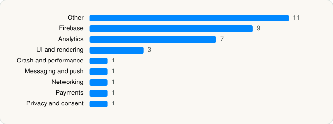

<picture><source media="(prefers-color-scheme: dark)" srcset="../../../../assets/logo/logo-dark.svg"></picture> [Tech Stack](../../../../README.md) / [Ticketmaster](../../../../companies/ticketmaster.md) / Ticketmaster－Buy, Sell Tickets

# Ticketmaster－Buy, Sell Tickets

<picture><source media="(prefers-color-scheme: dark)" srcset="../../../../assets/badges/ios-dark.svg"></picture> <picture><source media="(prefers-color-scheme: dark)" srcset="../../../../assets/badges/inactive-dark.svg"></picture> <picture><source media="(prefers-color-scheme: dark)" srcset="../../../../assets/badges/floor-dark.svg"></picture> <picture><source media="(prefers-color-scheme: dark)" srcset="../../../../assets/badges/encrypted-dark.svg"></picture>

[App Store](https://apps.apple.com/app/id500003565) · [latest.json](latest.json)

| | |
|---|---|
| Company | [Ticketmaster](../../../../companies/ticketmaster.md) |
| Store id | `500003565` |
| Bundle / package id | `com.ticketmaster.ios.TicketmasterApp` |
| Latest version | 304.0 (analysed 2026-11-15) |
| Versions tracked | 1 |
| SDKs in latest version | 35 |
| Languages | C/C++, Objective-C, Swift |
| UI | Lottie (animations), SwiftUI, UIKit |
| Build | Swift Package Manager (SwiftPM) |
| Minimum OS | iOS 18.6 (built with Xcode 26.2, SDK iphoneos26.2) |
| Devices / ABIs | iPhone, iPad |
| Localisations | 29 |
| Capabilities | 6 |
| Declares tracking | Yes |
| Tracked | No. Kept for history. |

## SDKs by category

<picture><source media="(prefers-color-scheme: dark)" srcset="../../../../assets/charts/apps/ios/ticketmaster/ticketmaster-buy-sell-tickets-dark.svg"></picture>

- **Other** (11): Capture 0.23.9, Favorites 1.0, FavoritesUI, ForYou, KlarnaCore 2.11.3, KlarnaCoreWebView 2.11.3, KlarnaMobileSDK 2.11.3, LuciqSDK 19.9.3, SFMCSDK 1.1.4, Theme, Usabilla 6.13.7
- **Firebase** (9): FBLPromises, Firebase, FirebaseCore, FirebaseCoreInternal, FirebaseInstallations, GoogleDataTransport, GoogleUtilities, nanopb, Promises
- **Analytics** (7): AppsFlyerLib 1.0, Facebook SDK, FirebaseAnalytics 10.28.0, GoogleAppMeasurement 10.28.0, GoogleAppMeasurementIdentitySupport 10.28.0, MarketingCloudSDK 8.1.4, mParticle
- **UI and rendering** (3): Kingfisher, Lottie, RiveRuntime 6.15.1
- **Crash and performance** (1): FirebaseCrashlytics
- **Messaging and push** (1): FirebaseMessaging
- **Networking** (1): SmallSwiftNetworking
- **Payments** (1): KlarnaPayments 2.11.3
- **Privacy and consent** (1): OTPublishersHeadlessSDK 202501.1.0

Frameworks (29)

App Tracking Transparency (ATT), Authentication Services (Sign in with Apple / passkeys), AVFoundation (audio/video), AVKit, Combine (reactive), Contacts, Core Data, Core Image, Core Location, Core Motion, CryptoKit, DeviceCheck / App Attest, EventKit (Calendar / Reminders), Local Authentication (Face ID / Touch ID), MapKit, MessageUI (mail / SMS compose), MetalKit, MetricKit (diagnostics), Network.framework, PassKit (Wallet / Apple Pay), Photos, PhotosUI, SafariServices, StoreKit (in-app purchase), Swift Charts, SwiftUI, UIKit, User Notifications, WidgetKit (widgets)

Capabilities (6)

App Groups, Apple Pay, Associated Domains (Universal Links), Background Push, Push Notifications (APNs), Wallet passes

## Version history

| Version | Analysed | Store update | SDKs | Change | SDK list is a floor | Binary encrypted | File |
|---|---|---|---|---|---|---|---|
| 304.0 | 2026-11-15 |  | 35 |  | Yes | Yes | [304.0.json](304.0.json) |

---

Generated by `scripts/build_readme.py` from the JSON files. Do not edit by hand.
