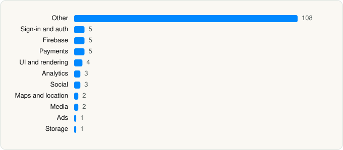

<picture><source media="(prefers-color-scheme: dark)" srcset="../../../../assets/logo/logo-dark.svg"></picture> [Tech Stack](../../../../README.md) / [TikTok Ltd.](../../../../companies/tiktok-ltd.md) / TikTok

# TikTok - Videos, Shop & LIVE

<picture><source media="(prefers-color-scheme: dark)" srcset="../../../../assets/badges/ios-dark.svg"></picture> <picture><source media="(prefers-color-scheme: dark)" srcset="../../../../assets/badges/active-dark.svg"></picture> <picture><source media="(prefers-color-scheme: dark)" srcset="../../../../assets/badges/floor-dark.svg"></picture> <picture><source media="(prefers-color-scheme: dark)" srcset="../../../../assets/badges/encrypted-dark.svg"></picture>

[App Store](https://apps.apple.com/app/id835599320) · [latest.json](latest.json)

| | |
|---|---|
| Company | [TikTok Ltd.](../../../../companies/tiktok-ltd.md) |
| Store id | `835599320` |
| Bundle / package id | `com.zhiliaoapp.musically` |
| Latest version | 45.4.0 (analysed 2026-06-19) |
| Versions tracked | 1 |
| SDKs in latest version | 139 |
| Languages | C/C++, Metal (shaders), Objective-C, Swift |
| UI | Lottie (animations), SwiftUI, UIKit |
| Build | Swift Package Manager (SwiftPM) |
| Minimum OS | iOS 14.0 (built with Xcode 26.0, SDK iphoneos26.0) |
| Devices / ABIs | iPhone, iPad |
| Localisations | 58 |
| Capabilities | 13 |
| Declares tracking | Yes |
| Tracked | Yes |

## SDKs by category

<picture><source media="(prefers-color-scheme: dark)" srcset="../../../../assets/charts/apps/ios/tiktok-ltd/tiktok-dark.svg"></picture>

- **Other** (108): AAAASingularity 0.1.5, AAWEBootChecker 0.3.2, AAWELaunchTracker 0.5.6, AWECommerce 26.5.0, AWECompliance 26.4.0, AWEDetailCollection 26.6.0, AWEDiscover 26.4.0, AWEFeed 26.5.0, AWEIM 26.5.0, AWEIMFoundation 0.1.0, AWEIMSticker 0.1.0, AWELynxKit 26.4.0, AWEMediaDownloader 26.4.0, AWENotice 26.5.0, AWESearch 26.6.0, AWEShare 26.6.0, AWESplashKit 26.4.0, AWEStudio 26.6.0, AWETextInputController 26.4.0, AWEUIColor 0.1.0, AWEUser 26.5.0, AWEUserCenter 26.5.0, AWEVersionManager 26.4.0, AWEVideoWidget 26.4.0, BDALog 0.9.6, BDAlogProtocol 1.3.3, BDFishhookPrivacyInfo 0.2.13, BDLRepairer 1.0, BDMemoryMatrix 0.0.26, BDTuringLocalized-en 2.4.2, BDTuringLocalized-zh-Hant 2.4.2, BDWebKit 1.4.36, BDXServiceCenter 3.0.5, boringssl 1.0, Bytedance1 1.4.13, bytevc1enc 1.10.2, CapCutKitImpl 0.1.0, CKEffectCreator 0.1.0, crypto 1.0, ECommerce, EmoticonsOverseas, Filter, FilterEffect, FrameRecoverPrivacyInfo 1.37.2, GraphConfig 26.4.0, HeimdallrPrivacyInfo 0.8.99, Hermas 2.1.2, HMDGWPAsanPrivacyInfo 0.3.0, i18n, IESBroadcastExtensionKit 1.4.13, IESLiveMTKit 3.0.2, IESLiveMTVideoGift 1.0.7, IESLiveVideoGift 1.3.40, IESPhoto, IESWebViewMonitor 1.7.5, Illustration 0.1.0, IllustrationV2 0.1.0, InternationalPay 1.2.5, Lemon8KitImpl 0.1.0, Lemon8OpenSDK 0.2.0, libvcn 4.0.2, Lodash, MaLiangKit 0.1.0, MemoryGraphCapture 1.4.9, MJRefresh, OECTuringLocalized-en 3.2.5, OECTuringLocalized-zh 3.2.5, OECTuringLocalized-zh-Hant 3.2.5, Online 26.6.0, OrbuculumCore, PIPOBase 0.1.0, PIPOElement 0.1.0, PIPONetworkSecurityImpl 0.1.0, PIPOUIComponent 0.1.0, PNSAgeGate 1.0.1, PNSFamilyPairingImpl 0.1.0, PNSGateKeeperImpl 0.1.0, PNSGeoblockingAdapter 0.1.0, PNSGeoblockingAdapterImpl 0.1.0, PNSScreenImpl 0.1.0, PNSUnifiedPrivacyControlImpl 0.1.0, PNSWebContainerImpl 0.1.0, PrivacyInfo, SessionCheck 0.1.0, ShareExtensionAWEUIColor 0.1.0, SharePlay 26.4.0, splashResourceCore 1.23.5, StingerPrivacyInfo 1.0.19, TTAdvanceEditor 0.1.0, TTFFmpeg 1.0, TTKBadgeImpl 0.1.0, TTKBootPreloader 0.1.0, TTKChannelAuthBizImpl 0.1.0, TTKIMContactImpl 0.1.0, TTKL8BusinessImpl 0.1.0, TTKTouchPoint 0.1.0, TTLHCore, TTLiveHubDebugger, TTPOrbuService 1.0, TTVideoLive 1.10.285, TUCImpl 0.1.0, TUXMetalShader 1.3.1, TwitterShareExtensionUI 1.0.0, umvfi, vhdr, videovrsr, VideoWidgetAWEUIColor 0.1.0, WCDBSQLCipherFrameworkA 0.0.8
- **Sign-in and auth** (5): AppAuth 1.7.6, GoogleSignIn 7.1.0, GTMAppAuth 4.1.1, GTMSessionFetcher 3.3.2, SpotifyLogin 1.1.1
- **Firebase** (5): FirebaseCore 11.14.0, FirebaseCoreInternal 11.14.0, FirebaseInstallations 11.14.0, GoogleUtilities 8.1.0, nanopb 3.30910.0
- **Payments** (5): AddCardToWalletImpl 0.1.0, Braintree 0.0.10, PIPOWalletBizBasic 35.6.0, PIPOWalletImpl 0.1.0, Stripe 23.32.0
- **UI and rendering** (4): AppGenLottie 0.1.0, Lottie 4.4.1, TUXGenLottie 1.3.1, TUXLottie 1.3.1
- **Analytics** (3): AppsFlyerLib 6.17.9, Facebook SDK, SCSDKCoreKit 1.6
- **Social** (3): LineSDK 5.10.0, SCSDKCreativeKit 1.6, TwitterKit
- **Maps and location** (2): GMSCore 6.11.0, GoogleMaps 6.2.1
- **Media** (2): dashdec 1.0, GoogleCast
- **Ads** (1): Google Mobile Ads (AdMob)
- **Storage** (1): SAMKeychain

Frameworks (46)

ActivityKit (Live Activities), AdSupport (IDFA), App Intents, App Tracking Transparency (ATT), ARKit, Authentication Services (Sign in with Apple / passkeys), AVFoundation (audio/video), AVKit, Background Tasks, CallKit (VoIP), CloudKit, Combine (reactive), Contacts, Core Bluetooth, Core Data, Core Image, Core Location, Core ML, Core Motion, CryptoKit, DeviceCheck / App Attest, EventKit (Calendar / Reminders), Group Activities (SharePlay), Local Authentication (Face ID / Touch ID), MapKit, Media Player, MessageUI (mail / SMS compose), MetalKit, MetricKit (diagnostics), MusicKit, Natural Language, Network.framework, PassKit (Wallet / Apple Pay), Photos, PhotosUI, SafariServices, SceneKit, SiriKit (Intents), Speech (recognition), StoreKit (in-app purchase), SwiftUI, UIKit, User Notifications, Vision, Watch Connectivity, WidgetKit (widgets)

Capabilities (13)

App Groups, Apple Pay, Associated Domains (Universal Links), Background App Refresh, Background Audio, Background Push, Communication Notifications, Keychain Sharing, Push Notifications (APNs), Sign in with Apple, SiriKit, Time-Sensitive Notifications, Wallet passes

## Version history

| Version | Analysed | Store update | SDKs | Change | SDK list is a floor | Binary encrypted | File |
|---|---|---|---|---|---|---|---|
| 45.4.0 | 2026-06-19 |  | 139 |  | Yes | Yes | [45.4.0.json](45.4.0.json) |

## Model-written summary

> TikTok iOS app with SwiftUI/UIKit hybrid, 452 Metal shaders, 139 third-party SDKs, App Intents, ActivityKit, Firebase, and Apple Pay/Wallet

Written by a language model from the detected signals (`inferred[]`). It is commentary, not measurement.

---

Generated by `scripts/build_readme.py` from the JSON files. Do not edit by hand.
