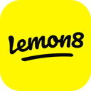
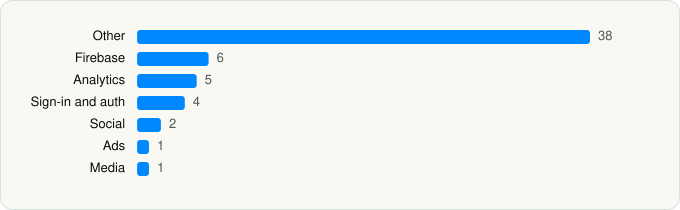

<picture><source media="(prefers-color-scheme: dark)" srcset="../../../../assets/logo/logo-dark.svg"></picture> [Tech Stack](../../../../README.md) / [TIKTOK PTE. LTD.](../../../../companies/tiktok-pte-ltd.md) / Lemon8

# Lemon8 - Lifestyle Community

<picture><source media="(prefers-color-scheme: dark)" srcset="../../../../assets/badges/ios-dark.svg"></picture> <picture><source media="(prefers-color-scheme: dark)" srcset="../../../../assets/badges/active-dark.svg"></picture> <picture><source media="(prefers-color-scheme: dark)" srcset="../../../../assets/badges/floor-dark.svg"></picture> <picture><source media="(prefers-color-scheme: dark)" srcset="../../../../assets/badges/encrypted-dark.svg"></picture>

[App Store](https://apps.apple.com/app/id1498607143) · [latest.json](latest.json)

| | |
|---|---|
| Company | [TIKTOK PTE. LTD.](../../../../companies/tiktok-pte-ltd.md) |
| Store id | `1498607143` |
| Bundle / package id | `com.bd.nproject` |
| Latest version | 15.0.0 (analysed 2026-10-24) |
| Versions tracked | 1 |
| SDKs in latest version | 57 |
| Languages | C/C++, Metal (shaders), Objective-C, Swift |
| UI | SwiftUI, UIKit |
| Build | Swift Package Manager (SwiftPM) |
| Minimum OS | iOS 14.0 (built with Xcode 26.0, SDK iphoneos26.0) |
| Devices / ABIs | iPhone, iPad |
| Localisations | 6 |
| Capabilities | 8 |
| Declares tracking | Yes |
| Tracked | Yes |

## SDKs by category

<picture><source media="(prefers-color-scheme: dark)" srcset="../../../../assets/charts/apps/ios/tiktok-pte-ltd/lemon8-dark.svg"></picture>

- **Other** (38): BDALog 0.9.6, BDAlogProtocol 1.3.3, BDFishhookPrivacyInfo 0.2.13, BDMemoryMatrix 0.0.26, BDTuringLocalized-en 2.3.9, BDWebKit 1.4.18, boringssl 1.0, Bytedance1 1.4.13, bytevc1enc 1.9.7, crypto 1.0, GMTIAB 0.4.2, GMTSKOverlayImpl 0.0.1, HeimdallrPrivacyInfo 0.8.99, Hermas 2.1.2, HMDGWPAsanPrivacyInfo 0.3.0, IESLiveVideoGift 1.4.27, IESPhoto, IESWebViewMonitor 1.7.5, L8IM 0.1.0, L8ShareModule 0.1.0, libvcn 4.0.2, LUXIcons 7.6.5, MemoryGraphCapture 1.4.9, MJRefresh, NewsMaster-Settings-Watch, NImagePicker 0.1.0, NUGCEditor 0.1.0, OrbuculumCore, splashResourceCore 2.2.0, StingerPrivacyInfo 1.0.19, TikTokOpenAuthSDKPrivacyInfo 2.5.1, TTAppStoreStarManager 0.1.0, TTFFmpeg 1.0, TTPOrbuService 1.0, TwitterShareExtensionUI 1.0.0, umvfi, vhdr, videovrsr
- **Firebase** (6): FBLPromises 2.4.0, FirebaseCore 11.14.0, FirebaseCoreInternal 11.14.0, FirebaseInstallations 11.14.0, GoogleUtilities 8.1.0, nanopb 3.30910.0
- **Analytics** (5): AppsFlyerLib 6.17.7, Facebook SDK, SCSDKCoreKit 1.6, TikTokOpenSDK 2.5.1, TikTokOpenShareSDK 2.5.1
- **Sign-in and auth** (4): AppAuth 1.7.6, GoogleSignIn 7.1.0, GTMAppAuth 4.1.1, GTMSessionFetcher 3.3.2
- **Social** (2): SCSDKCreativeKit 1.6, TwitterKit
- **Ads** (1): GABMediation
- **Media** (1): dashdec 1.0

Frameworks (34)

AdSupport (IDFA), App Tracking Transparency (ATT), ARKit, Authentication Services (Sign in with Apple / passkeys), AVFoundation (audio/video), AVKit, Combine (reactive), Contacts, Core Data, Core Image, Core Location, Core ML, Core Motion, CryptoKit, DeviceCheck / App Attest, Local Authentication (Face ID / Touch ID), MapKit, Media Player, MessageUI (mail / SMS compose), MetalKit, MetricKit (diagnostics), Natural Language, Network.framework, Photos, PhotosUI, SafariServices, SiriKit (Intents), Speech (recognition), StoreKit (in-app purchase), SwiftUI, UIKit, User Notifications, Vision, WidgetKit (widgets)

Capabilities (8)

App Groups, Associated Domains (Universal Links), Background App Refresh, Communication Notifications, Keychain Sharing, Push Notifications (APNs), Sign in with Apple, Time-Sensitive Notifications

## Version history

| Version | Analysed | Store update | SDKs | Change | SDK list is a floor | Binary encrypted | File |
|---|---|---|---|---|---|---|---|
| 15.0.0 | 2026-10-24 | 2026-10-23 | 57 |  | Yes | Yes | [15.0.0.json](15.0.0.json) |

---

Generated by `scripts/build_readme.py` from the JSON files. Do not edit by hand.
