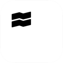
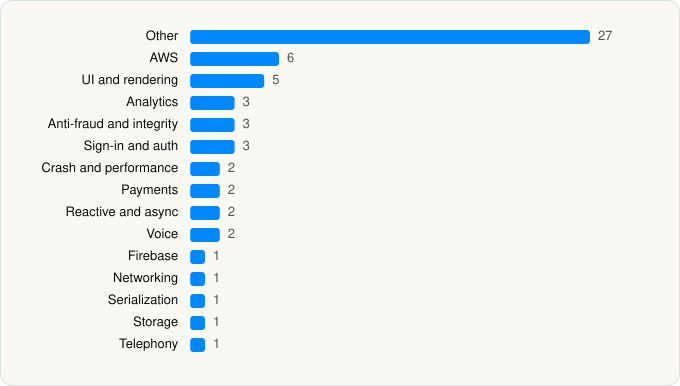

<picture><source media="(prefers-color-scheme: dark)" srcset="../../../../assets/logo/logo-dark.svg"></picture> [Tech Stack](../../../../README.md) / [Trade Republic Bank GmbH](../../../../companies/trade-republic-bank-gmbh.md) / Trade Republic

# Trade Republic: Broker & Bank

<picture><source media="(prefers-color-scheme: dark)" srcset="../../../../assets/badges/ios-dark.svg"></picture> <picture><source media="(prefers-color-scheme: dark)" srcset="../../../../assets/badges/inactive-dark.svg"></picture> <picture><source media="(prefers-color-scheme: dark)" srcset="../../../../assets/badges/floor-dark.svg"></picture> <picture><source media="(prefers-color-scheme: dark)" srcset="../../../../assets/badges/encrypted-dark.svg"></picture>

[App Store](https://apps.apple.com/app/id1410703839) · [latest.json](latest.json)

| | |
|---|---|
| Company | [Trade Republic Bank GmbH](../../../../companies/trade-republic-bank-gmbh.md) |
| Store id | `1410703839` |
| Bundle / package id | `de.traderepublic.app` |
| Latest version | 4.2646.1 (analysed 2026-11-12) |
| Versions tracked | 1 |
| SDKs in latest version | 60 |
| Languages | C/C++, Objective-C, React Native / JavaScript, Swift |
| UI | Lottie (animations), SwiftUI, UIKit |
| Build | Swift Package Manager (SwiftPM) |
| Minimum OS | iOS 17.0 (built with Xcode 26.5, SDK iphoneos26.5) |
| Devices / ABIs | iPhone |
| Localisations | 9 |
| Capabilities | 7 |
| Declares tracking | Yes |
| Tracked | No. Kept for history. |

## SDKs by category

<picture><source media="(prefers-color-scheme: dark)" srcset="../../../../assets/charts/apps/ios/trade-republic-bank-gmbh/trade-republic-dark.svg"></picture>

- **Other** (27): AhoyKit 6.0, Appboy 1.0, AppboyKit 1.0, AppboyUI 1.0, AssetsNG, BrazeDynamic 1.0, ClientRuntime 1.0, CoreMLPredictionsPlugin, CustomerSupport, DesignSystemIcons, DesignSystemNG, FourthlineCore 2.37.3, FourthlineVision 2.37.3, GiftReveal, Instrument, OnboardingNG, PIN, Pompeius, PortfolioAccountComponents, RustLiveKitUniFFI 1.0, SavingsPatron, TokensUI, WebIdIosSdk 11.2.1, WebIdPluginCore 12.1.0, WebIdUiKitComponents 7.0.2, WebIdVideoIdentPlugin 10.4.0, WeScan
- **AWS** (6): Amplify, AWSClientRuntime 1.0, AwsCommonRuntimeKit 1.0, AWSPluginsCore, AWSPredictionsPlugin, InternalAmplifyCredentials
- **UI and rendering** (5): Kingfisher 7.12.0, Lottie, MarkdownUI 2.1.0, RiveRuntime 6.11.4, SDWebImage
- **Analytics** (3): Adjust 1.0, AdjustSdk 1.0, FirebaseAnalytics
- **Anti-fraud and integrity** (3): FaceLiveness, FourthlineKYC 2.37.3, KYCNG
- **Sign-in and auth** (3): AWSCognitoAuthPlugin, Login, SelfieAuthentication
- **Crash and performance** (2): FirebaseCrashlytics, Sentry
- **Payments** (2): Adyen, PaymentLinks
- **Reactive and async** (2): ReactiveCocoa 12.0.0, ReactiveSwift 6.5.0
- **Voice** (2): AhoyWebRTC 1.9, LiveKit
- **Firebase** (1): Firebase 1.0
- **Networking** (1): Starscream
- **Serialization** (1): SwiftProtobuf
- **Storage** (1): ZIPFoundation 1.0
- **Telephony** (1): PhoneNumberKit

Frameworks (37)

AdServices (Apple Search Ads attribution), AdSupport (IDFA), App Tracking Transparency (ATT), Authentication Services (Sign in with Apple / passkeys), AVFoundation (audio/video), AVKit, CallKit (VoIP), Combine (reactive), Contacts, Core Data, Core Image, Core Location, Core ML, Core Motion, CryptoKit, DeviceCheck / App Attest, Local Authentication (Face ID / Touch ID), MapKit, Media Player, MetalKit, MetricKit (diagnostics), Natural Language, Network.framework, PassKit (Wallet / Apple Pay), PDFKit, Photos, PhotosUI, PushKit (VoIP push), SafariServices, Speech (recognition), StoreKit (in-app purchase), Swift Charts, SwiftUI, UIKit, User Notifications, Vision, Watch Connectivity

Capabilities (7)

App Attest, Apple Pay, Associated Domains (Universal Links), Push Notifications (APNs), Sign in with Apple, Time-Sensitive Notifications, VoIP

## Version history

| Version | Analysed | Store update | SDKs | Change | SDK list is a floor | Binary encrypted | File |
|---|---|---|---|---|---|---|---|
| 4.2646.1 | 2026-11-12 |  | 60 |  | Yes | Yes | [4.2646.1.json](4.2646.1.json) |

---

Generated by `scripts/build_readme.py` from the JSON files. Do not edit by hand.
