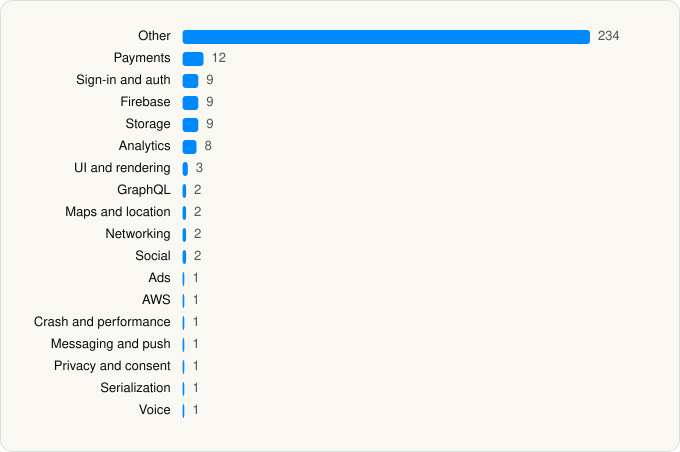

<picture><source media="(prefers-color-scheme: dark)" srcset="../../../../assets/logo/logo-dark.svg"></picture> [Tech Stack](../../../../README.md) / [trendyol.com](../../../../companies/trendyol-com.md) / Trendyol

# Trendyol: Online Shopping

<picture><source media="(prefers-color-scheme: dark)" srcset="../../../../assets/badges/ios-dark.svg"></picture> <picture><source media="(prefers-color-scheme: dark)" srcset="../../../../assets/badges/inactive-dark.svg"></picture> <picture><source media="(prefers-color-scheme: dark)" srcset="../../../../assets/badges/floor-dark.svg"></picture> <picture><source media="(prefers-color-scheme: dark)" srcset="../../../../assets/badges/encrypted-dark.svg"></picture>

[App Store](https://apps.apple.com/app/id524362642) · [latest.json](latest.json)

| | |
|---|---|
| Company | [trendyol.com](../../../../companies/trendyol-com.md) |
| Store id | `524362642` |
| Bundle / package id | `trendyol.com.trendyol` |
| Latest version | 8.24.3 (analysed 2026-11-23) |
| Versions tracked | 1 |
| SDKs in latest version | 299 |
| Languages | C/C++, Metal (shaders), Objective-C, Swift |
| UI | Lottie (animations), SwiftUI, UIKit |
| Build | Swift Package Manager (SwiftPM) |
| Minimum OS | iOS 16.0 (built with Xcode 26.2, SDK iphoneos26.2) |
| Devices / ABIs | iPhone, iPad |
| Localisations | 14 |
| Capabilities | 12 |
| Declares tracking | Yes |
| Tracked | No. Kept for history. |

## SDKs by category

<picture><source media="(prefers-color-scheme: dark)" srcset="../../../../assets/charts/apps/ios/trendyol-com/trendyol-dark.svg"></picture>

- **Other** (234): AccountModule, AccountSettingsModule, AddressModule, AgeRestrictedContentKit, AmazonIVSChatMessaging 1.0, AppGroupSDK 1.0.0, BannerCarouselKit, BasketModule, BottomSheetKit, BrowsingCommonViewsKit, BuyAgainModule, CartLoan, CartLoanUI, CategoriesModule, Clarity 1.0, CollectionModule, CommonKit, CommonViewsKit, CommonWebViewKit, CoreModule 2.1.0, Crypto 1.0, CustomizableProductKit, CustomShareModule, DemeterUtilityKit, DigitalServicesModule, DiscoveryModule, DLAppRedirectionKit, DLBasketModule, DLCouponModule, DLDeeplinkBuilderKit, DLFavoritesModule, DLLocalizableKit, DLProductListingKit, DLProductModule, DLQuickSellModule, DLSearchModule, DLShareLinkBottomPopupKit, DLTabBarModule, DLUIComponentsKit, DLVideoModule, DLWebViewModule, DropdownFilterKit, EngagementModule, ENGNotificationCenterModule, EvaluateProductReviewViewKit, FaceModule 2.1.0, FavoritesCollectionCommonKit, FavoritesModule, GiftPackageKit, GOBannerCarouselKit, GOCommonViewsKit, GOImageGalleryKit, GooglePlaces 10.12.0, GooglePlacesTarget, GOOnboardingKit, GOOTPVerificationKit, GOPasswordComplexityKit, GORollingTabItemsKit, GOShareLinkBottomPopupKit, GOThemeManager, GOTipBoxKit, GOTYCoreApi, GOTYCoreUtils, GOTYLocalizableKit, GOTYNavigationBarKit, GOTYUtilityKit, GOVideoPlayerKit, GOWebChatBot, GOWidgetEngineKit, GRCAvailableTimeSlotsPopupKit, GRCBasketModule, GRCCollectionsModule, GRCCommonKit, GRCCommonViewsKit, GRCDeliveryPricesPopupKit, GRCEmptyViewKit, GRCFilterModule, GRCFloatingButtonKit, GRCHomeModule, GRCInfoWithIconViewKit, GRCLocalizableKit, GRCOrderModule, GRCProductDetailModule, GRCProductSliderKit, GRCPromotionsModule, GRCReviewOrderPopupKit, GRCSearchModule, GRCStoreModule, GRCStoreProductCellKit, GRCTabBarModule, GRCUtilityKit, GRCWidgetsKit, ImageGalleryKit, ImagePopupKit, ImageSliderKit, InAppPopupKit, KlarnaCore 2.10.2, KlarnaMobileSDK 2.10.2, LBBundleOrderViewKit, LBLoyaltyViewsKit, LBWidgetsKit, LocationBasedAddressModule, LocationBasedViewsKit, LUXAccountModule, LUXAccountSettingsModule, LUXAddressModule, LUXAgeRestrictedContentKit, LUXBasketModule, LUXBottomSheetKit, LUXBuyAgainModule, LUXCategoriesModule, LUXCobrandedModule, LUXCommonViewsKit, LUXCommonWebViewKit, LUXDigitalServicesModule, LUXDiscoveryModule, LUXDropdownFilterKit, LUXEvaluateProductReviewViewKit, LUXFavoritesBasketCommonKit, LUXFavoritesCollectionCommonKit, LUXFavoritesModule, LUXGiftPackageKit, LUXImageSliderKit, LUXLocalizableKit, LUXOnboardingKit, LUXOrderModule, LUXOTPVerificationKit, LUXPriceSummaryKit, LUXRecommendedProductsPopupModule, LUXReviewImageUploadKit, LUXSearchCommonViewsKit, LUXSearchModule, LUXSearchSuggestionKit, LUXSellerModule, LUXSizeChartPopupKit, LUXSocialModule, LUXStoreRedirectPopupKit, LUXTabBarModule, LUXTYNavigationBarKit, LUXTYProductDetailModule, LUXTYProductListingKit, LUXTYWidgetsKit, LUXVariantPickerViewKit, LUXVisualSearchModule, LUXWebChatBot, LUXWidgetEngineKit, LUXWidgetModule, MCExtensionSDK 3.0.0, MFEMakeupLite 14.5.1, MLBasketModule, MLCommonKit, MLCommonViewsKit, MLEmptyViewKit, MLFavoritesModule, MLHomeModule, MLLocalizableKit, MLOrdersModule, MLProductDetailModule, MLPromotionsModule, MLRestaurantDetailModule, MLReviewOrderPopupKit, MLSearchModule, MLTabBarModule, MLUtilityKit, MLWidgetsKit, Multipay, NFCModule 2.1.0, OcrModule 2.1.0, OnboardingKit, OpenSSL 3.3.2000, OrderModule, OTPVerificationKit, PasswordComplexityKit, PriceSummaryKit, PromotionViewKit, PushFeatureSDK 1.0.0, RecommendedProductsPopupModule, ReviewImageUploadKit, RollingTabItemsKit, SearchCommonViewsKit, SearchModule, SearchSuggestionKit, SellerModule, SFMCSDK 4.0.2, ShareKit, SizeChartPopupKit, SocialModule, SplashModule, SpotlightSearchKit, StoreRedirectPopupKit, TabbarModule, TextOnlyBottomPopupKit, TGOChannel 1.0, ThemeManager, ThirdPartyDependencies 1.0, TLCommonViewsKit, TLHomeModule, TLInstallmentsModule, TLLimitModule, TLLimitUpgradeModule, TLLoansModule, TLProfileModule, TPAuthModule, TPCommonViewsKit, TPDemeterUtilityKit, TPDesignKit, TPEnVerifyWrapper 1.0, TPSplashModule, TPTrendPay, TPWebViewModule, TWDigitalServicesModule, TWHomeModule, TWPreciousMetalsModule, TWProfileModule, TWTransactionsModule, TYCoreApi, TYCoreUtils, TYGOCommonKit, TYGOEmptyViewKit, TYGOLocalizableKit, TYLocalizableKit, TYNavigationBarKit, TYProductDetailModule, TYProductListingKit, TYUtilityKit, TYWidgetsKit, UtilityModule 2.1.0, VariantPickerViewKit, VideoCallModule 2.1.0, VideoPlayerKit, VisualSearchModule, WebChatBot, WidgetEngineKit, WidgetModule
- **Payments** (12): Braintree 6.23.4, CheckoutCommonViewsKit, CheckoutSuccessModule, DLCheckoutModule, GRCPaymentModule, KlarnaPayments 2.10.2, LUXCheckoutCommonViewsKit, LUXCheckoutSuccessModule, LUXPaymentModule, MLCheckoutModule, PaymentModule, TWWalletModule
- **Sign-in and auth** (9): AppAuth, AuthenticationModule, FacebookLogin, FBSDKLoginKit 1.0, GoogleSignIn, GTMAppAuth, GTMSessionFetcher, LocationBasedLoginModule, LUXAuthenticationModule
- **Firebase** (9): FBLPromises, Firebase 1.0, FirebaseCore, FirebaseCoreInternal, FirebaseInstallations, GoogleDataTransport, GoogleUtilities 1.0, nanopb, Promises
- **Storage** (9): GOInformationBottomPopupKit, GOInformationViewKit, GoogleToolboxForMac 4.2.1, InformationBottomPopupKit, InformationTipViewKit, InformationViewKit, LUXInformationBottomPopupKit, LUXInformationTipViewKit, LUXInformationViewKit
- **Analytics** (8): Adjust 1.0, AdjustSdk, FacebookAEM, FacebookCore, FBAEMKit 1.0, FBSDKCoreKit 1.0, FullStory 1.46.1, MarketingCloudSDK 11.0.2
- **UI and rendering** (3): Lottie 1.0, SDWebImage, SDWebImageSwiftUI
- **GraphQL** (2): Apollo, ApolloAPI
- **Maps and location** (2): GMSCore 26.13.0, GoogleMaps
- **Networking** (2): Alamofire, Starscream
- **Social** (2): FacebookShare, FBSDKShareKit 1.0
- **Ads** (1): Google Mobile Ads (AdMob)
- **AWS** (1): AmazonIVSBroadcast 1.12.0
- **Crash and performance** (1): FirebaseCrashlytics
- **Messaging and push** (1): FirebaseMessaging
- **Privacy and consent** (1): OTPublishersHeadlessSDK 202503.2.0
- **Serialization** (1): SwiftProtobuf
- **Voice** (1): WebRTC 1.0

Frameworks (36)

ActivityKit (Live Activities), AdServices (Apple Search Ads attribution), AdSupport (IDFA), App Intents, App Tracking Transparency (ATT), Authentication Services (Sign in with Apple / passkeys), AVFoundation (audio/video), AVKit, CallKit (VoIP), Combine (reactive), Contacts, Core Data, Core Image, Core Location, Core ML, Core Motion, Core NFC, CryptoKit, DeviceCheck / App Attest, Local Authentication (Face ID / Touch ID), MapKit, MessageUI (mail / SMS compose), MetalKit, MetricKit (diagnostics), Network.framework, PassKit (Wallet / Apple Pay), PDFKit, Photos, SafariServices, SiriKit (Intents), StoreKit (in-app purchase), SwiftUI, UIKit, User Notifications, Vision, WidgetKit (widgets)

Capabilities (12)

App Groups, Apple Pay, Associated Domains (Universal Links), Background App Refresh, Background Push, Communication Notifications, iCloud Key-Value Storage, Keychain Sharing, NFC, Push Notifications (APNs), Sign in with Apple, Time-Sensitive Notifications

## Version history

| Version | Analysed | Store update | SDKs | Change | SDK list is a floor | Binary encrypted | File |
|---|---|---|---|---|---|---|---|
| 8.24.3 | 2026-11-23 |  | 299 |  | Yes | Yes | [8.24.3.json](8.24.3.json) |

---

Generated by `scripts/build_readme.py` from the JSON files. Do not edit by hand.
