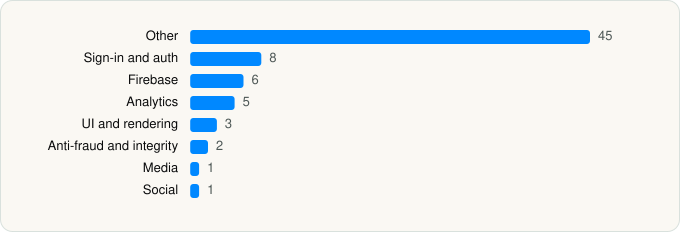

<picture><source media="(prefers-color-scheme: dark)" srcset="../../../../assets/logo/logo-dark.svg"></picture> [Tech Stack](../../../../README.md) / [Trip.com Travel Singapore Pte. Ltd.](../../../../companies/trip-com-travel-singapore-pte-ltd.md) / Trip.com

# Trip.com: Book Flights, Hotels

<picture><source media="(prefers-color-scheme: dark)" srcset="../../../../assets/badges/ios-dark.svg"></picture> <picture><source media="(prefers-color-scheme: dark)" srcset="../../../../assets/badges/active-dark.svg"></picture> <picture><source media="(prefers-color-scheme: dark)" srcset="../../../../assets/badges/floor-dark.svg"></picture> <picture><source media="(prefers-color-scheme: dark)" srcset="../../../../assets/badges/encrypted-dark.svg"></picture>

[App Store](https://apps.apple.com/app/id681752345) · [latest.json](latest.json)

| | |
|---|---|
| Company | [Trip.com Travel Singapore Pte. Ltd.](../../../../companies/trip-com-travel-singapore-pte-ltd.md) |
| Store id | `681752345` |
| Bundle / package id | `com.ctrip.EBooking` |
| Latest version | 8.59.0 (analysed 2026-10-24) |
| Versions tracked | 1 |
| SDKs in latest version | 71 |
| Languages | C/C++, Flutter / Dart, Metal (shaders), Objective-C, React Native / JavaScript, Swift |
| UI | SwiftUI, UIKit |
| Build | Swift Package Manager (SwiftPM) |
| Minimum OS | iOS 15.0 (built with Xcode 26.2, SDK iphoneos26.2) |
| Devices / ABIs | iPhone, iPad |
| Localisations | 51 |
| Capabilities | 13 |
| Declares tracking | Yes |
| Tracked | Yes |

## SDKs by category

<picture><source media="(prefers-color-scheme: dark)" srcset="../../../../assets/charts/apps/ios/trip-com-travel-singapore-pte-ltd/trip-com-dark.svg"></picture>

- **Other** (45): AlipaySDK, DYFHostBridgeFW 0.0.1, Flutter 1.0, FlutterCommunication 1.0, FTRAuth 1.0.2, FTRCommon 1.0.2, highlightjs, IBUAccount 0.1.0, IBUAccountLib 0.1.0, IBUBusiness 0.1.0, IBUCargoSDK, IBUCTPay 0.1.0, IBUEAAKit 0.0.1, IBUEvaluation 0.1.0, IBUFinance 8.40.2, IBUFlight 0.1.0, IBUFlightHome 8.40.2, IBUFoundation 0.0.1, IBUHome 0.1.0, IBUHotel 0.1.0, IBUHotelChat 0.1.0, IBUKaKaoSDK2 8.40.2, IBUMarket 15.0.0, IBUMarketKit 0.1.0, IBUMidas 8.40.2, IBUNativeDynamic 0.1.0, IBUSchedule 0.1.0, IBUSDUI 8.40.2, IBUSharkSDK 5.1.0, IBUTDComponent 8.40.2, IBUTour 0.1.0, IBUTrain 0.1.0, IBUTravelGuide 0.1.0, IBUTripComponentKit 8.40.2, IBUTripGenie 8.40.2, IBUTripKit 0.2.0, IBUTripKitPlugin 8.40.2, IBUTripLink 0.1.0, IBUTripSearch 0.1.0, IBUUICommonKit 8.40.2, MJRefresh, MWPhotoBrowser 2.1.3, PayPalMessages 0.0.1, Razorpay 1.4.6, ServiceContract 1.0
- **Sign-in and auth** (8): AppAuth 1.7.6, Facebook Login, FBSDKLoginKit 1.0, GoogleSignIn 8.0.0, GTMAppAuth 4.1.1, GTMSessionFetcher 3.5.0, IBULoginService 0.1.0, NaverThirdPartyLogin 4.2.3
- **Firebase** (6): FBLPromises 2.4.0, FirebaseCore 11.14.0, FirebaseCoreInternal 11.14.0, FirebaseInstallations 11.14.0, GoogleUtilities 8.1.0, nanopb 3.30910.0
- **Analytics** (5): Adjust 1.0, AdjustSdk 1.0, Facebook SDK, FBAEMKit 1.0, FBSDKCoreKit 1.0
- **UI and rendering** (3): AntMarkdown, hermes 0.12.0, Highlight.js 11.10.0
- **Anti-fraud and integrity** (2): CTNewCaptcha, Forter 3.0.2
- **Media** (1): NvStreamingSdkCore 1.0
- **Social** (1): FBSDKShareKit 1.0

Frameworks (42)

ActivityKit (Live Activities), AdServices (Apple Search Ads attribution), AdSupport (IDFA), App Intents, App Tracking Transparency (ATT), Authentication Services (Sign in with Apple / passkeys), AVFoundation (audio/video), AVKit, CallKit (VoIP), Combine (reactive), Contacts, Core Data, Core Image, Core Location, Core ML, Core Motion, CryptoKit, DeviceCheck / App Attest, EventKit (Calendar / Reminders), Local Authentication (Face ID / Touch ID), MapKit, Media Player, MessageUI (mail / SMS compose), MetalKit, MetricKit (diagnostics), Natural Language, Network.framework, PassKit (Wallet / Apple Pay), PDFKit, Photos, PhotosUI, PushKit (VoIP push), SafariServices, SiriKit (Intents), Speech (recognition), StoreKit (in-app purchase), SwiftUI, UIKit, User Notifications, Vision, Watch Connectivity, WidgetKit (widgets)

Capabilities (13)

App Groups, Apple Pay, Associated Domains (Universal Links), Background Audio, Background Push, Keychain Sharing, Multipath networking, Push Notifications (APNs), Sign in with Apple, SiriKit, Time-Sensitive Notifications, VoIP, Wallet passes

## Version history

| Version | Analysed | Store update | SDKs | Change | SDK list is a floor | Binary encrypted | File |
|---|---|---|---|---|---|---|---|
| 8.59.0 | 2026-10-24 | 2026-10-23 | 71 |  | Yes | Yes | [8.59.0.json](8.59.0.json) |

---

Generated by `scripts/build_readme.py` from the JSON files. Do not edit by hand.
