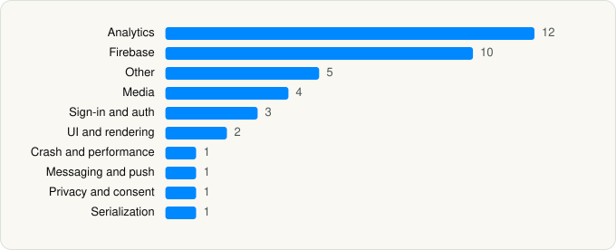

<picture><source media="(prefers-color-scheme: dark)" srcset="../../../../assets/logo/logo-dark.svg"></picture> [Tech Stack](../../../../README.md) / [Tubi, Inc](../../../../companies/tubi-inc.md) / Tubi

# Tubi: Movies & Live TV

<picture><source media="(prefers-color-scheme: dark)" srcset="../../../../assets/badges/ios-dark.svg"></picture> <picture><source media="(prefers-color-scheme: dark)" srcset="../../../../assets/badges/active-dark.svg"></picture> <picture><source media="(prefers-color-scheme: dark)" srcset="../../../../assets/badges/floor-dark.svg"></picture> <picture><source media="(prefers-color-scheme: dark)" srcset="../../../../assets/badges/encrypted-dark.svg"></picture>

[App Store](https://apps.apple.com/app/id886445756) · [latest.json](latest.json)

| | |
|---|---|
| Company | [Tubi, Inc](../../../../companies/tubi-inc.md) |
| Store id | `886445756` |
| Bundle / package id | `com.adrise.tubitv` |
| Latest version | 10.22.1 (analysed 2026-06-23) |
| Versions tracked | 1 |
| SDKs in latest version | 40 |
| Languages | C/C++, Objective-C, Swift |
| UI | Lottie (animations), SwiftUI, UIKit |
| Build | Swift Package Manager (SwiftPM) |
| Minimum OS | iOS 16.0 (built with Xcode 26.2, SDK iphoneos26.2) |
| Devices / ABIs | iPhone, iPad |
| Localisations | 6 |
| Capabilities | 9 |
| Declares tracking | Yes |
| Tracked | Yes |

## SDKs by category

<picture><source media="(prefers-color-scheme: dark)" srcset="../../../../assets/charts/apps/ios/tubi-inc/tubi-dark.svg"></picture>

- **Analytics** (12): Adjust 1.0, AdjustSdk, AEPCore 5.2.0, AEPServices 5.8.0, Branch, BrazeKit, ComScore 1.0, FirebaseAnalytics 11.13.0, GoogleAppMeasurement 11.13.0, GoogleAppMeasurementIdentitySupport 11.13.0, MUXSDKStats 4.11.1, NielsenAppApi 10.2.0
- **Firebase** (10): FBLPromises, Firebase, FirebaseCore, FirebaseCoreInternal, FirebaseInstallations, FirebaseRemoteConfig, GoogleDataTransport, GoogleUtilities, nanopb, Promises
- **Other** (5): confett, Fox 1.4.12, FOXPlayer 4.36.1, YOAdManagement 3.11.1, YouboraLib 6.7.23
- **Media** (4): GoogleCast 4.8.3, GoogleInteractiveMediaAds 3.22.1, MatterTvCastingBridge 1.0, MuxCore 5.11.0
- **Sign-in and auth** (3): AppAuth, GoogleSignIn, GTMSessionFetcher
- **UI and rendering** (2): Kingfisher, Lottie
- **Crash and performance** (1): FirebaseCrashlytics
- **Messaging and push** (1): BrazeUI
- **Privacy and consent** (1): OTPublishersHeadlessSDK 202602.1.0
- **Serialization** (1): SwiftProtobuf

Frameworks (27)

ActivityKit (Live Activities), AdServices (Apple Search Ads attribution), AdSupport (IDFA), App Tracking Transparency (ATT), Authentication Services (Sign in with Apple / passkeys), AVFoundation (audio/video), AVKit, Combine (reactive), Core Bluetooth, Core Data, Core Image, Core Location, Core Motion, CryptoKit, Group Activities (SharePlay), Local Authentication (Face ID / Touch ID), Media Player, MessageUI (mail / SMS compose), MetricKit (diagnostics), Network.framework, SafariServices, Speech (recognition), SpriteKit, StoreKit (in-app purchase), SwiftUI, UIKit, User Notifications

Capabilities (9)

App Groups, Associated Domains (Universal Links), Background App Refresh, Background Audio, Background Push, Keychain Sharing, Multipath networking, Push Notifications (APNs), Sign in with Apple

## Version history

| Version | Analysed | Store update | SDKs | Change | SDK list is a floor | Binary encrypted | File |
|---|---|---|---|---|---|---|---|
| 10.22.1 | 2026-06-23 |  | 40 |  | Yes | Yes | [10.22.1.json](10.22.1.json) |

## Model-written summary

> SwiftUI/UIKit iOS streaming app with Firebase, Braze, Google Cast, 40+ third-party SDKs, encrypted binary, and broad tracking permissions

Written by a language model from the detected signals (`inferred[]`). It is commentary, not measurement.

---

Generated by `scripts/build_readme.py` from the JSON files. Do not edit by hand.
