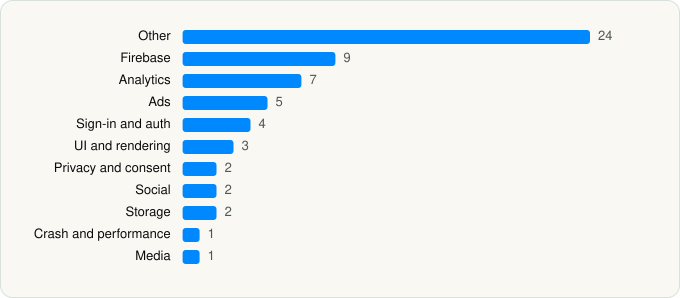

<picture><source media="(prefers-color-scheme: dark)" srcset="../../../../assets/logo/logo-dark.svg"></picture> [Tech Stack](../../../../README.md) / [Tumblr, Inc.](../../../../companies/tumblr-inc.md) / Tumblr

# Tumblr: Social Media & Art

<picture><source media="(prefers-color-scheme: dark)" srcset="../../../../assets/badges/ios-dark.svg"></picture> <picture><source media="(prefers-color-scheme: dark)" srcset="../../../../assets/badges/active-dark.svg"></picture> <picture><source media="(prefers-color-scheme: dark)" srcset="../../../../assets/badges/floor-dark.svg"></picture> <picture><source media="(prefers-color-scheme: dark)" srcset="../../../../assets/badges/encrypted-dark.svg"></picture>

[App Store](https://apps.apple.com/app/id305343404) · [latest.json](latest.json)

| | |
|---|---|
| Company | [Tumblr, Inc.](../../../../companies/tumblr-inc.md) |
| Store id | `305343404` |
| Bundle / package id | `com.tumblr.tumblr` |
| Latest version | 44.8 (analysed 2026-06-19) |
| Versions tracked | 1 |
| SDKs in latest version | 60 |
| Languages | C/C++, Metal (shaders), Objective-C, Swift |
| UI | Lottie (animations), SwiftUI, UIKit |
| Build | Swift Package Manager (SwiftPM) |
| Minimum OS | iOS 17.0 (built with Xcode 26.1.1, SDK iphoneos26.1) |
| Devices / ABIs | iPhone, iPad |
| Localisations | 18 |
| Capabilities | 9 |
| Declares tracking | Yes |
| Tracked | Yes |

## SDKs by category

<picture><source media="(prefers-color-scheme: dark)" srcset="../../../../assets/charts/apps/ios/tumblr-inc/tumblr-dark.svg"></picture>

- **Other** (24): Adsbynimbus 1.6.5, AppReviewPrompt, CommunityHubs, ComposeUI, CoreTumblr, DIOSDK 1.0, EmojiPicker, HorseFriend, Kanvas, LRAtsSDK 2.5.0, MediaPicker, Messaging, NimbusCoreKit 1.0.0, NimbusKit 1.0.0, NimbusRenderKit 1.0.0, NimbusRenderOMKit 1.0.0, NimbusRenderStaticKit 1.0.0, NimbusRenderVideoKit 1.0.0, NimbusRequestKit 1.0.0, OnboardingKit, OnboardingUI, PostAudioView, SASDisplayKit 7.23.4, TMAudioKit
- **Firebase** (9): FBLPromises, Firebase, FirebaseCore, FirebaseCoreInternal, FirebaseInstallations, GoogleDataTransport, GoogleUtilities, nanopb, Promises
- **Analytics** (7): FacebookAEM, FacebookCore, FBAEMKit 1.0, FBSDKCoreKit 1.0, FirebaseAnalytics 11.0.0, GoogleAppMeasurement 11.0.0, GoogleAppMeasurementIdentitySupport 11.0.0
- **Ads** (5): FBAudienceNetwork 1.0, Google Mobile Ads (AdMob), GoogleMobileAds 12.11.0, MolocoSDK 4.6.0, VungleAds 7.7.0
- **Sign-in and auth** (4): AppAuth, GoogleSignIn, GTMAppAuth, GTMSessionFetcher
- **UI and rendering** (3): Lottie, SDWebImage, TOCropViewController
- **Privacy and consent** (2): TMCMPKit, UserMessagingPlatform 3.1.0
- **Social** (2): FacebookShare, FBSDKShareKit 1.0
- **Storage** (2): ActivityKit, PostForms
- **Crash and performance** (1): FirebaseCrashlytics
- **Media** (1): TMVideoPlayer

Frameworks (29)

AdSupport (IDFA), App Tracking Transparency (ATT), Authentication Services (Sign in with Apple / passkeys), AVFoundation (audio/video), AVKit, Combine (reactive), Core Data, Core Image, Core Location, Core Motion, CryptoKit, DeviceCheck / App Attest, EventKit (Calendar / Reminders), Local Authentication (Face ID / Touch ID), Media Player, MessageUI (mail / SMS compose), MetalKit, MetricKit (diagnostics), Network.framework, Photos, PhotosUI, SafariServices, SceneKit, SiriKit (Intents), SpriteKit, StoreKit (in-app purchase), SwiftUI, UIKit, User Notifications

Capabilities (9)

App Groups, Associated Domains (Universal Links), Background App Refresh, Background Audio, Background Push, Communication Notifications, Keychain Sharing, Push Notifications (APNs), Sign in with Apple

## Version history

| Version | Analysed | Store update | SDKs | Change | SDK list is a floor | Binary encrypted | File |
|---|---|---|---|---|---|---|---|
| 44.8 | 2026-06-19 |  | 60 |  | Yes | Yes | [44.8.json](44.8.json) |

---

Generated by `scripts/build_readme.py` from the JSON files. Do not edit by hand.
