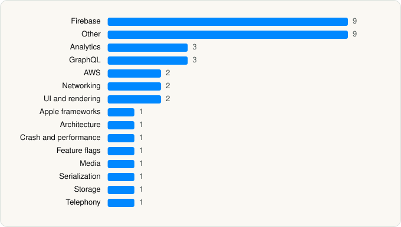

<picture><source media="(prefers-color-scheme: dark)" srcset="../../../../assets/logo/logo-dark.svg"></picture> [Tech Stack](../../../../README.md) / [Twitch Interactive, Inc.](../../../../companies/twitch-interactive-inc.md) / Twitch

# Twitch: Live Streaming

<picture><source media="(prefers-color-scheme: dark)" srcset="../../../../assets/badges/ios-dark.svg"></picture> <picture><source media="(prefers-color-scheme: dark)" srcset="../../../../assets/badges/active-dark.svg"></picture> <picture><source media="(prefers-color-scheme: dark)" srcset="../../../../assets/badges/floor-dark.svg"></picture> <picture><source media="(prefers-color-scheme: dark)" srcset="../../../../assets/badges/encrypted-dark.svg"></picture>

[App Store](https://apps.apple.com/app/id460177396) · [latest.json](latest.json)

| | |
|---|---|
| Company | [Twitch Interactive, Inc.](../../../../companies/twitch-interactive-inc.md) |
| Store id | `460177396` |
| Bundle / package id | `tv.twitch` |
| Latest version | 29.7 (analysed 2026-06-19) |
| Versions tracked | 1 |
| SDKs in latest version | 38 |
| Languages | C/C++, Kotlin Multiplatform, Metal (shaders), Objective-C, Swift |
| UI | Lottie (animations), SwiftUI, UIKit |
| Build | Swift Package Manager (SwiftPM) |
| Minimum OS | iOS 16.4 (built with Xcode 26.4, SDK iphoneos26.4) |
| Devices / ABIs | iPhone, iPad |
| Localisations | 30 |
| Capabilities | 9 |
| Declares tracking | Yes |
| Tracked | Yes |

## SDKs by category

<picture><source media="(prefers-color-scheme: dark)" srcset="../../../../assets/charts/apps/ios/twitch-interactive-inc/twitch-dark.svg"></picture>

- **Firebase** (9): FBLPromises, Firebase, FirebaseCore, FirebaseCoreInternal, FirebaseInstallations, GoogleDataTransport, GoogleUtilities, nanopb, Promises
- **Other** (9): Capacitor 1.0, Clocks 1.0, Cordova 1.0, IssueReporting 1.0, Lodash, MobileShieldKit 1.18.2, Moment.js, PMHTTP 4.5.0, Tomorrowland 1.4.0
- **Analytics** (3): Branch, ComScore 1.0, UserLeapKit 4.8.5
- **GraphQL** (3): Apollo, Apollo GraphQL, ApolloAPI
- **AWS** (2): AmazonIVSBroadcast 1.43.0, AmazonIVSPlayer 1.53.0
- **Networking** (2): Axios, Reachability
- **UI and rendering** (2): Lottie 4.6.0, MathJax
- **Apple frameworks** (1): OrderedCollections 1.0
- **Architecture** (1): ComposableArchitecture
- **Crash and performance** (1): FirebaseCrashlytics
- **Feature flags** (1): EppoExperimentation
- **Media** (1): GoogleCast 4.8.3
- **Serialization** (1): PMJSON 4.0.0
- **Storage** (1): FLAnimatedImage 1.0.17
- **Telephony** (1): PhoneNumberKit

Frameworks (30)

AdServices (Apple Search Ads attribution), AdSupport (IDFA), App Tracking Transparency (ATT), Authentication Services (Sign in with Apple / passkeys), AVFoundation (audio/video), AVKit, CallKit (VoIP), Combine (reactive), Contacts, Core Data, Core Image, Core ML, CryptoKit, Group Activities (SharePlay), MapKit, Media Player, MessageUI (mail / SMS compose), MetalKit, MetricKit (diagnostics), Network.framework, Photos, PhotosUI, SafariServices, SiriKit (Intents), StoreKit (in-app purchase), Swift Charts, SwiftUI, UIKit, User Notifications, WidgetKit (widgets)

Capabilities (9)

App Groups, Associated Domains (Universal Links), Background Audio, Communication Notifications, Keychain Sharing, Push Notifications (APNs), Sign in with Apple, Time-Sensitive Notifications, VoIP

## Version history

| Version | Analysed | Store update | SDKs | Change | SDK list is a floor | Binary encrypted | File |
|---|---|---|---|---|---|---|---|
| 29.7 | 2026-06-19 |  | 38 |  | Yes | Yes | [29.7.json](29.7.json) |

---

Generated by `scripts/build_readme.py` from the JSON files. Do not edit by hand.
