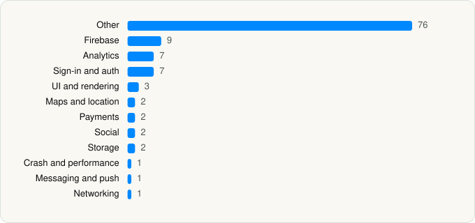

<picture><source media="(prefers-color-scheme: dark)" srcset="../../../../assets/logo/logo-dark.svg"></picture> [Tech Stack](../../../../README.md) / [TYG TURKEY ELEKTRONIK TICARET HIZMETLERI VE YATIRIMLARI ANONIM SIRKETI](../../../../companies/tyg-turkey-elektronik-ticaret-hizmetleri-ve-yatirimlari-anon.md) / Trendyol Go

# Trendyol Go: Food & Groceries

<picture><source media="(prefers-color-scheme: dark)" srcset="../../../../assets/badges/ios-dark.svg"></picture> <picture><source media="(prefers-color-scheme: dark)" srcset="../../../../assets/badges/inactive-dark.svg"></picture> <picture><source media="(prefers-color-scheme: dark)" srcset="../../../../assets/badges/floor-dark.svg"></picture> <picture><source media="(prefers-color-scheme: dark)" srcset="../../../../assets/badges/encrypted-dark.svg"></picture>

[App Store](https://apps.apple.com/app/id6463031298) · [latest.json](latest.json)

| | |
|---|---|
| Company | [TYG TURKEY ELEKTRONIK TICARET HIZMETLERI VE YATIRIMLARI ANONIM SIRKETI](../../../../companies/tyg-turkey-elektronik-ticaret-hizmetleri-ve-yatirimlari-anon.md) |
| Store id | `6463031298` |
| Bundle / package id | `com.trendyol.go` |
| Latest version | 2.10.0 (analysed 2026-11-14) |
| Versions tracked | 1 |
| SDKs in latest version | 113 |
| Languages | C/C++, Metal (shaders), Objective-C, Swift |
| UI | Lottie (animations), SwiftUI, UIKit |
| Build | Swift Package Manager (SwiftPM) |
| Minimum OS | iOS 16.0 (built with Xcode 26.2, SDK iphoneos26.2) |
| Devices / ABIs | iPhone, iPad |
| Localisations | 0 |
| Capabilities | 7 |
| Declares tracking | Yes |
| Tracked | No. Kept for history. |

## SDKs by category

<picture><source media="(prefers-color-scheme: dark)" srcset="../../../../assets/charts/apps/ios/tyg-turkey-elektronik-ticaret-hizmetleri-ve-yatirimlari-anon/trendyol-go-dark.svg"></picture>

- **Other** (76): Crypto 1.0, GOBannerCarouselKit, GOCommonViewsKit, GOImageGalleryKit, GooglePlaces 10.12.0, GooglePlacesTarget, GOOnboardingKit, GOOTPVerificationKit, GOPasswordComplexityKit, GORollingTabItemsKit, GOShareLinkBottomPopupKit, GOSpotlightSearchKit, GOThemeManager, GOTipBoxKit, GOTYCoreApi, GOTYCoreUtils, GOTYLocalizableKit, GOTYNavigationBarKit, GOTYUtilityKit, GOVideoPlayerKit, GOWebChatBot, GOWidgetEngineKit, GRCAvailableTimeSlotsPopupKit, GRCBasketModule, GRCCollectionsModule, GRCCommonKit, GRCCommonViewsKit, GRCDeliveryPricesPopupKit, GRCEmptyViewKit, GRCFilterModule, GRCFloatingButtonKit, GRCHomeModule, GRCInfoWithIconViewKit, GRCLocalizableKit, GRCOrderModule, GRCProductDetailModule, GRCProductSliderKit, GRCPromotionsModule, GRCReviewOrderPopupKit, GRCSearchModule, GRCStoreModule, GRCStoreProductCellKit, GRCTabBarModule, GRCUtilityKit, GRCWidgetsKit, LBBundleOrderViewKit, LBLoyaltyViewsKit, LBWidgetsKit, MLBasketModule, MLCommonKit, MLCommonViewsKit, MLEmptyViewKit, MLFavoritesModule, MLHomeModule, MLLocalizableKit, MLOrdersModule, MLProductDetailModule, MLPromotionsModule, MLRestaurantDetailModule, MLReviewOrderPopupKit, MLSearchModule, MLTabBarModule, MLUtilityKit, MLWidgetsKit, Multipay, SFMCSDK 1.1.4, ThirdPartyDependencies 1.0, TYGOAccountModule, TYGOCommonKit, TYGOEmptyViewKit, TYGOLandingModule, TYGOLocalizableKit, TYGOOrdersModule, TYGOSearchModule, TYGOSplashModule, TYGOTabBarModule
- **Firebase** (9): FBLPromises, Firebase 1.0, FirebaseCore, FirebaseCoreInternal, FirebaseInstallations, GoogleDataTransport, GoogleUtilities 1.0, nanopb, Promises
- **Analytics** (7): Adjust 1.0, AdjustSdk, FacebookAEM, FacebookCore, FBAEMKit 1.0, FBSDKCoreKit 1.0, MarketingCloudSDK 8.1.4
- **Sign-in and auth** (7): AppAuth, FacebookLogin, FBSDKLoginKit 1.0, GoogleSignIn, GTMAppAuth, GTMSessionFetcher, TYGOAuthenticationModule
- **UI and rendering** (3): Lottie 1.0, SDWebImage, SDWebImageSwiftUI
- **Maps and location** (2): GMSCore 26.13.0, GoogleMaps
- **Payments** (2): GRCPaymentModule, MLCheckoutModule
- **Social** (2): FacebookShare, FBSDKShareKit 1.0
- **Storage** (2): GOInformationBottomPopupKit, GOInformationViewKit
- **Crash and performance** (1): FirebaseCrashlytics
- **Messaging and push** (1): FirebaseMessaging
- **Networking** (1): Alamofire

Frameworks (26)

ActivityKit (Live Activities), AdServices (Apple Search Ads attribution), AdSupport (IDFA), App Tracking Transparency (ATT), Authentication Services (Sign in with Apple / passkeys), AVFoundation (audio/video), Combine (reactive), Contacts, Core Data, Core Image, Core Location, CryptoKit, Local Authentication (Face ID / Touch ID), MapKit, MessageUI (mail / SMS compose), MetricKit (diagnostics), Network.framework, PassKit (Wallet / Apple Pay), Photos, SafariServices, StoreKit (in-app purchase), SwiftUI, UIKit, User Notifications, Watch Connectivity, WidgetKit (widgets)

Capabilities (7)

App Groups, Associated Domains (Universal Links), Background App Refresh, Background Push, Keychain Sharing, Push Notifications (APNs), Sign in with Apple

## Version history

| Version | Analysed | Store update | SDKs | Change | SDK list is a floor | Binary encrypted | File |
|---|---|---|---|---|---|---|---|
| 2.10.0 | 2026-11-14 |  | 113 |  | Yes | Yes | [2.10.0.json](2.10.0.json) |

---

Generated by `scripts/build_readme.py` from the JSON files. Do not edit by hand.
