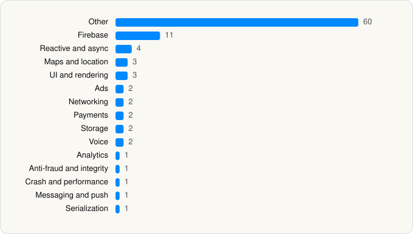

<picture><source media="(prefers-color-scheme: dark)" srcset="../../../../assets/logo/logo-dark.svg"></picture> [Tech Stack](../../../../README.md) / [Uber Technologies, Inc.](../../../../companies/uber-technologies-inc.md) / Uber

# Uber - Rides, Eats, Hotels

<picture><source media="(prefers-color-scheme: dark)" srcset="../../../../assets/badges/ios-dark.svg"></picture> <picture><source media="(prefers-color-scheme: dark)" srcset="../../../../assets/badges/active-dark.svg"></picture> <picture><source media="(prefers-color-scheme: dark)" srcset="../../../../assets/badges/floor-dark.svg"></picture> <picture><source media="(prefers-color-scheme: dark)" srcset="../../../../assets/badges/encrypted-dark.svg"></picture>

[App Store](https://apps.apple.com/app/id368677368) · [latest.json](latest.json)

| | |
|---|---|
| Company | [Uber Technologies, Inc.](../../../../companies/uber-technologies-inc.md) |
| Store id | `368677368` |
| Bundle / package id | `com.ubercab.UberClient` |
| Latest version | 3.744.10001 (analysed 2026-10-24) |
| Versions tracked | 1 |
| SDKs in latest version | 96 |
| Languages | C/C++, Metal (shaders), Objective-C, Swift |
| UI | Intercom UI, Lottie (animations), SwiftUI, UIKit |
| Build | Swift Package Manager (SwiftPM) |
| Minimum OS | iOS 18.0 (built with Xcode 26.5, SDK iphoneos26.5) |
| Devices / ABIs | iPhone, iPad |
| Localisations | 65 |
| Capabilities | 17 |
| Declares tracking | Yes |
| Tracked | Yes |

## SDKs by category

<picture><source media="(prefers-color-scheme: dark)" srcset="../../../../assets/charts/apps/ios/uber-technologies-inc/uber-dark.svg"></picture>

- **Other** (60): 10001, BikeChecklistMale, BikeChecklistMaleNYC, Camera-MotionGraphics, CommuteHub-Localizations-Common, Concurrent 1.0, ContactsUIObjc-Localizations-Helix, CreditsMotionGraphics, DesignSystem-Localizations-Helix, DocScanMotionGraphics, EaterOnboardingMotionGraphics, EMobilityMotionGraphics, GiftingMotionGraphics, GiftingRedemptionResultMotionGraphics, Healthline-Localizations, HelpResources-Localizations-Helix, IFoodOnboardingMotionGraphics, ImageCaptureOverlaysMotionGraphics, IntentsObjc-Localizations-Helix, IntentsUIObjc-Localizations-Helix, IO 1.0, JSON 1.0, JSR305 1.0, JustRideSDK 1.2.0, LocationSharingUIMotionGraphics, LoggedInFeaturesImpl-Localizations-Helix, ModernWebView-Localizations-Helios, MotoChecklistFemaleEats, MotoChecklistFemaleRides, MotoChecklistMaleEats, MotoChecklistMaleRides, MyUber-Localizations-Common, NavigationRealtime-Localizations-Common, Net 1.0, OrdersWidgetMotionGraphics, PhotoQualityMotionGraphics, PlacesCore-Localizations-Common, Presidio-Localizations-Helix, PromotionMotionGraphics, RatingMotionGraphics, RiderAgentMotionGraphics, RiderEmergencyAssistanceMotionGraphics, RiderSharedKit 1.0, RiderSharedMapsMotionGraphics, RiderWayfinding-MotionGraphics, RNCryptor 1.0, RoutingCore-Localizations-Common, SafetyAgentsMotionGraphics, SafetyEmergencyMotionGraphics, SafetyMotionGraphics, SavedPlaces-Localizations-Common, ScheduledRidesMotionGraphics, SelfieVerificationMotionGraphics, SharedResources-Localizations-Shared, TripDetailsCardsMotionGraphics, USnapGraphicsFileName, Util 1.0, VenueMotionGraphics, WebToolkitModeMotionGraphics, ZXingObjC 1.0
- **Firebase** (11): FBLPromises 2.4.0, Firebase 11.15.0, FirebaseCore 11.15.0, FirebaseCoreInternal 11.15.0, FirebaseInstallations 11.15.0, FirebaseRemoteConfig 11.15.0, GoogleDataTransport 10.1.0, GoogleUtilities 8.1.0, gRPC, nanopb 3.30910.0, Promises 2.4.0
- **Reactive and async** (4): RxBlocking, RxCocoa, RxRelay, RxSwift
- **Maps and location** (3): GMSCore 25.45.0, GoogleMaps 10.6.0, Mapbox
- **UI and rendering** (3): Lottie, MarqueeLabel 1.0, PromotionLottieAnimations
- **Ads** (2): Google Mobile Ads (AdMob), GoogleMobileAds 7.15.0
- **Networking** (2): com.uber.networking.certs, com.uber.networking.grpc.certs
- **Payments** (2): Adyen 2.4.1, Braintree 6.41.0
- **Storage** (2): PlatformUI-Helix, SSZipArchive 1.0
- **Voice** (2): TwilioVoice 6.13.6, WebRTC 1.0
- **Analytics** (1): Facebook SDK
- **Anti-fraud and integrity** (1): RiskMotionGraphics
- **Crash and performance** (1): FirebaseCrashlytics 11.15.0
- **Messaging and push** (1): Intercom
- **Serialization** (1): SwiftProtobuf

Frameworks (46)

ActivityKit (Live Activities), AdServices (Apple Search Ads attribution), AdSupport (IDFA), App Intents, App Tracking Transparency (ATT), ARKit, Authentication Services (Sign in with Apple / passkeys), AVFoundation (audio/video), AVKit, Background Tasks, CallKit (VoIP), Combine (reactive), Contacts, Core Bluetooth, Core Data, Core Image, Core Location, Core Motion, Core NFC, CryptoKit, DeviceCheck / App Attest, EventKit (Calendar / Reminders), Local Authentication (Face ID / Touch ID), MapKit, Media Player, MessageUI (mail / SMS compose), MetalKit, MetricKit (diagnostics), Natural Language, Network.framework, PassKit (Wallet / Apple Pay), PDFKit, Photos, PhotosUI, PushKit (VoIP push), SafariServices, SceneKit, SiriKit (Intents), Speech (recognition), StoreKit (in-app purchase), SwiftUI, UIKit, User Notifications, Vision, VisionKit (document/data scanning), WidgetKit (widgets)

Capabilities (17)

App Groups, Apple Pay, Associated Domains (Universal Links), Background App Refresh, Background Audio, Background Location, Background Processing, Background Push, Bluetooth (central), CloudKit, iCloud, Keychain Sharing, Push Notifications (APNs), Sign in with Apple, SiriKit, Time-Sensitive Notifications, VoIP

## Version history

| Version | Analysed | Store update | SDKs | Change | SDK list is a floor | Binary encrypted | File |
|---|---|---|---|---|---|---|---|
| 3.744.10001 | 2026-10-24 | 2026-10-19 | 96 |  | Yes | Yes | [3.744.10001.json](3.744.10001.json) |

---

Generated by `scripts/build_readme.py` from the JSON files. Do not edit by hand.
