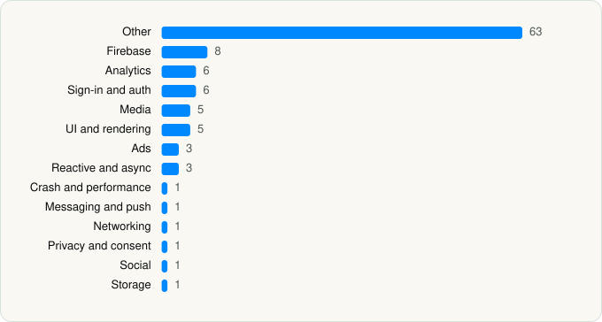

<picture><source media="(prefers-color-scheme: dark)" srcset="../../../../assets/logo/logo-dark.svg"></picture> [Tech Stack](../../../../README.md) / [Ubiquiti Labs, LLC](../../../../companies/ubiquiti-labs-llc.md) / VN

# VN: Photo & Video Editor

<picture><source media="(prefers-color-scheme: dark)" srcset="../../../../assets/badges/ios-dark.svg"></picture> <picture><source media="(prefers-color-scheme: dark)" srcset="../../../../assets/badges/inactive-dark.svg"></picture> <picture><source media="(prefers-color-scheme: dark)" srcset="../../../../assets/badges/floor-dark.svg"></picture> <picture><source media="(prefers-color-scheme: dark)" srcset="../../../../assets/badges/encrypted-dark.svg"></picture>

[App Store](https://apps.apple.com/app/id1343581380) · [latest.json](latest.json)

| | |
|---|---|
| Company | [Ubiquiti Labs, LLC](../../../../companies/ubiquiti-labs-llc.md) |
| Store id | `1343581380` |
| Bundle / package id | `com.frontrow.vlog` |
| Latest version | 2.24.1 (analysed 2026-11-11) |
| Versions tracked | 2 |
| SDKs in latest version | 105 |
| Languages | C/C++, Metal (shaders), Objective-C, Swift |
| UI | Lottie (animations), SwiftUI, UIKit |
| Build | Swift Package Manager (SwiftPM) |
| Minimum OS | iOS 16.0 (built with Xcode 27.1, SDK iphoneos27.1) |
| Devices / ABIs | iPhone, iPad |
| Localisations | 18 |
| Capabilities | 7 |
| Declares tracking | Yes |
| Tracked | No. Kept for history. |

## SDKs by category

<picture><source media="(prefers-color-scheme: dark)" srcset="../../../../assets/charts/apps/ios/ubiquiti-labs-llc/vn-dark.svg"></picture>

- **Other** (63): BeatsClipsCore, CocoaLumberjackPrivacy 3.10.0, CodeScan, CollageEditor 0.2.5, DeviceKit 5.9.0, DFNAudioProcessing, ffmpegkit 6.0, FlowAILibrary, FlowAILibraryShaders 0.34.20, FlowCaptionTemplateKit 0.0.10, FlowCIFilter, FlowCIFilterShaders 2.4.4, FlowDebugZonePicker, FlowEditorLayer, FlowENV, FlowExportUX 0.1.25, FlowFontLato, FlowGeneralView, FlowGrid, FlowImportResourceHelp, FlowMusicLibrary, FlowSpeechKit, FlowStoreKit, FlowTextEditor, FlowWebUploader, FRImageStrokeShaders 0.3.14, FrontRowEditor, FrontRowEditorResourceFX, FrontRowEditorResourceGuide, FrontRowEditorResourceOverlay, FrontRowEditorResourceTitleTemplate, FrontRowEditorShaders 0.0.1, FRVE2LoadingView, FRVideoEffectCatalog 0.5.9, FRVideoEffectFaceModel 0.5.9, FRVideoEffectShaders 0.5.9, FRVideoStabilizerShaders 0.1.13, FSPopoverView 3.1.6, GCDWebUploader, GiphyUISDK 2.2.15, HappyDNS.privacy 1.0.4, IQKeyboardManager 8.0.0, JPVideoPlayer, JXPagerView 2.1.3, JXPagingView 2.1.3, JXSegmentedView 1.4.1, libavdevice 60.1.100, libavfilter 9.3.100, libWeiboSDK 3.3.8, ManufacturerLUTs 0.2.35, MBProgressHUD 1.2.0, MediaPipeTasksCommon 1.1.1, MediaPipeTasksVision 1.1.1, MJExtension 3.4.2, MJRefresh, MJRefresh.Privacy 3.7.9, Qiniu.privacy 8.9.2, Teleprompter 0.1.19, Text, TransferFunctionLUTs 0.2.35, VNFontIcons 0.0.9, VNText, WeiboSDK
- **Firebase** (8): FBLPromises, Firebase, FirebaseCore, FirebaseCoreInternal, FirebaseInstallations, GoogleDataTransport, GoogleUtilities, nanopb
- **Analytics** (6): Facebook SDK, FBAEMKit 1.0, FBSDKCoreKit 1.0, FirebaseAnalytics 13.0.1, GoogleAppMeasurement 13.0.1, GoogleAppMeasurementIdentitySupport 13.0.1
- **Sign-in and auth** (6): AppAuth, Facebook Login, FBSDKLoginKit 1.0, GoogleSignIn, GTMAppAuth, GTMSessionFetcher
- **Media** (5): libavcodec 60.3.100, libavformat 60.3.100, libavutil 58.2.100, libswresample 4.10.100, libswscale 7.1.100
- **UI and rendering** (5): DGCharts 5.1.0, Lottie 4.6.1, MarqueeLabel 4.5.3, SDWebImage 5.21.7, SDWebImageSwiftUI 3.1.4
- **Ads** (3): Google Mobile Ads (AdMob), GoogleAdsOnDeviceConversion 3.7.0, GoogleMobileAds 13.11.0
- **Reactive and async** (3): RxCocoa 6.9.0, RxRelay 6.9.0, RxSwift 6.9.0
- **Crash and performance** (1): FirebaseCrashlytics
- **Messaging and push** (1): FirebaseMessaging
- **Networking** (1): AFNetworking 4.0.3
- **Privacy and consent** (1): UserMessagingPlatform 3.1.0
- **Social** (1): FBSDKShareKit 1.0
- **Storage** (1): FRSSZipArchive 2.5.4

Frameworks (27)

AdSupport (IDFA), App Tracking Transparency (ATT), Authentication Services (Sign in with Apple / passkeys), AVFoundation (audio/video), AVKit, Combine (reactive), Core Data, Core Image, Core Location, Core ML, Core Motion, CryptoKit, DeviceCheck / App Attest, Local Authentication (Face ID / Touch ID), MapKit, Media Player, MessageUI (mail / SMS compose), MetalKit, Natural Language, Network.framework, Photos, SafariServices, StoreKit (in-app purchase), SwiftUI, UIKit, User Notifications, Vision

Capabilities (7)

App Groups, Associated Domains (Universal Links), Background Audio, Background Push, Keychain Sharing, Push Notifications (APNs), Sign in with Apple

## Version history

| Version | Analysed | Store update | SDKs | Change | SDK list is a floor | Binary encrypted | File |
|---|---|---|---|---|---|---|---|
| 2.24.1 | 2026-11-11 |  | 105 | +0 / −0 | Yes | Yes | [2.24.1.json](2.24.1.json) |
| 2.24.0 | 2026-11-08 |  | 105 |  | Yes | Yes | [2.24.0.json](2.24.0.json) |

---

Generated by `scripts/build_readme.py` from the JSON files. Do not edit by hand.
