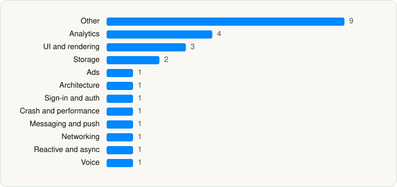

<picture><source media="(prefers-color-scheme: dark)" srcset="../../../../assets/logo/logo-dark.svg"></picture> [Tech Stack](../../../../README.md) / [Viber Media SARL.](../../../../companies/viber-media-sarl.md) / Rakuten Viber Messenger

# Rakuten Viber Messenger

<picture><source media="(prefers-color-scheme: dark)" srcset="../../../../assets/badges/ios-dark.svg"></picture> <picture><source media="(prefers-color-scheme: dark)" srcset="../../../../assets/badges/inactive-dark.svg"></picture> <picture><source media="(prefers-color-scheme: dark)" srcset="../../../../assets/badges/floor-dark.svg"></picture> <picture><source media="(prefers-color-scheme: dark)" srcset="../../../../assets/badges/encrypted-dark.svg"></picture>

[App Store](https://apps.apple.com/app/id382617920) · [latest.json](latest.json)

| | |
|---|---|
| Company | [Viber Media SARL.](../../../../companies/viber-media-sarl.md) |
| Store id | `382617920` |
| Bundle / package id | `com.viber` |
| Latest version | 28.0.2 (analysed 2026-06-19) |
| Versions tracked | 1 |
| SDKs in latest version | 26 |
| Languages | C/C++, Metal (shaders), Objective-C, React Native / JavaScript, Swift |
| UI | SwiftUI, UIKit |
| Build | Swift Package Manager (SwiftPM) |
| Minimum OS | iOS 15.2 (built with Xcode 26.3, SDK iphoneos26.2) |
| Devices / ABIs | iPhone, iPad |
| Localisations | 33 |
| Capabilities | 18 |
| Declares tracking | No |
| Tracked | No. Kept for history. |

## SDKs by category

<picture><source media="(prefers-color-scheme: dark)" srcset="../../../../assets/charts/apps/ios/viber-media-sarl/viber-messenger-dark.svg"></picture>

- **Other** (9): AhoCorasick 1.0, AppHarbrSDK 1.24.2, DebugSettings, Lodash, Mantle 1.0, PayneticsCard 1.0, Rswift 1.0, SCSDKCameraKit 1.29.0, VLN
- **Analytics** (4): Adjust 1.0, BrazeKit 13.3.0, Mixpanel, SCSDKCoreKit 2.5.0
- **UI and rendering** (3): MarkdownKit 1.0, React Native, SwiftyGif 1.0
- **Storage** (2): GRDB 4.8.1, ZIPFoundation 1.0
- **Ads** (1): Google Mobile Ads (AdMob)
- **Architecture** (1): React Navigation
- **Sign-in and auth** (1): SCSDKLoginKit 2.5.0
- **Crash and performance** (1): GAPMobile
- **Messaging and push** (1): BrazeUI 13.3.0
- **Networking** (1): Axios
- **Reactive and async** (1): ReactiveCocoa 1.0
- **Voice** (1): WebRTC 1.0

Frameworks (41)

ActivityKit (Live Activities), AdServices (Apple Search Ads attribution), AdSupport (IDFA), App Tracking Transparency (ATT), ARKit, Authentication Services (Sign in with Apple / passkeys), AVFoundation (audio/video), AVKit, Background Tasks, CallKit (VoIP), CloudKit, Combine (reactive), Contacts, Core Data, Core Image, Core Location, Core ML, Core Motion, CryptoKit, DeviceCheck / App Attest, Local Authentication (Face ID / Touch ID), MapKit, Media Player, MessageUI (mail / SMS compose), MetalKit, MetricKit (diagnostics), Natural Language, Network.framework, PassKit (Wallet / Apple Pay), Photos, PhotosUI, PushKit (VoIP push), SafariServices, SiriKit (Intents), Speech (recognition), StoreKit (in-app purchase), SwiftUI, UIKit, User Notifications, Vision, WidgetKit (widgets)

Capabilities (18)

App Attest, App Groups, Apple Pay, Associated Domains (Universal Links), Background App Refresh, Background Audio, Background Processing, Background Push, CarPlay, CloudKit, Communication Notifications, iCloud, iCloud Key-Value Storage, Keychain Sharing, Push Notifications (APNs), SiriKit, Time-Sensitive Notifications, VoIP

## Version history

| Version | Analysed | Store update | SDKs | Change | SDK list is a floor | Binary encrypted | File |
|---|---|---|---|---|---|---|---|
| 28.0.2 | 2026-06-19 |  | 26 |  | Yes | Yes | [28.0.2.json](28.0.2.json) |

## Model-written summary

> Hybrid Swift/React Native iOS messenger with CallKit VoIP, 6 app extensions for widgets/Siri/caller ID, 17 Metal shaders, App Attest, and Viber/Firebase backends

Written by a language model from the detected signals (`inferred[]`). It is commentary, not measurement.

---

Generated by `scripts/build_readme.py` from the JSON files. Do not edit by hand.
