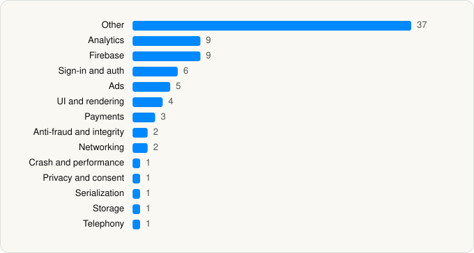

<picture><source media="(prefers-color-scheme: dark)" srcset="../../../../assets/logo/logo-dark.svg"></picture> [Tech Stack](../../../../README.md) / [Vinted Limited](../../../../companies/vinted-limited.md) / Vinted

# Vinted: Pre-loved marketplace

<picture><source media="(prefers-color-scheme: dark)" srcset="../../../../assets/badges/ios-dark.svg"></picture> <picture><source media="(prefers-color-scheme: dark)" srcset="../../../../assets/badges/inactive-dark.svg"></picture> <picture><source media="(prefers-color-scheme: dark)" srcset="../../../../assets/badges/floor-dark.svg"></picture> <picture><source media="(prefers-color-scheme: dark)" srcset="../../../../assets/badges/encrypted-dark.svg"></picture>

[App Store](https://apps.apple.com/app/id632064380) · [latest.json](latest.json)

| | |
|---|---|
| Company | [Vinted Limited](../../../../companies/vinted-limited.md) |
| Store id | `632064380` |
| Bundle / package id | `lt.manodrabuziai.fr` |
| Latest version | 26.41.1 (analysed 2026-10-24) |
| Versions tracked | 1 |
| SDKs in latest version | 82 |
| Languages | C/C++, Kotlin Multiplatform, Objective-C, Swift |
| UI | Lottie (animations), SwiftUI, UIKit |
| Build | Swift Package Manager (SwiftPM) |
| Minimum OS | iOS 15.8.5 (built with Xcode 26.4.1, SDK iphoneos26.4) |
| Devices / ABIs | iPhone, iPad |
| Localisations | 21 |
| Capabilities | 12 |
| Declares tracking | Yes |
| Tracked | No. Kept for history. |

## SDKs by category

<picture><source media="(prefers-color-scheme: dark)" srcset="../../../../assets/charts/apps/ios/vinted-limited/vinted-dark.svg"></picture>

- **Other** (37): Amazon 1.0, AppHarbrSDK 1.38.0, AppHealthLogs 1.0, ATOM 3.9.0, BloomAssetsCore 1.0, BloomKit 1.0, BloomSwiftUI 1.0, BotSignalsSDKContract 1.0, Dwifft 1.0, EventBuilder 1.0, FaceTecSDK 9.7.92, FeatureFlagsExposure 1.0, FeatureFlagsModels 1.0, Frames, HyBid 3.8.1, IncogniaCoreWrapper, IncogniaTrialWrapper, IncogniaWrapper, KlarnaCore 2.12.0, KlarnaCoreWebView 2.12.0, KlarnaMobileSDK 2.12.0, MetricsTracker 1.0, Ogury 1.6.6, OguryAds 4.3.0, OguryCore 2.3.0, OgurySdk 5.3.0, OndatoSDK 3.5.2, OpenWrapSDK 5.4.1, PterodactylContract 1.0, Pubnativenet 1.6.3, RoktUXHelper, SecurityContract 1.0, SystemConfigurationContract 1.0, SystemStatusAnnouncementContract 1.0, TaskScheduler 1.0, UITestsKit 1.0, VungleAdsSDK 1.0
- **Analytics** (9): Adjust 1.0, AdjustSdk, FacebookAEM 1.0, FacebookCore 1.0, FBAEMKit 1.0, FBSDKCoreKit 1.0, FullStory 1.73.1, ObjC 1.0, Rokt 1.0
- **Firebase** (9): FBLPromises, Firebase, FirebaseCore, FirebaseCoreInternal, FirebaseInstallations, GoogleDataTransport, GoogleUtilities 1.0, nanopb, Promises
- **Sign-in and auth** (6): AppAuth, FacebookLogin, FBSDKLoginKit 1.0, GoogleSignIn, GTMAppAuth, GTMSessionFetcher
- **Ads** (5): AppLovin 7.12.8, DTBiOSSDK 1.0, Google Mobile Ads (AdMob), InMobiSDK 11.4.1, Pubmatic 1.6.3
- **UI and rendering** (4): DGCharts, Lottie 1.0, SDWebImage, SwiftSoup 1.0
- **Payments** (3): Adyen, CheckoutEventLoggerKit 1.0, KlarnaPayments 2.12.0
- **Anti-fraud and integrity** (2): DataDomeSDK 3.1.0, Fingerprint 2.17.2
- **Networking** (2): Networking 1.0, NetworkingUtils 1.0
- **Crash and performance** (1): FirebaseCrashlytics
- **Privacy and consent** (1): OTPublishersHeadlessSDK 202609.1.0
- **Serialization** (1): SwiftProtobuf 1.0
- **Storage** (1): PlatformConfigurationContract 1.0
- **Telephony** (1): PhoneNumberKit

Frameworks (36)

ActivityKit (Live Activities), AdServices (Apple Search Ads attribution), AdSupport (IDFA), App Tracking Transparency (ATT), Authentication Services (Sign in with Apple / passkeys), AVFoundation (audio/video), AVKit, CloudKit, Combine (reactive), Contacts, Core Data, Core Image, Core Location, Core ML, Core Motion, Core NFC, CryptoKit, DeviceCheck / App Attest, EventKit (Calendar / Reminders), Local Authentication (Face ID / Touch ID), MapKit, Media Player, MessageUI (mail / SMS compose), MetalKit, MetricKit (diagnostics), Network.framework, PassKit (Wallet / Apple Pay), Photos, PhotosUI, SafariServices, StoreKit (in-app purchase), Swift Charts, SwiftUI, UIKit, User Notifications, Watch Connectivity

Capabilities (12)

App Attest, App Groups, Apple Pay, Associated Domains (Universal Links), Background App Refresh, Background Push, CloudKit, iCloud, iCloud Key-Value Storage, Keychain Sharing, Push Notifications (APNs), Sign in with Apple

## Version history

| Version | Analysed | Store update | SDKs | Change | SDK list is a floor | Binary encrypted | File |
|---|---|---|---|---|---|---|---|
| 26.41.1 | 2026-10-24 | 2026-10-20 | 82 |  | Yes | Yes | [26.41.1.json](26.41.1.json) |

---

Generated by `scripts/build_readme.py` from the JSON files. Do not edit by hand.
