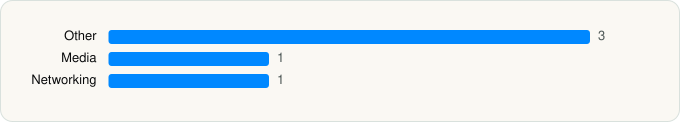

<picture><source media="(prefers-color-scheme: dark)" srcset="../../../../assets/logo/logo-dark.svg"></picture> [Tech Stack](../../../../README.md) / [Waldlust Co., Ltd.](../../../../companies/waldlust-co-ltd.md) / 쿠우쿠우 멤버십

# 쿠우쿠우 멤버십

<picture><source media="(prefers-color-scheme: dark)" srcset="../../../../assets/badges/ios-dark.svg"></picture> <picture><source media="(prefers-color-scheme: dark)" srcset="../../../../assets/badges/inactive-dark.svg"></picture> <picture><source media="(prefers-color-scheme: dark)" srcset="../../../../assets/badges/floor-dark.svg"></picture> <picture><source media="(prefers-color-scheme: dark)" srcset="../../../../assets/badges/encrypted-dark.svg"></picture>

[App Store](https://apps.apple.com/app/id6465872138) · [latest.json](latest.json)

| | |
|---|---|
| Company | [Waldlust Co., Ltd.](../../../../companies/waldlust-co-ltd.md) |
| Store id | `6465872138` |
| Bundle / package id | `co.kr.waldlust.qooqoo` |
| Latest version | 1.1.2 (analysed 2026-11-20) |
| Versions tracked | 1 |
| SDKs in latest version | 5 |
| Languages | C/C++, Objective-C, Swift |
| UI | UIKit |
| Build | Swift Package Manager (SwiftPM) |
| Minimum OS | iOS 13 (built with Xcode 26.4.1, SDK iphoneos26.4) |
| Devices / ABIs | iPhone |
| Localisations | 2 |
| Capabilities | 4 |
| Declares tracking | No |
| Tracked | No. Kept for history. |

## SDKs by category

<picture><source media="(prefers-color-scheme: dark)" srcset="../../../../assets/charts/apps/ios/waldlust-co-ltd/app-dark.svg"></picture>

- **Other** (3): KakaoSDKCertCore 2.22.0, KakaoSDKCommon, KakaoSDKFriendCore 2.22.0
- **Media** (1): YouTubeiOSPlayerHelper
- **Networking** (1): Alamofire

Frameworks (10)

Authentication Services (Sign in with Apple / passkeys), Combine (reactive), Contacts, Core Location, CryptoKit, Network.framework, Photos, PushKit (VoIP push), UIKit, User Notifications

Capabilities (4)

Background App Refresh, Background Push, Push Notifications (APNs), Sign in with Apple

## Version history

| Version | Analysed | Store update | SDKs | Change | SDK list is a floor | Binary encrypted | File |
|---|---|---|---|---|---|---|---|
| 1.1.2 | 2026-11-20 |  | 5 |  | Yes | Yes | [1.1.2.json](1.1.2.json) |

---

Generated by `scripts/build_readme.py` from the JSON files. Do not edit by hand.
