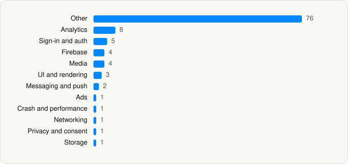

<picture><source media="(prefers-color-scheme: dark)" srcset="../../../../assets/logo/logo-dark.svg"></picture> [Tech Stack](../../../../README.md) / [WarnerMedia Global Digital Services, LLC](../../../../companies/warnermedia-global-digital-services-llc.md) / HBO Max

# HBO Max: Stream Movies & TV

<picture><source media="(prefers-color-scheme: dark)" srcset="../../../../assets/badges/ios-dark.svg"></picture> <picture><source media="(prefers-color-scheme: dark)" srcset="../../../../assets/badges/active-dark.svg"></picture> <picture><source media="(prefers-color-scheme: dark)" srcset="../../../../assets/badges/floor-dark.svg"></picture> <picture><source media="(prefers-color-scheme: dark)" srcset="../../../../assets/badges/encrypted-dark.svg"></picture>

[App Store](https://apps.apple.com/app/id1666653815) · [latest.json](latest.json)

| | |
|---|---|
| Company | [WarnerMedia Global Digital Services, LLC](../../../../companies/warnermedia-global-digital-services-llc.md) |
| Store id | `1666653815` |
| Bundle / package id | `com.wbd.stream` |
| Latest version | 7.4.0 (analysed 2026-06-19) |
| Versions tracked | 1 |
| SDKs in latest version | 107 |
| Languages | C/C++, Objective-C, Swift |
| UI | Lottie (animations), SwiftUI, UIKit |
| Build | Swift Package Manager (SwiftPM) |
| Minimum OS | iOS 16.4 (built with Xcode 26.3, SDK iphoneos26.2) |
| Devices / ABIs | iPhone, iPad |
| Localisations | 41 |
| Capabilities | 7 |
| Declares tracking | Yes |
| Tracked | Yes |

## SDKs by category

<picture><source media="(prefers-color-scheme: dark)" srcset="../../../../assets/charts/apps/ios/warnermedia-global-digital-services-llc/hbo-max-dark.svg"></picture>

- **Other** (76): ActivitySessionKit 1.0, AdapterKit 1.0, AdTechISdkTelemetryCollector 1.0, AdTechKit 1.0, AppFoundation 1.0, AppStoreKit 1.0, ApptentiveKit, AppUI 1.0, ArkoseLabsKit 2.19.0, BEAMPlayerOverlay 1.0, BLAdFramework 1.1, BoltAuthKit 1.0, BoltDynamicAdFetcher 1.0, BrazePushStory 11.9.0, ChromecastFeature 1.0, CommandKit 1.0, ContentFeedFeature 1.0, CrashReporter, DebugFeature 1.0, DeclarativeUIKit 1.0, Discovery2 1.5.5, ErrorKit 1.0, FuseUI 1.0, GIKit 1.0, HeroFeature 1.0, IAPFeature 1.0, InstrumentationKit 1.0, InstrumentationSchemaKit 1.0, JSONAPI 1.0, LabsKit 1.0, LegacyEventKit 1.0, LocationFeature 1.0, LocationServices 1.0, LunaCoordinators 1.0, LunaFoundation 1.0, LunaUI 1.0, MarkupKit 1.0, MaxUI 1.0, MediaMelonQoE 2.16.0, MemberFeedFeature 1.0, MultilevelFeature 1.0, NanoFeature 1.0, NumberedFeature 1.0, OneByOneFeature 1.0, PageFeature 1.0, PersistentModels 1.0, PillFeature 1.0, PlayerBolt 1.0, PlayerCommon 1.0, PlayerCore 1.0, PlayerCoreObjc 1.0, PlayerOverlay 1.0, PlayerUI 1.0, PlayerUtils 1.0, ProfilesFeature 1.0, RootTabsFeature 1.0, SchedulePageFeature 1.0, SearchFeature 1.0, SettingsFeature 1.0, SharePlayFeature 1.0, SharingKit 1.0, ShowcaseFeature 1.0, SideDrawerFeature 1.0, SixteenByNineFeature 1.0, SonicJSONAPI 1.0, SonicKit 1.0, SonicKitAdapter 1.0, SportSkin 0.1.0, StartUpFeature 1.0, TabGroupFeature 1.0, TemplateEngine 1.0, ThunderPlayer 1.0, TimelineManagerKit 1.0, TimelineMarkersFeature 1.0, TwoByThreeFeature 1.0, WebFeature 1.0
- **Analytics** (8): AnalyticsFeature 1.0, AppsFlyerLib 1.0, Branch 3.4.3, BrazeKit 11.9.0, ComScore 1.0, FirebaseAnalytics 10.23.1, GoogleAppMeasurement 10.23.1, GoogleAppMeasurementIdentitySupport 10.23.1
- **Sign-in and auth** (5): AppAuth, AuthenticationFeature 1.0, GoogleSignIn, GTMAppAuth, GTMSessionFetcher
- **Firebase** (4): FirebaseCore, FirebaseCoreInternal, FirebaseInstallations, GoogleUtilities
- **Media** (4): BOLTPlaybackInfoResolver 1.0, GoogleCast 4.8.3, MuxCore 5.7.0, PlaybackInfoResolver 1.0
- **UI and rendering** (3): DifferenceKit 1.0, Down 1.0, Lottie
- **Messaging and push** (2): BrazeNotificationService 11.9.0, BrazeUI 1.0
- **Ads** (1): ProgrammaticAccessLibrary 2.9.1
- **Crash and performance** (1): PLCrashReporter
- **Networking** (1): NetworkKit 1.0
- **Privacy and consent** (1): ConsentsFeature 1.0
- **Storage** (1): KeychainAccess 1.0

Frameworks (24)

ActivityKit (Live Activities), AdServices (Apple Search Ads attribution), AdSupport (IDFA), App Tracking Transparency (ATT), Authentication Services (Sign in with Apple / passkeys), AVFoundation (audio/video), AVKit, Combine (reactive), Core Data, Core Image, Core Location, Core Motion, CryptoKit, EventKit (Calendar / Reminders), Group Activities (SharePlay), Local Authentication (Face ID / Touch ID), Media Player, Network.framework, PhotosUI, SafariServices, StoreKit (in-app purchase), SwiftUI, UIKit, User Notifications

Capabilities (7)

App Groups, Associated Domains (Universal Links), Background App Refresh, Background Audio, Background Push, Keychain Sharing, Push Notifications (APNs)

## Version history

| Version | Analysed | Store update | SDKs | Change | SDK list is a floor | Binary encrypted | File |
|---|---|---|---|---|---|---|---|
| 7.4.0 | 2026-06-19 |  | 107 |  | Yes | Yes | [7.4.0.json](7.4.0.json) |

---

Generated by `scripts/build_readme.py` from the JSON files. Do not edit by hand.
