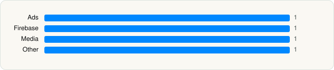

<picture><source media="(prefers-color-scheme: dark)" srcset="../../../../assets/logo/logo-dark.svg"></picture> [Tech Stack](../../../../README.md) / [Waze Inc.](../../../../companies/waze-inc.md) / Waze Navigation & Live Traffic

# Waze Navigation & Live Traffic

<picture><source media="(prefers-color-scheme: dark)" srcset="../../../../assets/badges/ios-dark.svg"></picture> <picture><source media="(prefers-color-scheme: dark)" srcset="../../../../assets/badges/inactive-dark.svg"></picture> <picture><source media="(prefers-color-scheme: dark)" srcset="../../../../assets/badges/floor-dark.svg"></picture> <picture><source media="(prefers-color-scheme: dark)" srcset="../../../../assets/badges/encrypted-dark.svg"></picture>

[App Store](https://apps.apple.com/app/id323229106) · [latest.json](latest.json)

| | |
|---|---|
| Company | [Waze Inc.](../../../../companies/waze-inc.md) |
| Store id | `323229106` |
| Bundle / package id | `com.waze.iphone` |
| Latest version | 5.26.0 (analysed 2026-10-24) |
| Versions tracked | 1 |
| SDKs in latest version | 4 |
| Languages | C/C++, Metal (shaders), Objective-C, Swift |
| UI | SwiftUI, UIKit |
| Build | Swift Package Manager (SwiftPM) |
| Minimum OS | iOS 16.0 (built with Xcode 26.4.1, SDK iphoneos26.4) |
| Devices / ABIs | iPhone, iPad |
| Localisations | 65 |
| Capabilities | 13 |
| Declares tracking | No |
| Tracked | No. Kept for history. |

## SDKs by category

<picture><source media="(prefers-color-scheme: dark)" srcset="../../../../assets/charts/apps/ios/waze-inc/waze-navigation-live-traffic-dark.svg"></picture>

- **Ads** (1): Google Mobile Ads (AdMob)
- **Firebase** (1): gRPC
- **Media** (1): SpotifyiOS 5.0.1
- **Other** (1): SingleSessionImplementation

Frameworks (31)

ActivityKit (Live Activities), App Intents, Authentication Services (Sign in with Apple / passkeys), AVFoundation (audio/video), AVKit, Combine (reactive), Contacts, Core Bluetooth, Core Data, Core Image, Core Location, Core Motion, DeviceCheck / App Attest, EventKit (Calendar / Reminders), Local Authentication (Face ID / Touch ID), MapKit, Media Player, MessageUI (mail / SMS compose), MetalKit, MetricKit (diagnostics), MusicKit, Network.framework, SafariServices, SceneKit, SiriKit (Intents), Speech (recognition), StoreKit (in-app purchase), SwiftUI, UIKit, User Notifications, WidgetKit (widgets)

Capabilities (13)

App Attest, App Groups, Associated Domains (Universal Links), Background App Refresh, Background Audio, Background Location, Background Push, CarPlay, CloudKit, iCloud, iCloud Key-Value Storage, Keychain Sharing, Push Notifications (APNs)

## Version history

| Version | Analysed | Store update | SDKs | Change | SDK list is a floor | Binary encrypted | File |
|---|---|---|---|---|---|---|---|
| 5.26.0 | 2026-10-24 |  | 4 |  | Yes | Yes | [5.26.0.json](5.26.0.json) |

---

Generated by `scripts/build_readme.py` from the JSON files. Do not edit by hand.
