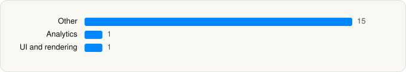

<picture><source media="(prefers-color-scheme: dark)" srcset="../../../../assets/logo/logo-dark.svg"></picture> [Tech Stack](../../../../README.md) / [WeChat](../../../../companies/wechat.md) / WeChat

# WeChat

<picture><source media="(prefers-color-scheme: dark)" srcset="../../../../assets/badges/ios-dark.svg"></picture> <picture><source media="(prefers-color-scheme: dark)" srcset="../../../../assets/badges/inactive-dark.svg"></picture> <picture><source media="(prefers-color-scheme: dark)" srcset="../../../../assets/badges/floor-dark.svg"></picture> <picture><source media="(prefers-color-scheme: dark)" srcset="../../../../assets/badges/encrypted-dark.svg"></picture>

[App Store](https://apps.apple.com/app/id414478124) · [latest.json](latest.json)

| | |
|---|---|
| Company | [WeChat](../../../../companies/wechat.md) |
| Store id | `414478124` |
| Bundle / package id | `com.tencent.xin` |
| Latest version | 8.0.74 (analysed 2026-06-19) |
| Versions tracked | 1 |
| SDKs in latest version | 17 |
| Languages | C/C++, Metal (shaders), Objective-C, Swift |
| UI | Lottie (animations), SwiftUI, UIKit |
| Build | Unknown / Xcode native |
| Minimum OS | iOS 15.0 (built with Xcode 26.1.1, SDK iphoneos26.1) |
| Devices / ABIs | iPhone, iPad |
| Localisations | 29 |
| Capabilities | 18 |
| Declares tracking | No |
| Tracked | No. Kept for history. |

## SDKs by category

<picture><source media="(prefers-color-scheme: dark)" srcset="../../../../assets/charts/apps/ios/wechat/wechat-dark.svg"></picture>

- **Other** (15): detector, JavaScriptCore2 615, jitruntimeres, Lodash, magicbrushres, MAVideoComposition, mmcronet 119.6045.214, MMRouter 1.0, NewMessageRingUtil 1.0, poseest, QMapKit, ufa, WCPlayer, WeAppCore, WeVisionSDK
- **Analytics** (1): Facebook SDK
- **UI and rendering** (1): Lottie 1.0

Frameworks (38)

AdSupport (IDFA), ARKit, Authentication Services (Sign in with Apple / passkeys), AVFoundation (audio/video), AVKit, CallKit (VoIP), CloudKit, Combine (reactive), Contacts, Core Bluetooth, Core Image, Core Location, Core ML, Core Motion, DeviceCheck / App Attest, EventKit (Calendar / Reminders), HealthKit, Local Authentication (Face ID / Touch ID), MapKit, Media Player, MessageUI (mail / SMS compose), MetalKit, MetricKit (diagnostics), Natural Language, Network.framework, PassKit (Wallet / Apple Pay), PDFKit, Photos, PhotosUI, PushKit (VoIP push), SceneKit, SiriKit (Intents), StoreKit (in-app purchase), SwiftUI, UIKit, User Notifications, Watch Connectivity, WidgetKit (widgets)

Capabilities (18)

App Groups, Apple Pay, Associated Domains (Universal Links), Background App Refresh, Background Audio, Background Location, Background Push, Background: network-authentication, CarPlay, Communication Notifications, HealthKit, Keychain Sharing, Network Extensions, Push Notifications (APNs), Sign in with Apple, SiriKit, VoIP, Wallet passes

## Version history

| Version | Analysed | Store update | SDKs | Change | SDK list is a floor | Binary encrypted | File |
|---|---|---|---|---|---|---|---|
| 8.0.74 | 2026-06-19 |  | 17 |  | Yes | Yes | [8.0.74.json](8.0.74.json) |

## Model-written summary

> Hybrid SwiftUI/UIKit iOS app for WeChat with 6 extensions (WidgetKit, Siri, ScreenCapture), 10 Metal shaders, first-party modules (TPFFmpeg, cronet_wrapper), and 29 localizations

Written by a language model from the detected signals (`inferred[]`). It is commentary, not measurement.

---

Generated by `scripts/build_readme.py` from the JSON files. Do not edit by hand.
