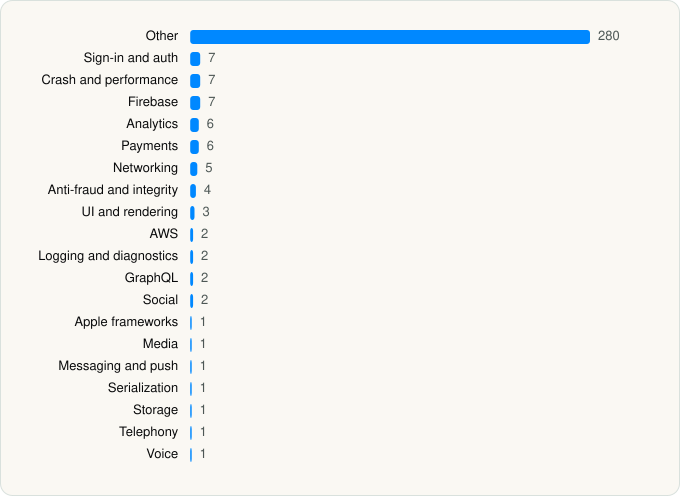

<picture><source media="(prefers-color-scheme: dark)" srcset="../../../../assets/logo/logo-dark.svg"></picture> [Tech Stack](../../../../README.md) / [Whatnot Inc.](../../../../companies/whatnot-inc.md) / Whatnot

# Whatnot: Shop, Sell, Connect

<picture><source media="(prefers-color-scheme: dark)" srcset="../../../../assets/badges/ios-dark.svg"></picture> <picture><source media="(prefers-color-scheme: dark)" srcset="../../../../assets/badges/inactive-dark.svg"></picture> <picture><source media="(prefers-color-scheme: dark)" srcset="../../../../assets/badges/floor-dark.svg"></picture> <picture><source media="(prefers-color-scheme: dark)" srcset="../../../../assets/badges/encrypted-dark.svg"></picture>

[App Store](https://apps.apple.com/app/id1488269261) · [latest.json](latest.json)

| | |
|---|---|
| Company | [Whatnot Inc.](../../../../companies/whatnot-inc.md) |
| Store id | `1488269261` |
| Bundle / package id | `com.whatnot` |
| Latest version | 26.45.0 (analysed 2026-11-04) |
| Versions tracked | 3 |
| SDKs in latest version | 349 |
| Languages | C/C++, Metal (shaders), Objective-C, Swift |
| UI | Lottie (animations), SwiftUI, UIKit |
| Build | Swift Package Manager (SwiftPM) |
| Minimum OS | iOS 17.0 (built with Xcode 26.4.1, SDK iphoneos26.4) |
| Devices / ABIs | iPhone |
| Localisations | 5 |
| Capabilities | 11 |
| Declares tracking | Yes |
| Tracked | No. Kept for history. |

## SDKs by category

<picture><source media="(prefers-color-scheme: dark)" srcset="../../../../assets/charts/apps/ios/whatnot-inc/whatnot-dark.svg"></picture>

- **Other** (286): AccountControls, AccountHealthLegacy, AccountHealthLegacyInterface, AccountHealthV2Implementation, AccountHealthV2Interface, AccountSwitcher, AccountTab, AccountTabInterface, ActivityTab, ActivityTabInterface, AddAddress, Addresses, AddressesInterface, Ads, AdsInterface, Agorafdkaac 4.5.3, Agoraffmpeg 4.5.3, AgoraSoundTouch 4.5.3, AnnouncementBanner, AnnouncementBannerInterface, aosl 1.3.9, AppStoreReviewImplementation, AppStoreReviewInterface, AttributesImplementation, AttributesInterface, AttributesPublicUI, Auction, AuctionInterface, BaseUI, BlockingMessage, BotsDetection, BreadcrumbsReporter, BreadcrumbsReporterInterface, Breaks, BreaksRandomizerResult, Browse, BrowseInterface, Captions, CardinalMobile 2.2.5, CategoriesImplementation, CategoriesInterface, CategoriesTab, ClientAdmission, ClientAdmissionInterface, ClientMetricsImplementation, ClientMetricsInterface, Clip, ConfettiView, ContactsRepository, CouponImplementation, CouponInterface, CouponPublicUI, CouponsImplementation, CouponsInterface, CouponsPublicUI, dec 4.5.3, DefaultFeatureValues, DependencyInjection, DirectMessaging, DirectMessagingInterface, DirectService, DirectServiceInterface, DiscoveryRoutingState, DiscoveryRoutingStateInterface, DMTranslation, EditorialEvent, Events, Experiences, FeatureFlag, Feed, FeedBanner, FeedContentInterface, FeedFilterAndSort, FeedInterface, FileSystemClient, FoilShaders, Friends, GamesPoints, GamesPointsInterface, GiftCardsImplementation, GiftCardsInterface, GiftCardsPublicUI, GiveawaysImplementation, GiveawaysInterface, GiveawaysPublicUI, GlobalBanner, GoldImplementation, GoldInterface, HomeTab, IdentityVerification, Impressions, ImpressionsInterface, InAppBrowser, InAppNotificationCenter, InstalledBusinessAppsImplementation, InstalledBusinessAppsInterface, InternalTools, InternalToolsUI, International, InternationalInterface, InventoryImplementation, InventoryInterface, Listing, ListingComposerImplementation, ListingComposerInterface, ListingComposerMediaPublicUI, ListingComposerPublicUI, ListingComposerService, ListingComposerServiceInterface, ListingDetails, ListingDetailsInterface, ListingEvents, ListingGenerationImplementation, ListingGenerationInterface, ListingGenerationPublicUI, ListingManagement, ListingMedia, ListingMediaInterface, ListingViews, Live, LiveBookmarkPromptImplementation, LiveBookmarkPromptInterface, LiveBookmarkPromptPublicUI, LiveExperience, LiveExperienceInterface, LiveExperiencePublicUI, LiveInterface, LivePinnedProducts, LivePinnedProductsInterface, LiveRehearsalImplementation, LiveRehearsalInterface, LiveRehearsalPublicUI, LiveShop, LivestreamCloningImplementation, LivestreamCloningInterface, LivestreamInterface, LivestreamScheduler, LivestreamSchedulerInterface, LivestreamStartImplementation, LivestreamStartInterface, LivestreamTagInterface, LivestreamTile, LivestreamVerticalScroll, LivestreamVideo, LivestreamVideoInterface, LiveVideoPreview, LiveXPUI, LocalPickup, LocalPickupInterface, LoyaltyRewards, LoyaltyRewardsInterface, MagicListingShared, MainApp, MainAppLegacy, MainTabInterface, Me, MediaAttachmentsImplementation, MediaAttachmentsInterface, MediaInterface, MobileShieldKit 2.0.2, MondialRelay, NewBets, Notifications, NotificationsHub, Offers, OnboardingLifecycle, OnboardingOptionInterface, OrderRatings, OverbidProtectionImplementation, OverbidProtectionInterface, PartyPurchaseFeedPublicUI, PartyPurchaseInterface, PartyPurchaseLiveExperiencePublicUI, PartyPurchasePublicUI, PayoutGateways, PayPalDataCollector, PostShow, PostShowInterface, PresalesInterface, ProductIdentificationImplementation, ProductIdentificationInterface, ProfileShop, ProfileVideos, PUDOImplementation, PUDOInterface, RandomizablesImplementation, RandomizablesInterface, RandomizablesPublicUI, RealTimeTranslation, Referrals, ReferralsInterface, RemoteMessaging, Rewards, RewardsInterface, RiveGenerated, Search, SearchInterface, SellerBrandsImplementation, SellerBrandsInterface, SellerBrandsPublicUI, SellerInShowTips, SellerLeaderboardImplementation, SellerLeaderboardInterface, SellerLeaderboardPublicUI, SellerOnboardingImplementation, SellerOnboardingInterface, SellerOnboardingPublicUI, SellerTaxIdImplementation, SellerTaxIdInterface, SellerTaxIdPublicUI, SellerTools, SellerToolsInterface, SellTab, SellTabInterface, SeonSDK 5.7.1, Shipments, ShipmentsInterface, ShippingPackageImplementation, ShippingPackageInterface, ShippingProfilesImplementation, ShippingProfilesInterface, ShippingQuotes, ShopifyIntegrationImplementation, ShopifyIntegrationInterface, ShopifyIntegrationPublicUI, ShortVideo, ShortVideoEventsImplementation, ShortVideoInterface, Smooch 12.1.0, Sounds, SplashScreenImplementation, SplashScreenInterface, StoreOffers, SupportChat, SupportReports, Sync, TagPickerImplementation, TagPickerInterface, Tags, TeamInviteAcceptImplementation, TeamInviteAcceptInterface, TeamInviteAcceptPublicUI, TeamPermissions, TimedListingEvent, TimedListingEventCompose, TimedListingEventComposeInterface, TimedListingEventInterface, Tipping, TippingInterface, Tooltip, UnifiedCheckpointImplementation, UnifiedCheckpointInterface, UniversalBundling, User, UserChallenge, UserChallengeInterface, UserEducation, UserEducationInterface, UserInterface, UserMenu, UserMenuInterface, UserProfile, UserProfileInterface, UserSession, UserSettings, VariantComposerImplementation, VariantComposerInterface, VariantComposerPublicUI, VariantMediaImplementation, VariantMediaInterface, VariantsImplementation, VariantsInterface, VariantsPublicUI, VideoCache, VODs, VODsInterface, WatchlistImplementation, WatchlistInterface, WDSKit, WDSKitInterface, WNCore, WNFoundation, WNModels, WNNetwork, WNStorage, WNVideoPlayer
- **Payments** (9): Braintree, Checkout, LivePaymentsImplementation, LivePaymentsInterface, LiveWalletInterface, Payment, PaymentsImplementation, PaymentsInterface, Stripe
- **Sign-in and auth** (7): AppAuth, Authentication, FacebookLogin, FBSDKLoginKit 1.0, GoogleSignIn, GTMAppAuth, GTMSessionFetcher
- **Crash and performance** (7): DatadogCore, DatadogCrashReporting, DatadogRUM, Instabug 16.0.2, KSCrash, LivestreamObservability, SDKObservability
- **Firebase** (7): FBLPromises, FirebaseCore, FirebaseCoreInternal, FirebaseInstallations, GoogleDataTransport, GoogleUtilities 1.0, nanopb
- **Analytics** (6): FacebookAEM, FacebookCore, FBAEMKit 1.0, FBSDKCoreKit 1.0, ListingComposerAnalyticsInterface, PromoteToolsAnalytics
- **Networking** (5): SocketChannel, SocketChannelCore, SocketChannelInterface, SocketChannelPhoenixInHouseClient, SocketGeneralService
- **Anti-fraud and integrity** (4): Persona2, PPRiskMagnes 1.0, RecaptchaTokenClientImplementation, RecaptchaTokenClientInterface
- **UI and rendering** (3): Animation, Lottie 1.0, RiveRuntime 6.28.1
- **AWS** (2): AmazonIVSBroadcast 1.47.0, AmazonIVSPlayer 1.56.0
- **Logging and diagnostics** (2): WNLogger, WNLoggerInterface
- **GraphQL** (2): Apollo, ApolloAPI
- **Social** (2): FacebookShare, FBSDKShareKit 1.0
- **Apple frameworks** (1): Collections
- **Media** (1): CrossStreaming
- **Messaging and push** (1): FirebaseMessaging
- **Serialization** (1): SwiftProtobuf
- **Storage** (1): Performance
- **Telephony** (1): PhoneNumberKit
- **Voice** (1): AgoraRtcKit 4.5.3

Frameworks (36)

AdServices (Apple Search Ads attribution), AdSupport (IDFA), App Tracking Transparency (ATT), Authentication Services (Sign in with Apple / passkeys), AVFoundation (audio/video), AVKit, CallKit (VoIP), Combine (reactive), Contacts, Core Data, Core Image, Core Location, Core ML, Core Motion, CryptoKit, DeviceCheck / App Attest, EventKit (Calendar / Reminders), Local Authentication (Face ID / Touch ID), MapKit, Media Player, MessageUI (mail / SMS compose), MetalKit, MetricKit (diagnostics), Network.framework, PassKit (Wallet / Apple Pay), PDFKit, Photos, PhotosUI, SafariServices, SiriKit (Intents), StoreKit (in-app purchase), Swift Charts, SwiftUI, UIKit, User Notifications, Vision

Capabilities (11)

Apple Pay, Associated Domains (Universal Links), Background Audio, Background Push, Communication Notifications, iCloud, iCloud Key-Value Storage, Keychain Sharing, Push Notifications (APNs), Sign in with Apple, Time-Sensitive Notifications

## Version history

| Version | Analysed | Store update | SDKs | Change | SDK list is a floor | Binary encrypted | File |
|---|---|---|---|---|---|---|---|
| 26.45.0 | 2026-11-04 | 2026-11-03 | 349 | +6 / −0 | Yes | Yes | [26.45.0.json](26.45.0.json) |
| 26.44.5 | 2026-11-02 | 2026-10-29 | 343 | +3 / −0 | Yes | Yes | [26.44.5.json](26.44.5.json) |
| 26.43.5 | 2026-10-24 | 2026-10-22 | 340 |  | Yes | Yes | [26.43.5.json](26.43.5.json) |

### SDK changes between versions

- 26.44.5 → 26.45.0: added LiveWalletInterface, LocalPickupInterface, PaymentsImplementation, PaymentsInterface, SplashScreenImplementation, SplashScreenInterface
- 26.43.5 → 26.44.5: added PresalesInterface, PUDOImplementation, PUDOInterface

---

Generated by `scripts/build_readme.py` from the JSON files. Do not edit by hand.
