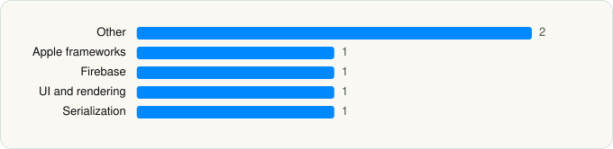

<picture><source media="(prefers-color-scheme: dark)" srcset="../../../../assets/logo/logo-dark.svg"></picture> [Tech Stack](../../../../README.md) / [WhatsApp Inc.](../../../../companies/whatsapp-inc.md) / WhatsApp Messenger

# WhatsApp Messenger

<picture><source media="(prefers-color-scheme: dark)" srcset="../../../../assets/badges/ios-dark.svg"></picture> <picture><source media="(prefers-color-scheme: dark)" srcset="../../../../assets/badges/active-dark.svg"></picture> <picture><source media="(prefers-color-scheme: dark)" srcset="../../../../assets/badges/floor-dark.svg"></picture> <picture><source media="(prefers-color-scheme: dark)" srcset="../../../../assets/badges/encrypted-dark.svg"></picture>

[App Store](https://apps.apple.com/app/id310633997) · [latest.json](latest.json)

| | |
|---|---|
| Company | [WhatsApp Inc.](../../../../companies/whatsapp-inc.md) |
| Store id | `310633997` |
| Bundle / package id | `net.whatsapp.WhatsApp` |
| Latest version | 26.41.75 (analysed 2026-10-23) |
| Versions tracked | 2 |
| SDKs in latest version | 6 |
| Languages | C/C++, Metal (shaders), Objective-C, Swift |
| UI | SwiftUI, UIKit |
| Build | Unknown / Xcode native |
| Minimum OS | iOS 15.1 (built with Xcode 27.1, SDK iphoneos27.1) |
| Devices / ABIs | iPhone, iPad |
| Localisations | 45 |
| Capabilities | 16 |
| Declares tracking | No |
| Tracked | Yes |

## SDKs by category

<picture><source media="(prefers-color-scheme: dark)" srcset="../../../../assets/charts/apps/ios/whatsapp-inc/whatsapp-messenger-dark.svg"></picture>

- **Other** (2): CommonLibrary 2.1, PsiphonTunnel 1.0
- **Apple frameworks** (1): OrderedCollections
- **Firebase** (1): Promises
- **UI and rendering** (1): Lottie
- **Serialization** (1): SwiftProtobuf

Frameworks (47)

ActivityKit (Live Activities), AdServices (Apple Search Ads attribution), App Intents, ARKit, Authentication Services (Sign in with Apple / passkeys), AVFoundation (audio/video), AVKit, Background Tasks, CallKit (VoIP), CloudKit, Combine (reactive), Contacts, Core Bluetooth, Core Data, Core Image, Core Location, Core ML, Core Motion, CryptoKit, DeviceCheck / App Attest, EventKit (Calendar / Reminders), Local Authentication (Face ID / Touch ID), MapKit, Media Player, MessageUI (mail / SMS compose), MetalKit, MetricKit (diagnostics), Natural Language, Network.framework, PassKit (Wallet / Apple Pay), PDFKit, Photos, PhotosUI, PushKit (VoIP push), SafariServices, SceneKit, SiriKit (Intents), Speech (recognition), StoreKit (in-app purchase), Swift Charts, SwiftUI, UIKit, User Notifications, Vision, VisionKit (document/data scanning), Watch Connectivity, WidgetKit (widgets)

Capabilities (16)

App Groups, Associated Domains (Universal Links), Background App Refresh, Background Audio, Background Location, Background Processing, Background Push, Bluetooth (central), Bluetooth (peripheral), CarPlay, CloudKit, Communication Notifications, iCloud, Push Notifications (APNs), SiriKit, VoIP

## Version history

| Version | Analysed | Store update | SDKs | Change | SDK list is a floor | Binary encrypted | File |
|---|---|---|---|---|---|---|---|
| 26.41.75 | 2026-10-23 | 2026-10-22 | 6 | +2 / −0 | Yes | Yes | [26.41.75.json](26.41.75.json) |
| 26.21.74 | 2026-06-19 |  | 4 |  | Yes | Yes | [26.21.74.json](26.21.74.json) |

### SDK changes between versions

- 26.21.74 → 26.41.75: added CommonLibrary, OrderedCollections

---

Generated by `scripts/build_readme.py` from the JSON files. Do not edit by hand.
