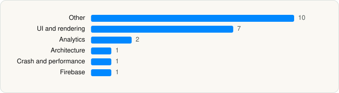

<picture><source media="(prefers-color-scheme: dark)" srcset="../../../../assets/logo/logo-dark.svg"></picture> [Tech Stack](../../../../README.md) / [Wikibuy, LLC](../../../../companies/wikibuy-llc.md) / Capital One Shopping

# Capital One Shopping: Save Now

<picture><source media="(prefers-color-scheme: dark)" srcset="../../../../assets/badges/ios-dark.svg"></picture> <picture><source media="(prefers-color-scheme: dark)" srcset="../../../../assets/badges/active-dark.svg"></picture> <picture><source media="(prefers-color-scheme: dark)" srcset="../../../../assets/badges/floor-dark.svg"></picture> <picture><source media="(prefers-color-scheme: dark)" srcset="../../../../assets/badges/encrypted-dark.svg"></picture>

[App Store](https://apps.apple.com/app/id1089294040) · [latest.json](latest.json)

| | |
|---|---|
| Company | [Wikibuy, LLC](../../../../companies/wikibuy-llc.md) |
| Store id | `1089294040` |
| Bundle / package id | `com.wikibuy.prod.main` |
| Latest version | 2.162.0 (analysed 2026-11-04) |
| Versions tracked | 1 |
| SDKs in latest version | 22 |
| Languages | C/C++, Metal (shaders), Objective-C, React Native / JavaScript, Swift |
| UI | Lottie (animations), SwiftUI, UIKit |
| Build | Swift Package Manager (SwiftPM) |
| Minimum OS | iOS 16.6 (built with Xcode 26.2, SDK iphoneos26.2) |
| Devices / ABIs | iPhone, iPad |
| Localisations | 0 |
| Capabilities | 7 |
| Declares tracking | Yes |
| Tracked | Yes |

## SDKs by category

<picture><source media="(prefers-color-scheme: dark)" srcset="../../../../assets/charts/apps/ios/wikibuy-llc/capital-one-shopping-dark.svg"></picture>

- **Other** (10): APIGuard 4.6.0, EXConstants 55.0.17, GLiNERCoreML, hermesvm 0.12.0, Lodash, Moment.js, RNDeviceInfoPrivacyInfo 15.0.2, RNPermissionsPrivacyInfo 5.6.3, TrustKit 3.0.7, www
- **UI and rendering** (7): FlashList, Lottie 4.6.0, React Native, React Native Reanimated, react-native-svg, RNSVGFilters 15.16.0, SDWebImage 5.18.12
- **Analytics** (2): Amplitude, Kochava 7.6.0
- **Architecture** (1): React Navigation
- **Crash and performance** (1): NewRelic 7.7.9
- **Firebase** (1): Firebase

Frameworks (25)

AdServices (Apple Search Ads attribution), AdSupport (IDFA), App Tracking Transparency (ATT), AVFoundation (audio/video), AVKit, Background Tasks, Combine (reactive), Core Image, Core Location, Core ML, Core Motion, CryptoKit, DeviceCheck / App Attest, Local Authentication (Face ID / Touch ID), Media Player, MessageUI (mail / SMS compose), Natural Language, Network.framework, Photos, SafariServices, SiriKit (Intents), StoreKit (in-app purchase), SwiftUI, UIKit, User Notifications

Capabilities (7)

App Groups, Apple Pay, Associated Domains (Universal Links), Background App Refresh, Background Push, Keychain Sharing, Push Notifications (APNs)

## Version history

| Version | Analysed | Store update | SDKs | Change | SDK list is a floor | Binary encrypted | File |
|---|---|---|---|---|---|---|---|
| 2.162.0 | 2026-11-04 | 2026-11-03 | 22 |  | Yes | Yes | [2.162.0.json](2.162.0.json) |

---

Generated by `scripts/build_readme.py` from the JSON files. Do not edit by hand.
