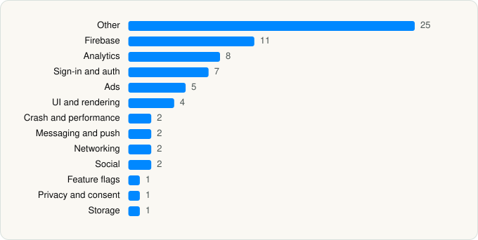

<picture><source media="(prefers-color-scheme: dark)" srcset="../../../../assets/logo/logo-dark.svg"></picture> [Tech Stack](../../../../README.md) / [WORXPHERE LLC.](../../../../companies/worxphere-llc.md) / 알바몬

# 알바몬 - 대한민국 1위 아르바이트 플랫폼

<picture><source media="(prefers-color-scheme: dark)" srcset="../../../../assets/badges/ios-dark.svg"></picture> <picture><source media="(prefers-color-scheme: dark)" srcset="../../../../assets/badges/inactive-dark.svg"></picture> <picture><source media="(prefers-color-scheme: dark)" srcset="../../../../assets/badges/floor-dark.svg"></picture> <picture><source media="(prefers-color-scheme: dark)" srcset="../../../../assets/badges/encrypted-dark.svg"></picture>

[App Store](https://apps.apple.com/app/id382535825) · [latest.json](latest.json)

| | |
|---|---|
| Company | [WORXPHERE LLC.](../../../../companies/worxphere-llc.md) |
| Store id | `382535825` |
| Bundle / package id | `kr.co.jobkorea.AlbamonMJ` |
| Latest version | 7.4.25 (analysed 2026-11-21) |
| Versions tracked | 1 |
| SDKs in latest version | 71 |
| Languages | C/C++, Flutter / Dart, Metal (shaders), Objective-C, Swift |
| UI | Lottie (animations), SwiftUI, UIKit |
| Build | Swift Package Manager (SwiftPM) |
| Minimum OS | iOS 16.0 (built with Xcode 27.1, SDK iphoneos27.1) |
| Devices / ABIs | iPhone, iPad |
| Localisations | 0 |
| Capabilities | 6 |
| Declares tracking | Yes |
| Tracked | No. Kept for history. |

## SDKs by category

<picture><source media="(prefers-color-scheme: dark)" srcset="../../../../assets/charts/apps/ios/worxphere-llc/app-dark.svg"></picture>

- **Other** (25): AdFitSDK 3.19.9, AdPopcornSSP 1.0, AdsGlobalSDK 7.8.0, apple 1.2.0, CenteredCollectionView 2.2.2, darwin 0.0.4, FacebookBasics, FBSDKGamingServicesKit 1.0, Flutter 1.0, foundation 0.0.1, ImageScrollView 1.9.3, KakaoSDKCertCore 2.24.5, KakaoSDKCommon, KakaoSDKFriendCore 2.24.5, map 1.4.0, NMapsGeometry 1.0.2, NMapsMap 3.22.1, OrderedSet 6.0.3, PAGAdSDK 7.8.0, plus 0.0.1, SideMenuSwift 2.0.10, TikTokBusinessSDK 7.8.0, TnkRwdSdk2 1.0, wkwebview 0.0.1, ZLPhotoBrowser
- **Firebase** (11): FBLPromises 2.4.1, Firebase 12.15.0, FirebaseCore 12.15.0, FirebaseCoreInternal 12.15.0, FirebaseInstallations 12.15.0, FirebasePerformance 12.15.0, FirebaseRemoteConfig 12.15.0, GoogleDataTransport 10.1.0, GoogleUtilities 8.1.1, nanopb 3.30910.0, Promises 2.4.1
- **Analytics** (8): Adjust 1.0, AppsFlyerLib 1.0, BrazeKit 18.2.1, FacebookAEM, FacebookCore, FBAEMKit 1.0, FBSDKCoreKit 1.0, FirebaseAnalytics
- **Sign-in and auth** (7): AppAuth 1.7.6, FacebookLogin, FBSDKLoginKit 1.0, GoogleSignIn 7.1.0, GTMAppAuth 4.1.1, GTMSessionFetcher 3.5.0, NaverThirdPartyLogin 4.2.3
- **Ads** (5): AppLovin 13.5.1, FBAudienceNetwork 6.20.1, Google Mobile Ads (AdMob), GoogleMobileAds 12.14.0, VungleAds 7.6.2
- **UI and rendering** (4): Kingfisher, Lottie, SDWebImage, SnapKit
- **Crash and performance** (2): FirebaseCrashlytics 12.15.0, Sentry 8.46.0
- **Messaging and push** (2): BrazeNotificationService 18.2.1, BrazeUI 7.4.25
- **Networking** (2): Alamofire, Starscream
- **Social** (2): FacebookShare, FBSDKShareKit 1.0
- **Feature flags** (1): Statsig 1.62.2
- **Privacy and consent** (1): UserMessagingPlatform 3.1.0
- **Storage** (1): FLAnimatedImage 1.0.17

Frameworks (31)

ActivityKit (Live Activities), AdServices (Apple Search Ads attribution), AdSupport (IDFA), App Tracking Transparency (ATT), Authentication Services (Sign in with Apple / passkeys), AVFoundation (audio/video), AVKit, Combine (reactive), Core Data, Core Image, Core Location, Core ML, Core Motion, CryptoKit, DeviceCheck / App Attest, EventKit (Calendar / Reminders), Local Authentication (Face ID / Touch ID), Media Player, MessageUI (mail / SMS compose), MetalKit, MetricKit (diagnostics), Network.framework, Photos, PhotosUI, SafariServices, SceneKit, StoreKit (in-app purchase), SwiftUI, UIKit, User Notifications, WidgetKit (widgets)

Capabilities (6)

App Groups, Associated Domains (Universal Links), Background Push, Keychain Sharing, Push Notifications (APNs), Sign in with Apple

## Version history

| Version | Analysed | Store update | SDKs | Change | SDK list is a floor | Binary encrypted | File |
|---|---|---|---|---|---|---|---|
| 7.4.25 | 2026-11-21 |  | 71 |  | Yes | Yes | [7.4.25.json](7.4.25.json) |

---

Generated by `scripts/build_readme.py` from the JSON files. Do not edit by hand.
