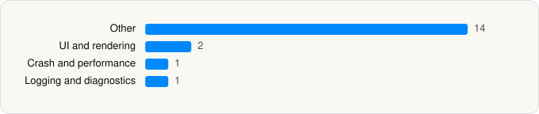

<picture><source media="(prefers-color-scheme: dark)" srcset="../../../../assets/logo/logo-dark.svg"></picture> [Tech Stack](../../../../README.md) / [X Corp.](../../../../companies/x-corp.md) / Grok Bot

# Grok Bot

<picture><source media="(prefers-color-scheme: dark)" srcset="../../../../assets/badges/ios-dark.svg"></picture> <picture><source media="(prefers-color-scheme: dark)" srcset="../../../../assets/badges/active-dark.svg"></picture> <picture><source media="(prefers-color-scheme: dark)" srcset="../../../../assets/badges/floor-dark.svg"></picture> <picture><source media="(prefers-color-scheme: dark)" srcset="../../../../assets/badges/encrypted-dark.svg"></picture>

[App Store](https://apps.apple.com/app/id6794501026) · [latest.json](latest.json)

| | |
|---|---|
| Company | [X Corp.](../../../../companies/x-corp.md) |
| Store id | `6794501026` |
| Bundle / package id | `co.anysphere.sand` |
| Latest version | 1.0.0 (analysed 2026-08-11) |
| Versions tracked | 1 |
| SDKs in latest version | 18 |
| Languages | C/C++, Metal (shaders), Objective-C, React Native / JavaScript, Swift |
| UI | SwiftUI, UIKit |
| Build | Swift Package Manager (SwiftPM) |
| Minimum OS | iOS 18.0 (built with Xcode 26.4.1, SDK iphoneos26.4) |
| Devices / ABIs | iPhone |
| Localisations | 0 |
| Capabilities | 2 |
| Declares tracking | No |
| Tracked | Yes |

## SDKs by category

<picture><source media="(prefers-color-scheme: dark)" srcset="../../../../assets/charts/apps/ios/x-corp/grok-bot-dark.svg"></picture>

- **Other** (14): boost, EXConstants 57.0.5, ExpoFileSystem 1.0, ExpoImage 1.0, ExpoMediaLibrary 1.0, ExpoModulesCore 1.0, ExpoModulesJSI 1.0, ExpoModulesWorklets 1.0, ExpoVideo 1.0, folly, hermesvm 1.0.0, libavif 1.0, React 1.0, ReactNativeDependencies 1.0
- **UI and rendering** (2): RNSVGFilters 15.15.4, SDWebImage 1.0
- **Crash and performance** (1): Sentry 8.56.1
- **Logging and diagnostics** (1): glog

Frameworks (24)

Authentication Services (Sign in with Apple / passkeys), AVFoundation (audio/video), AVKit, Combine (reactive), Core Data, Core Image, Core Location, Core Motion, CryptoKit, Local Authentication (Face ID / Touch ID), Media Player, MetricKit (diagnostics), Network.framework, PDFKit, Photos, PhotosUI, SafariServices, StoreKit (in-app purchase), Swift Charts, SwiftUI, UIKit, User Notifications, VisionKit (document/data scanning), WidgetKit (widgets)

Capabilities (2)

Background Audio, Push Notifications (APNs)

## Version history

| Version | Analysed | Store update | SDKs | Change | SDK list is a floor | Binary encrypted | File |
|---|---|---|---|---|---|---|---|
| 1.0.0 | 2026-08-11 |  | 18 |  | Yes | Yes | [1.0.0.json](1.0.0.json) |

## Model-written summary

> Hybrid React Native-SwiftUI iOS app with Expo, Hermes, 2 Metal shaders, Sentry, and biometric auth; FairPlay-encrypted binary hides backends

Written by a language model from the detected signals (`inferred[]`). It is commentary, not measurement.

---

Generated by `scripts/build_readme.py` from the JSON files. Do not edit by hand.
