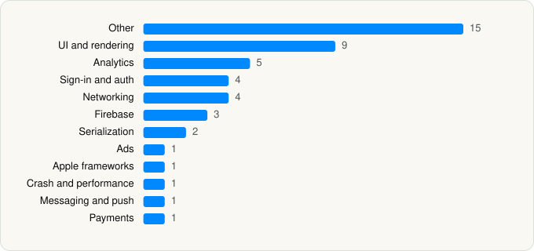

<picture><source media="(prefers-color-scheme: dark)" srcset="../../../../assets/logo/logo-dark.svg"></picture> [Tech Stack](../../../../README.md) / [X Corp.](../../../../companies/x-corp.md) / Grok

# Grok - AI Chat & Video

<picture><source media="(prefers-color-scheme: dark)" srcset="../../../../assets/badges/ios-dark.svg"></picture> <picture><source media="(prefers-color-scheme: dark)" srcset="../../../../assets/badges/active-dark.svg"></picture> <picture><source media="(prefers-color-scheme: dark)" srcset="../../../../assets/badges/floor-dark.svg"></picture> <picture><source media="(prefers-color-scheme: dark)" srcset="../../../../assets/badges/encrypted-dark.svg"></picture>

[App Store](https://apps.apple.com/app/id6670324846) · [latest.json](latest.json)

| | |
|---|---|
| Company | [X Corp.](../../../../companies/x-corp.md) |
| Store id | `6670324846` |
| Bundle / package id | `ai.x.GrokApp` |
| Latest version | 1.4.58 (analysed 2026-10-24) |
| Versions tracked | 13 |
| SDKs in latest version | 47 |
| Languages | C/C++, Metal (shaders), Objective-C, Swift |
| UI | Intercom UI, Lottie (animations), SwiftUI, UIKit |
| Build | Swift Package Manager (SwiftPM) |
| Minimum OS | iOS 17 (built with Xcode 27.1, SDK iphoneos27.1) |
| Devices / ABIs | iPhone, iPad |
| Localisations | 43 |
| Capabilities | 12 |
| Declares tracking | No |
| Tracked | Yes |

## SDKs by category

<picture><source media="(prefers-color-scheme: dark)" srcset="../../../../assets/charts/apps/ios/x-corp/grok-dark.svg"></picture>

- **Other** (15): beautiful-mermaid-swift, CastleSDK 4.3.2, elk-swift, Files, Hightouch, ios-sdk, SimpleKeychain, swift-atomics, swift-cmark, swift-nio, swift-nio-http2, swift-nio-ssl, swift-secp256k1, swift-system, swiftui-introspect
- **UI and rendering** (9): Highlight.js 11.9.0, Highlighter, Lottie 4.6.0, Markdownosaur, MarkdownView, MathJax, MathJaxSwift, Nuke, swift-markdown
- **Analytics** (5): AppsFlyerLib 1.0, BrazeKit 14.1.0, Mixpanel, TikTokOpenSDK, TikTokOpenShareSDK
- **Sign-in and auth** (4): AppAuth, GoogleSignIn, GTMAppAuth, GTMSessionFetcher
- **Networking** (4): connect-swift, NIOPosix, NIOSSL, Starscream
- **Firebase** (3): FBLPromises, GoogleUtilities, nanopb
- **Serialization** (2): swift-protobuf, SwiftProtobuf
- **Ads** (1): GoogleAdsOnDeviceConversion 3.6.0
- **Apple frameworks** (1): swift-collections
- **Crash and performance** (1): Sentry 8.49.1
- **Messaging and push** (1): Intercom 19.6.3
- **Payments** (1): LinkKit

Frameworks (33)

ActivityKit (Live Activities), AdServices (Apple Search Ads attribution), AdSupport (IDFA), App Intents, App Tracking Transparency (ATT), Authentication Services (Sign in with Apple / passkeys), AVFoundation (audio/video), AVKit, Background Tasks, CallKit (VoIP), Combine (reactive), Core Data, Core Image, Core Location, Core ML, Core Motion, CryptoKit, DeviceCheck / App Attest, Local Authentication (Face ID / Touch ID), MapKit, Media Player, MetalKit, MetricKit (diagnostics), Network.framework, Photos, PhotosUI, SafariServices, SiriKit (Intents), StoreKit (in-app purchase), SwiftUI, UIKit, User Notifications, WidgetKit (widgets)

Capabilities (12)

App Attest, App Groups, Associated Domains (Universal Links), Background App Refresh, Background Audio, Background Processing, Background Push, CarPlay, Communication Notifications, Keychain Sharing, Push Notifications (APNs), Sign in with Apple

## Version history

| Version | Analysed | Store update | SDKs | Change | SDK list is a floor | Binary encrypted | File |
|---|---|---|---|---|---|---|---|
| 1.4.58 | 2026-10-24 | 2026-10-23 | 47 | +6 / −32 | Yes | Yes | [1.4.58.json](1.4.58.json) |
| 1.4.28 | 2026-11-02 | 2026-08-21 | 73 | +0 / −0 | Yes | Yes | [1.4.28.json](1.4.28.json) |
| 1.4.26 | 2026-08-18 | 2026-08-18 | 73 | +0 / −0 | Yes | Yes | [1.4.26.json](1.4.26.json) |
| 1.4.25 | 2026-08-16 | 2026-08-16 | 73 | +0 / −0 | Yes | Yes | [1.4.25.json](1.4.25.json) |
| 1.4.24 | 2026-08-15 | 2026-08-14 | 73 | +0 / −0 | Yes | Yes | [1.4.24.json](1.4.24.json) |
| 1.4.22 | 2026-08-15 | 2026-08-07 | 73 | +0 / −0 | Yes | Yes | [1.4.22.json](1.4.22.json) |
| 1.4.20 | 2026-08-06 | 2026-08-05 | 73 | +0 / −0 | Yes | Yes | [1.4.20.json](1.4.20.json) |
| 1.4.19 | 2026-08-04 | 2026-08-03 | 73 | +2 / −0 | Yes | Yes | [1.4.19.json](1.4.19.json) |
| 1.4.17 | 2026-07-31 | 2026-07-30 | 71 | +0 / −0 | Yes | Yes | [1.4.17.json](1.4.17.json) |
| 1.4.15 | 2026-07-31 | 2026-07-27 | 71 | +0 / −0 | Yes | Yes | [1.4.15.json](1.4.15.json) |
| 1.4.14 | 2026-07-29 | 2026-07-25 | 71 | +1 / −0 | Yes | Yes | [1.4.14.json](1.4.14.json) |
| 1.3.87 | 2026-06-23 |  | 70 | +14 / −1 | Yes | Yes | [1.3.87.json](1.3.87.json) |
| 1.3.86 | 2026-06-03 |  | 57 |  | Yes | Yes | [1.3.86.json](1.3.86.json) |

### SDK changes between versions

- 1.4.28 → 1.4.58: added beautiful-mermaid-swift, elk-swift, GoogleAdsOnDeviceConversion, Hightouch, LinkKit, nanopb; removed Autodesk FBX, Bakery (lightmapper), Cinemachine (camera), Deepgram speech, ElevenLabs TTS, Google API GAX (.NET), Google APIs (.NET), Google LongRunning, Google Speech-to-Text, Graphy (perf HUD), Groq API, gRPC (.NET), LWGUI, MagicaCloth (cloth physics), Microsoft.Bcl, Microsoft.Extensions (.NET), Newtonsoft.Json, NiloToon (toon shader), OpenAI API, Polly (resilience), Protobuf, Serilog, uLipSync (lip-sync), Unity Addressables, Unity Animation Rigging, Unity RenderPipelines Core, Unity ResourceManager, Unity TextMeshPro, Unity Timeline, Unity Universal Render Pipeline, UnityFramework, Volumetric Light Beam
- 1.4.17 → 1.4.19: added Highlighter, MathJaxSwift
- 1.3.87 → 1.4.14: added CastleSDK
- 1.3.86 → 1.3.87: added Deepgram speech, ElevenLabs TTS, Google Speech-to-Text, Groq API, Highlight.js, MathJax, OpenAI API, Unity Addressables, Unity Animation Rigging, Unity RenderPipelines Core, Unity ResourceManager, Unity TextMeshPro, Unity Timeline, Unity Universal Render Pipeline; removed SwiftUIX

---

Generated by `scripts/build_readme.py` from the JSON files. Do not edit by hand.
