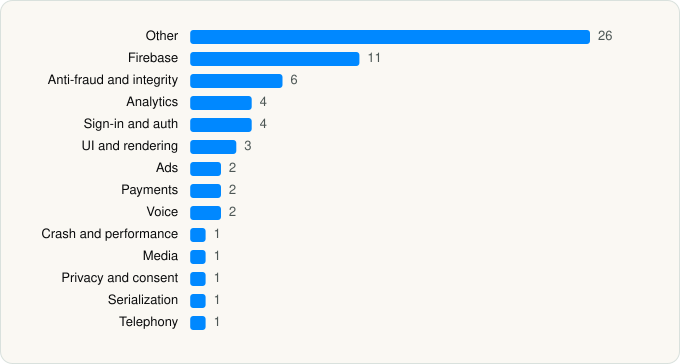

<picture><source media="(prefers-color-scheme: dark)" srcset="../../../../assets/logo/logo-dark.svg"></picture> [Tech Stack](../../../../README.md) / [X Corp.](../../../../companies/x-corp.md) / X

# X

<picture><source media="(prefers-color-scheme: dark)" srcset="../../../../assets/badges/ios-dark.svg"></picture> <picture><source media="(prefers-color-scheme: dark)" srcset="../../../../assets/badges/inactive-dark.svg"></picture> <picture><source media="(prefers-color-scheme: dark)" srcset="../../../../assets/badges/floor-dark.svg"></picture> <picture><source media="(prefers-color-scheme: dark)" srcset="../../../../assets/badges/encrypted-dark.svg"></picture>

[App Store](https://apps.apple.com/app/id333903271) · [latest.json](latest.json)

| | |
|---|---|
| Company | [X Corp.](../../../../companies/x-corp.md) |
| Store id | `333903271` |
| Bundle / package id | `com.atebits.Tweetie2` |
| Latest version | 11.97 (analysed 2026-06-23) |
| Versions tracked | 1 |
| SDKs in latest version | 65 |
| Languages | C/C++, Metal (shaders), Objective-C, Swift |
| UI | SwiftUI, UIKit |
| Build | Swift Package Manager (SwiftPM) |
| Minimum OS | iOS 15.0 (built with Xcode 26.4, SDK iphoneos26.4) |
| Devices / ABIs | iPhone, iPad |
| Localisations | 43 |
| Capabilities | 14 |
| Declares tracking | No |
| Tracked | No. Kept for history. |

## SDKs by category

<picture><source media="(prefers-color-scheme: dark)" srcset="../../../../assets/charts/apps/ios/x-corp/x-dark.svg"></picture>

- **Other** (26): C2PAC 1.0, CastleSDK 1.0, CodeScanner, Grok, MobileIntelligence 1.1.21, OCFTestKit, PalmAPISaas 1.0.0, PeriscopeSDK, PinwheelSDK 1.0, Prelude 1.0, PreludeCore 1.0, Profile, SocureDocV 5.4.1, Stamps, SwiftUIIntrospect 1.0, T1Twitter 1.0, TFNUI, TFSFeatureSwitchesUI 1.0, TFSLocalizedUtilities, TFXParametersUI, TGIFilters, Threads, TSATwitterAppleSystemAuthorizationServiceManagerKit, XCoreLibraries 1.0, XDSFoundation, XKotlin 1.0
- **Firebase** (11): AppCheck 11.2.0, FBLPromises 2.4.0, Firebase 11.14.0, FirebaseCore 11.14.0, FirebaseCoreInternal 11.14.0, FirebaseInstallations 11.14.0, FirebaseRemoteConfig 11.14.0, GoogleDataTransport 10.1.0, GoogleUtilities 8.1.0, nanopb 3.30910.0, Promises 2.4.0
- **Anti-fraud and integrity** (6): DeviceRisk 4.8.1, FaceLivenessCore, Persona2, VeryAILiveness 1.0.50, XFaceLiveness 1.0, XPalmLiveness
- **Analytics** (4): BrazeKit 14.1.0, FirebaseAnalytics 11.14.0, GoogleAppMeasurement 11.14.0, GoogleAppMeasurementIdentitySupport 11.14.0
- **Sign-in and auth** (4): AppAuth 1.7.6, GoogleSignIn 8.0.0, GTMAppAuth 4.1.1, GTMSessionFetcher 3.5.0
- **UI and rendering** (3): Highlight.js 11.9.0, MarkdownView, MathJax
- **Ads** (2): Google Mobile Ads (AdMob), GoogleMobileAds 11.13.0
- **Payments** (2): LinkKit 6.4.7, Payments
- **Voice** (2): LiveKit, WebRTC 1.0
- **Crash and performance** (1): FirebaseCrashlytics 11.14.0
- **Media** (1): LHLSLib 1.0
- **Privacy and consent** (1): UserMessagingPlatform 2.7.0
- **Serialization** (1): SwiftProtobuf
- **Telephony** (1): PhoneNumberKit

Frameworks (44)

ActivityKit (Live Activities), AdServices (Apple Search Ads attribution), AdSupport (IDFA), App Intents, App Tracking Transparency (ATT), Authentication Services (Sign in with Apple / passkeys), AVFoundation (audio/video), AVKit, Background Tasks, CallKit (VoIP), CloudKit, Combine (reactive), Contacts, Core Image, Core Location, Core ML, Core Motion, CryptoKit, DeviceCheck / App Attest, EventKit (Calendar / Reminders), Local Authentication (Face ID / Touch ID), MapKit, Media Player, MessageUI (mail / SMS compose), MetalKit, MetricKit (diagnostics), Network.framework, PassKit (Wallet / Apple Pay), PDFKit, PencilKit, Photos, PhotosUI, PushKit (VoIP push), SafariServices, SceneKit, SiriKit (Intents), Speech (recognition), StoreKit (in-app purchase), Swift Charts, SwiftUI, UIKit, User Notifications, Vision, WidgetKit (widgets)

Capabilities (14)

App Attest, App Groups, Associated Domains (Universal Links), Background App Refresh, Background Audio, Background Push, Communication Notifications, Keychain Sharing, Push Notifications (APNs), Sign in with Apple, SiriKit, Time-Sensitive Notifications, VoIP, Wallet passes

## Version history

| Version | Analysed | Store update | SDKs | Change | SDK list is a floor | Binary encrypted | File |
|---|---|---|---|---|---|---|---|
| 11.97 | 2026-06-23 |  | 65 |  | Yes | Yes | [11.97.json](11.97.json) |

## Model-written summary

> Native iOS app for X with Swift, SwiftUI/UIKit, 5 Metal shaders, Core ML face models, LiveKit, Grok, and X/Twitter backends

Written by a language model from the detected signals (`inferred[]`). It is commentary, not measurement.

---

Generated by `scripts/build_readme.py` from the JSON files. Do not edit by hand.
