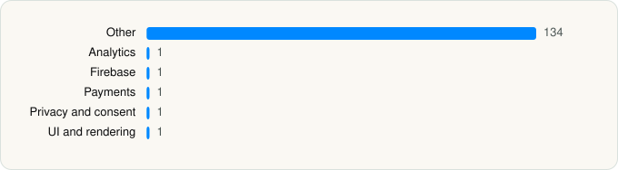

<picture><source media="(prefers-color-scheme: dark)" srcset="../../../../assets/logo/logo-dark.svg"></picture> [Tech Stack](../../../../README.md) / [Xingin](../../../../companies/xingin.md) / rednote

# rednote

<picture><source media="(prefers-color-scheme: dark)" srcset="../../../../assets/badges/ios-dark.svg"></picture> <picture><source media="(prefers-color-scheme: dark)" srcset="../../../../assets/badges/active-dark.svg"></picture> <picture><source media="(prefers-color-scheme: dark)" srcset="../../../../assets/badges/floor-dark.svg"></picture> <picture><source media="(prefers-color-scheme: dark)" srcset="../../../../assets/badges/encrypted-dark.svg"></picture>

[App Store](https://apps.apple.com/app/id741292507) · [latest.json](latest.json)

| | |
|---|---|
| Company | [Xingin](../../../../companies/xingin.md) |
| Store id | `741292507` |
| Bundle / package id | `com.xingin.discover` |
| Latest version | 9.51.1 (analysed 2026-10-24) |
| Versions tracked | 1 |
| SDKs in latest version | 139 |
| Languages | C/C++, Metal (shaders), Objective-C, Swift |
| UI | Lottie (animations), SwiftUI, UIKit |
| Build | Swift Package Manager (SwiftPM) |
| Minimum OS | iOS 15.0 (built with Xcode 27.1, SDK iphoneos27.1) |
| Devices / ABIs | iPhone, iPad |
| Localisations | 12 |
| Capabilities | 17 |
| Declares tracking | Yes |
| Tracked | Yes |

## SDKs by category

<picture><source media="(prefers-color-scheme: dark)" srcset="../../../../assets/charts/apps/ios/xingin/rednote-dark.svg"></picture>

- **Other** (134): AlipaySDK, AMSElement, AMSFoundation, Bifrost 4.0.715, DSLTemplate 0.1.14, Hey 0.1.13, IAPLogLite, IAPProviderManager, IQKeyboardManager, IWebContainer, KasaSDK 1.0.0, MJRefresh, QMapKit, RedI18N 1.2.178, RedNQE 9.39.5, rn-resource-hermes-72, Sources 0.0.1, TencentCloudHuiyanSDKFace 8.14.0, TencentRTCSDK 1.0, TXFFmpeg 1.0, TXSoundTouch 1.0, XHSApplet 4.25.11, XHSPrivacyGuard 1.0.16, XYAdsBase 1.3.0, XYAdsBusiness 0.0.1, XYAdsSplash 0.2.1, XYADVendorReturnManager 0.2.0, XYAGI 0.1.0, XYAlertCenter 0.4.64, XYAlphaShare 0.0.1, XYAPIRoute 2.1.261, XYApplicationModule 0.1.1, XYASDKNoteCardComponent 0.2.0, XYAuthFlowKit 1.1.0, XYAVCamera 0.2.0, XYAVKit 0.2.0, XYBarley 0.2.103, XYBCIM 0.0.1, XYCanvas 9.48.1, XYCMusicPlayer 0.1.0, XYCNYAtmosphereKit 0.1.0, XYCommentBar 0.2.5, XYCommentUtils 0.0.1, XYComponentKit 0.5.0, XYDeveloperKit 0.7.151, XYDots 0.0.1, XYDotsAgentPage 0.1.0, XYDotsBase 1.0.12, XYDotsComponent 1.0.16, XYEmojiConvert 0.0.21, XYExploreModule 1.6.0, XYFeedLandRecommend 0.2.4, XYFoundation 0.2.31, XYGlobalBusinessModules 0.0.1, XYGoodsDetail 9.49.12, XYHomeModule 0.1.3, XYHula 0.0.1, XYHybridJSEngine 0.0.12, XYHybridModule 0.5.308, XYImageCropKit 0.2.38, XYiOSMathKit 1.0.4, XYJavaScriptKit 1.0.27, XYLiveKit 0.0.2, XYLivePlayManager 0.1.0, XYLiveUIKit 0.0.1, XYLocalModule 0.1.0, XYMapBiz, XYMediaBrowser 0.0.59, XYMediaFfmpeg 1.0, XYMenuButton 0.2.0, XYMerchantBridge 1.0.41, XYMessageUIKit 1.2.5, XYNegativeFeedback 0.2.0, XYNewUserPresent 0.1.0, XYNoteBasic 0.2.6, XYNoteCardComponent 0.0.4, XYNoteModule 0.1.6, XYOldNoteModule 0.0.4, XYPBPhotoBrowser 1.3.48, XYPHBindPhoneManager 0.2.0, XYPHBoard 0.1.0, XYPHNotificationManager 0.3.0, XYPhotosKit 0.1.120, XYPhotosUIKit 0.0.1, XYPHPhoneZonesViewController, XYPHProfile 0.1.0, XYPHSetting 0.1.2, XYPHUserList 0.1.0, XYPMFileManager 0.0.1, XYPodcastCore 0.0.1, XYPodcastModule 0.0.1, XYPOILocation 0.0.1, XYPopMessageBox, XYPostBeautyKit 0.1.0, XYPostKit 3.13.6, XYPostParallelModule 0.1.1, XYPrivacy 0.2.57, XYProAccountC2C 0.1.0, XYPullToRefresh 0.2.36, XYQRCode 0.1.78, XYRainbow, XYRedLocation, XYRedMedia 0.0.1, XYResizableKit 1.0.8, XYSearchBar 0.3.1, XYSearchImageModule 0.1.1, XYSearchKit 0.21.2, XYSearchPlaceholderManager 0.0.13, XYSecurity 1.1.40, XYSemiModalPresenter 0.2.0, XYSettlement 1.0.286, XYSharingUIKit 0.1.0, XYShopExtension 0.1.0, XYShopping 0.1.0, XYSparkModule 2.1.17, XYSurpriceBox 0.0.1, XYTagOverlayer 0.2.0, XYTeenagerModeKit 0.1.0, XYTesseract 0.0.1, XYTextKit 0.4.0, XYTipsManager 0.1.0, XYTradeDiversion 1.0.9, XYTradeFMP 1.0.51, XYTXLivePusherFramework 1.0, XYUIKit 1.0.89, XYUITheme 0.2.334, XYUniCore 1.0, XYUserAvatar 0.3.0, XYUserGrowth 0.1.0, XYUserProfileSetting 0.1.0, XYVideoCast 0.0.1, XYVideoDetail 0.0.1, XYVision 0.0.243, XYWidgetExtension 0.1.0
- **Analytics** (1): AppsFlyerLib 1.0
- **Firebase** (1): GoogleUtilities 8.1.0
- **Payments** (1): AMSPaymentCheckout
- **Privacy and consent** (1): XYConsent 1.0.7
- **UI and rendering** (1): XYLottieAnimationView 0.2.0

Frameworks (43)

ActivityKit (Live Activities), AdServices (Apple Search Ads attribution), AdSupport (IDFA), App Intents, App Tracking Transparency (ATT), Authentication Services (Sign in with Apple / passkeys), AVFoundation (audio/video), AVKit, Background Tasks, Combine (reactive), Contacts, Core Bluetooth, Core Image, Core Location, Core ML, Core Motion, Core NFC, CryptoKit, DeviceCheck / App Attest, EventKit (Calendar / Reminders), HealthKit, HomeKit, Local Authentication (Face ID / Touch ID), MapKit, Media Player, MessageUI (mail / SMS compose), MetalKit, MetricKit (diagnostics), Natural Language, Network.framework, PassKit (Wallet / Apple Pay), Photos, PhotosUI, SafariServices, SceneKit, SiriKit (Intents), Speech (recognition), StoreKit (in-app purchase), SwiftUI, UIKit, User Notifications, Vision, WidgetKit (widgets)

Capabilities (17)

App Groups, Apple Pay, Associated Domains (Universal Links), Background App Refresh, Background Audio, Background Location, Background Processing, Background Push, Communication Notifications, HealthKit, Keychain Sharing, NFC, Push Notifications (APNs), Sign in with Apple, SiriKit, Time-Sensitive Notifications, Wallet passes

## Version history

| Version | Analysed | Store update | SDKs | Change | SDK list is a floor | Binary encrypted | File |
|---|---|---|---|---|---|---|---|
| 9.51.1 | 2026-10-24 | 2026-10-20 | 139 |  | Yes | Yes | [9.51.1.json](9.51.1.json) |

---

Generated by `scripts/build_readme.py` from the JSON files. Do not edit by hand.
