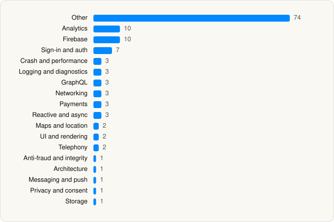

<picture><source media="(prefers-color-scheme: dark)" srcset="../../../../assets/logo/logo-dark.svg"></picture> [Tech Stack](../../../../README.md) / [YEMEK SEPETI ELEKTRONIK ILETISIM PERAKENDE GIDA LOJISTIK ANONIM SIRKETI](../../../../companies/yemek-sepeti-elektronik-iletisim-perakende-gida-lojistik-ano.md) / Yemeksepeti

# Yemeksepeti: Food & Grocery

<picture><source media="(prefers-color-scheme: dark)" srcset="../../../../assets/badges/ios-dark.svg"></picture> <picture><source media="(prefers-color-scheme: dark)" srcset="../../../../assets/badges/inactive-dark.svg"></picture> <picture><source media="(prefers-color-scheme: dark)" srcset="../../../../assets/badges/floor-dark.svg"></picture> <picture><source media="(prefers-color-scheme: dark)" srcset="../../../../assets/badges/encrypted-dark.svg"></picture>

[App Store](https://apps.apple.com/app/id373034841) · [latest.json](latest.json)

| | |
|---|---|
| Company | [YEMEK SEPETI ELEKTRONIK ILETISIM PERAKENDE GIDA LOJISTIK ANONIM SIRKETI](../../../../companies/yemek-sepeti-elektronik-iletisim-perakende-gida-lojistik-ano.md) |
| Store id | `373034841` |
| Bundle / package id | `yemeksepeti.com.valensas` |
| Latest version | 26.46.0 (analysed 2026-11-22) |
| Versions tracked | 1 |
| SDKs in latest version | 130 |
| Languages | C/C++, Metal (shaders), Objective-C, Swift |
| UI | Lottie (animations), SwiftUI, UIKit |
| Build | Swift Package Manager (SwiftPM) |
| Minimum OS | iOS 15.0 (built with Xcode 26.0.1, SDK iphoneos26.0) |
| Devices / ABIs | iPhone |
| Localisations | 17 |
| Capabilities | 8 |
| Declares tracking | Yes |
| Tracked | No. Kept for history. |

## SDKs by category

<picture><source media="(prefers-color-scheme: dark)" srcset="../../../../assets/charts/apps/ios/yemek-sepeti-elektronik-iletisim-perakende-gida-lojistik-ano/yemeksepeti-dark.svg"></picture>

- **Other** (74): AdtechSDK 1.0, Auth 1.0, AvoInspector, Bento 1.0, Cart 1.0, CashierSDK 1.0, ChatSDK 1.0, ChatService 1.0, ChatUI 1.0, Configurations 1.0, ConfigurationsDataModels 1.0, ConfigurationsMockingSupport 1.0, Corporate 1.0, CountryPickerView 1.0, CustomerChat 1.0, DebugMenuInterface 1.0, DeepLinkKit 1.0, Deliveryhero3 1.6.4, DeliveryHeroImageProvider 1.0, DeliveryHeroNetwork 1.0, DesignTokensInterface 1.0, FeatureFlagIdentifiers 1.0, Filters 1.0, FiltersInterface 1.0, GroupOrdering 1.0, GroupOrderingKit 1.0, HelpCenter 1.0, HeroEssentials 1.0, HeroExperiments 1.0, HeroTracking 1.0, ImpressionTracking 1.0, Incentives 1.0, IncentivesAccessibility 1.0, IncentivesInterface 1.0, IncogniaCoreWrapper, IncogniaTrialWrapper, IncogniaWrapper, ItemReplacementSuggestions 1.0, ItemReplacementSuggestionsAccessibility 1.0, ItemReplacementSuggestionsInterface 1.0, Joker 1.0, KlarnaMobileSDK 2.6.28, LandingPage 1.0, LandingPageAccessibility 1.0, LandingPageInterface 1.0, Listing 1.0, ListingInterface 1.0, ListingUI 1.0, Location 1.0, Loyalty 1.0, MultiMaps 1.0, Offers 1.0, OrderTracking 1.0, PandoraAccessibilityIDs 1.0, PandoraDesignTokens 1.0, Partnership 1.0, PerseusCodegen 1.0, PerseusCommon 1.0, PerseusTypes 1.0, PickUp 1.0, PlannedOrders 1.0, ProBrandingInterface 1.0, Reordering 1.0, Search 1.0, Shadowing 1.0, Shake 17.1.0, Survey 1.0, TrackingUI 1.0, TrackingUIBrandYemeksepeti, TravelerWelcome 1.0, TravelerWelcomeInterface 1.0, UsercentricsUI, Verticals 1.0, xPay 1.0
- **Analytics** (10): Adjust 1.0, AdjustSdk, AnalyticsSDK 1.0, FacebookAEM, FacebookCore, FBAEMKit 1.0, FBSDKCoreKit 1.0, IosAnalyticsDebugger, Kronos, PerseusAnalytics 1.0
- **Firebase** (10): FBLPromises, Firebase, FirebaseCore, FirebaseCoreInternal, FirebaseInstallations, FirebaseRemoteConfig, GoogleDataTransport, GoogleUtilities 1.0, nanopb, Promises
- **Sign-in and auth** (7): AppAuth, FacebookLogin, FBSDKLoginKit 1.0, GoogleSignIn, GTMAppAuth, GTMSessionFetcher, InputBarAccessoryView 1.0
- **Crash and performance** (3): ObservabilityConfigurations 1.0, ObservabilityConfigurationsInterface 1.0, Sentry 9.32.0
- **Logging and diagnostics** (3): ConsoleLogging 1.0, PerseusLogging 1.0, UnifiedLogging 1.0
- **GraphQL** (3): Apollo 1, ApolloAPI 1, GraphQLSchema 1.0
- **Networking** (3): APIClient 1.0, HeroNetworking 1.0, Starscream 1.0
- **Payments** (3): Checkout 1.0, PaymentSDK, Subscription 1.0
- **Reactive and async** (3): RxCocoa 1.0, RxRelay 1.0, RxSwift 1.0
- **Maps and location** (2): GMSCore 6.122.0, GoogleMaps
- **UI and rendering** (2): Lottie 1.0, SDWebImage 1.0
- **Telephony** (2): libPhoneNumber 1.0, PhoneNumberKit 1.0
- **Anti-fraud and integrity** (1): Onfido 1.0
- **Architecture** (1): Swinject 1.0
- **Messaging and push** (1): BrazeUI 1.0
- **Privacy and consent** (1): Usercentrics 1.0
- **Storage** (1): PerformanceKit 1.0

Frameworks (35)

ActivityKit (Live Activities), AdServices (Apple Search Ads attribution), AdSupport (IDFA), App Tracking Transparency (ATT), Authentication Services (Sign in with Apple / passkeys), AVFoundation (audio/video), AVKit, Combine (reactive), Contacts, Core Data, Core Image, Core Location, Core ML, Core Motion, Core NFC, CryptoKit, DeviceCheck / App Attest, EventKit (Calendar / Reminders), Local Authentication (Face ID / Touch ID), MapKit, MessageUI (mail / SMS compose), MetricKit (diagnostics), Network.framework, PassKit (Wallet / Apple Pay), PDFKit, Photos, PhotosUI, SafariServices, SpriteKit, StoreKit (in-app purchase), SwiftUI, UIKit, User Notifications, Vision, WidgetKit (widgets)

Capabilities (8)

App Groups, Associated Domains (Universal Links), Background Audio, Background Location, Background Push, Push Notifications (APNs), Sign in with Apple, VoIP

## Version history

| Version | Analysed | Store update | SDKs | Change | SDK list is a floor | Binary encrypted | File |
|---|---|---|---|---|---|---|---|
| 26.46.0 | 2026-11-22 |  | 130 |  | Yes | Yes | [26.46.0.json](26.46.0.json) |

---

Generated by `scripts/build_readme.py` from the JSON files. Do not edit by hand.
