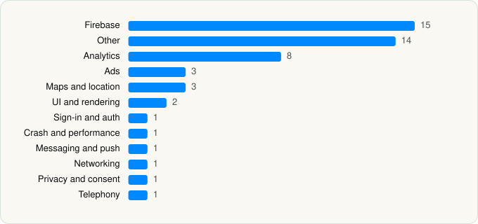

<picture><source media="(prefers-color-scheme: dark)" srcset="../../../../assets/logo/logo-dark.svg"></picture> [Tech Stack](../../../../README.md) / [YENİ MAĞAZACILIK ANONİM ŞİRKETİ](../../../../companies/yeni-magazacilik-anonim-sirketi.md) / A101

# A101: Tek Uygulama

<picture><source media="(prefers-color-scheme: dark)" srcset="../../../../assets/badges/ios-dark.svg"></picture> <picture><source media="(prefers-color-scheme: dark)" srcset="../../../../assets/badges/inactive-dark.svg"></picture> <picture><source media="(prefers-color-scheme: dark)" srcset="../../../../assets/badges/floor-dark.svg"></picture> <picture><source media="(prefers-color-scheme: dark)" srcset="../../../../assets/badges/encrypted-dark.svg"></picture>

[App Store](https://apps.apple.com/app/id1644664646) · [latest.json](latest.json)

| | |
|---|---|
| Company | [YENİ MAĞAZACILIK ANONİM ŞİRKETİ](../../../../companies/yeni-magazacilik-anonim-sirketi.md) |
| Store id | `1644664646` |
| Bundle / package id | `com.a101kapida.ios` |
| Latest version | 3.0.6 (analysed 2026-11-04) |
| Versions tracked | 1 |
| SDKs in latest version | 51 |
| Languages | C/C++, Metal (shaders), Objective-C, Swift |
| UI | Lottie (animations), SwiftUI, UIKit |
| Build | Swift Package Manager (SwiftPM) |
| Minimum OS | iOS 15.0 (built with Xcode 26.1.1, SDK iphoneos26.1) |
| Devices / ABIs | iPhone |
| Localisations | 1 |
| Capabilities | 7 |
| Declares tracking | Yes |
| Tracked | No. Kept for history. |

## SDKs by category

<picture><source media="(prefers-color-scheme: dark)" srcset="../../../../assets/charts/apps/ios/yeni-magazacilik-anonim-sirketi/a101-dark.svg"></picture>

- **Firebase** (15): abseil, FBLPromises, Firebase, FirebaseAuth, FirebaseCore, FirebaseCoreInternal, FirebaseFirestore, FirebaseInstallations, FirebaseRemoteConfig, GoogleDataTransport, GoogleUtilities, gRPC, leveldb, nanopb, Promises
- **Other** (14): absl 1.20240722.0, abslWrapper, Clarity 1.0, Cosmos, FacebookBasics, GoogleTagManager 9.0.0, InsiderGeofence 1.2.4, InsiderMobile 15.1.1, InsiderMobileAdvancedNotification 2.4.0, IQKeyboardManagerSwift, Managers, MapLibre 6.26.1, Masterpass 1.5.2, opensslWrapper
- **Analytics** (8): Adjust, FacebookAEM, FacebookCore, FBAEMKit 1.0, FBSDKCoreKit 1.0, FirebaseAnalytics 11.15.0, GoogleAppMeasurement 11.15.0, GoogleAppMeasurementIdentitySupport 11.15.0
- **Ads** (3): Google Mobile Ads (AdMob), GoogleAdsOnDeviceConversion 2.3.0, GoogleMobileAds 12.6.0
- **Maps and location** (3): GMSCore 25.0.0, GoogleMaps, Mapbox
- **UI and rendering** (2): Lottie 4.5.2, SkeletonView
- **Sign-in and auth** (1): GTMSessionFetcher
- **Crash and performance** (1): FirebaseCrashlytics
- **Messaging and push** (1): FirebaseMessaging
- **Networking** (1): Alamofire
- **Privacy and consent** (1): UserMessagingPlatform 3.1.0
- **Telephony** (1): PhoneNumberKit

Frameworks (22)

AdSupport (IDFA), App Tracking Transparency (ATT), Authentication Services (Sign in with Apple / passkeys), AVFoundation (audio/video), Combine (reactive), Contacts, Core Data, Core Image, Core Location, Core Motion, CryptoKit, DeviceCheck / App Attest, MapKit, MetalKit, MetricKit (diagnostics), Network.framework, Photos, SafariServices, StoreKit (in-app purchase), SwiftUI, UIKit, User Notifications

Capabilities (7)

App Groups, Associated Domains (Universal Links), Background App Refresh, Background Location, Background Push, Keychain Sharing, Push Notifications (APNs)

## Version history

| Version | Analysed | Store update | SDKs | Change | SDK list is a floor | Binary encrypted | File |
|---|---|---|---|---|---|---|---|
| 3.0.6 | 2026-11-04 | 2026-10-22 | 51 |  | Yes | Yes | [3.0.6.json](3.0.6.json) |

---

Generated by `scripts/build_readme.py` from the JSON files. Do not edit by hand.
