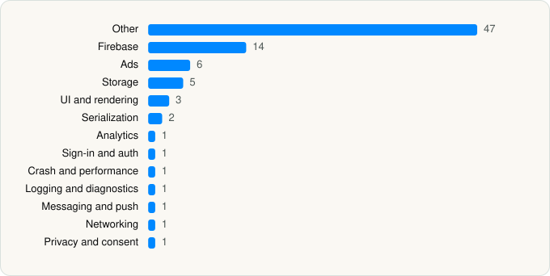

<picture><source media="(prefers-color-scheme: dark)" srcset="../../../../assets/logo/logo-dark.svg"></picture> [Tech Stack](../../../../README.md) / [YS Culture Limited](../../../../companies/ys-culture-limited.md) / CoinDrama

# CoinDrama

<picture><source media="(prefers-color-scheme: dark)" srcset="../../../../assets/badges/ios-dark.svg"></picture> <picture><source media="(prefers-color-scheme: dark)" srcset="../../../../assets/badges/inactive-dark.svg"></picture> <picture><source media="(prefers-color-scheme: dark)" srcset="../../../../assets/badges/floor-dark.svg"></picture> <picture><source media="(prefers-color-scheme: dark)" srcset="../../../../assets/badges/encrypted-dark.svg"></picture>

[App Store](https://apps.apple.com/app/id6801006288) · [latest.json](latest.json)

| | |
|---|---|
| Company | [YS Culture Limited](../../../../companies/ys-culture-limited.md) |
| Store id | `6801006288` |
| Bundle / package id | `coin.com.drama` |
| Latest version | 1.0.5 (analysed 2026-11-15) |
| Versions tracked | 1 |
| SDKs in latest version | 84 |
| Languages | C/C++, Metal (shaders), Objective-C, Swift |
| UI | Lottie (animations), SwiftUI, UIKit |
| Build | Swift Package Manager (SwiftPM) |
| Minimum OS | iOS 15.0 (built with Xcode 26.6, SDK iphoneos26.5) |
| Devices / ABIs | iPhone, iPad |
| Localisations | 24 |
| Capabilities | 2 |
| Declares tracking | Yes |
| Tracked | No. Kept for history. |

## SDKs by category

<picture><source media="(prefers-color-scheme: dark)" srcset="../../../../assets/charts/apps/ios/ys-culture-limited/coindrama-dark.svg"></picture>

- **Other** (47): AdsGlobalSDK 8.1.0, AnyThinkSDK 1.0, AppMetricaAdSupport 6.4.2, AppMetricaCore 6.4.2, AppMetricaCoreExtension 6.4.2, AppMetricaCoreUtils 6.4.2, AppMetricaEncodingUtils 6.4.2, AppMetricaFMDB 6.4.2, AppMetricaHostState 6.4.2, AppMetricaIdentifiers 6.4.2, AppMetricaIDSync 6.4.2, AppMetricaKeychain 6.4.2, AppMetricaLibraryAdapter 6.4.2, AppMetricaLog 6.4.2, AppMetricaLogSwift 6.4.2, AppMetricaNetwork 6.4.2, AppMetricaStorageUtils 6.4.2, AppMetricaSynchronization 6.4.2, CHTCollectionViewWaterfallLayout 1.0.1, IronSourceAdQualityPrivacyInfo 9.8.1, JXPagingView 2.1.3, JXSegmentedView 1.4.1, KwaiAdsSDK 1.0, libpag 4.5.81, libvcn 4.0.2, MJRefresh, MJRefresh.Privacy 3.7.9, PAGAdSDK 8.1.0, PAGSShortPlay 1.8.0, PrivacyInfo, RangersAppLog 6.16.9, SmartdigimktSDK 1.0, TikTokBusinessSDK 8.1.0, Toast-Swift 5.1.1, ttboringssl 1.0, ttcrypto 1.0, TTFFmpeg 1.0, TTSDKBMF 1.49.300, TTSDKCore 1.49.300, TTSDKPlayer 1.49.300, TTSDKTools 1.49.300, TTSDKTopSignature 1.49.300, TTSDKVCN 1.49.300, TTSDKVolcLog 1.49.300, UnityCoherenceLib 0.1.0, VolcBaseLog 1.0.0, xcprivacy 1.20240722.0
- **Firebase** (14): FBLPromises 2.4.1, Firebase 11.15.0, FirebaseAuth 11.15.0, FirebaseCore 11.15.0, FirebaseCoreInternal 11.15.0, FirebaseFirestore 11.15.0, FirebaseInstallations 11.15.0, FirebaseRemoteConfig 11.15.0, GoogleDataTransport 10.1.1, GoogleUtilities 8.1.2, gRPC, leveldb 1.22.6, nanopb 3.30910.0, Promises 2.4.1
- **Ads** (6): AppLovin 13.6.0, BigoADS 5.2.0, FBAudienceNetwork 1.0, Google Mobile Ads (AdMob), GoogleMobileAds 13.4.0, VungleAds 7.7.1
- **Storage** (5): AppMetricaPlatform 6.4.2, Realm 20.0.6, SQLite.swift 0.16.0, TTSDKPlayerCoreNormal 1.49.300, TTSDKTTFFmpegNormal 1.49.300
- **UI and rendering** (3): Kingfisher 8.11.0, Lottie 4.6.1, SDWebImage 5.21.7
- **Serialization** (2): AppMetricaProtobuf 6.4.2, AppMetricaProtobufUtils 6.4.2
- **Analytics** (1): Adjust 1.0
- **Sign-in and auth** (1): GTMSessionFetcher 4.5.0
- **Crash and performance** (1): FirebaseCrashlytics 11.15.0
- **Logging and diagnostics** (1): SwiftyBeaver 2.1.1
- **Messaging and push** (1): FirebaseMessaging 11.15.0
- **Networking** (1): TTSDKReachability 1.49.300
- **Privacy and consent** (1): UserMessagingPlatform 3.1.0

Frameworks (28)

AdServices (Apple Search Ads attribution), AdSupport (IDFA), App Tracking Transparency (ATT), AVFoundation (audio/video), AVKit, Combine (reactive), Contacts, Core Data, Core Image, Core Location, Core ML, Core Motion, CryptoKit, DeviceCheck / App Attest, EventKit (Calendar / Reminders), Local Authentication (Face ID / Touch ID), Media Player, MessageUI (mail / SMS compose), MetalKit, MetricKit (diagnostics), Network.framework, Photos, PushKit (VoIP push), SafariServices, StoreKit (in-app purchase), SwiftUI, UIKit, User Notifications

Capabilities (2)

Background Push, Push Notifications (APNs)

## Version history

| Version | Analysed | Store update | SDKs | Change | SDK list is a floor | Binary encrypted | File |
|---|---|---|---|---|---|---|---|
| 1.0.5 | 2026-11-15 |  | 84 |  | Yes | Yes | [1.0.5.json](1.0.5.json) |

---

Generated by `scripts/build_readme.py` from the JSON files. Do not edit by hand.
