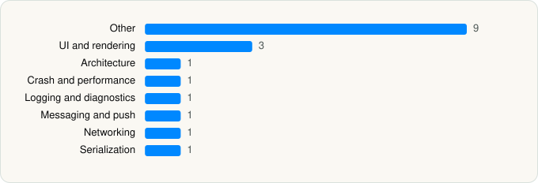

<picture><source media="(prefers-color-scheme: dark)" srcset="../../../../assets/logo/logo-dark.svg"></picture> [Tech Stack](../../../../README.md) / [Zoom Communications, Inc.](../../../../companies/zoom-communications-inc.md) / Zoom Workplace

# Zoom Workplace

<picture><source media="(prefers-color-scheme: dark)" srcset="../../../../assets/badges/ios-dark.svg"></picture> <picture><source media="(prefers-color-scheme: dark)" srcset="../../../../assets/badges/active-dark.svg"></picture> <picture><source media="(prefers-color-scheme: dark)" srcset="../../../../assets/badges/floor-dark.svg"></picture> <picture><source media="(prefers-color-scheme: dark)" srcset="../../../../assets/badges/encrypted-dark.svg"></picture>

[App Store](https://apps.apple.com/app/id546505307) · [latest.json](latest.json)

| | |
|---|---|
| Company | [Zoom Communications, Inc.](../../../../companies/zoom-communications-inc.md) |
| Store id | `546505307` |
| Bundle / package id | `us.zoom.videomeetings` |
| Latest version | 7.2.3 (analysed 2026-10-24) |
| Versions tracked | 1 |
| SDKs in latest version | 18 |
| Languages | C/C++, Metal (shaders), Objective-C, React Native / JavaScript, Swift |
| UI | Lottie (animations), SwiftUI, UIKit |
| Build | Swift Package Manager (SwiftPM) |
| Minimum OS | iOS 15.0 (built with Xcode 26.2, SDK iphoneos26.2) |
| Devices / ABIs | iPhone, iPad |
| Localisations | 19 |
| Capabilities | 18 |
| Declares tracking | No |
| Tracked | Yes |

## SDKs by category

<picture><source media="(prefers-color-scheme: dark)" srcset="../../../../assets/charts/apps/ios/zoom-communications-inc/zoom-workplace-dark.svg"></picture>

- **Other** (9): boost, folly, hermesvm 0.12.0, Lodash, openssl, ReactNativeDependencies 1.0, ViperResModels, zdcRes 1.0, zSWorker
- **UI and rendering** (3): Lottie, React Native, React Native Reanimated
- **Architecture** (1): React Navigation
- **Crash and performance** (1): KSCrash
- **Logging and diagnostics** (1): glog
- **Messaging and push** (1): Intercom
- **Networking** (1): Axios
- **Serialization** (1): libprotobuf-lite

Frameworks (35)

ActivityKit (Live Activities), App Intents, ARKit, Authentication Services (Sign in with Apple / passkeys), AVFoundation (audio/video), AVKit, CallKit (VoIP), Combine (reactive), Contacts, Core Bluetooth, Core Image, Core Location, Core ML, Core Motion, Core NFC, CryptoKit, DeviceCheck / App Attest, EventKit (Calendar / Reminders), Local Authentication (Face ID / Touch ID), Media Player, MessageUI (mail / SMS compose), MetricKit (diagnostics), Network.framework, Photos, PhotosUI, PushKit (VoIP push), SafariServices, SiriKit (Intents), StoreKit (in-app purchase), SwiftUI, UIKit, User Notifications, Vision, Watch Connectivity, WidgetKit (widgets)

Capabilities (18)

App Groups, Associated Domains (Universal Links), Background App Refresh, Background Audio, Background Location, Background Push, Background: push-to-talk, Bluetooth (central), CarPlay, CloudKit, iCloud, Keychain Sharing, NFC, Push Notifications (APNs), Sign in with Apple, SiriKit, Time-Sensitive Notifications, VoIP

## Version history

| Version | Analysed | Store update | SDKs | Change | SDK list is a floor | Binary encrypted | File |
|---|---|---|---|---|---|---|---|
| 7.2.3 | 2026-10-24 | 2026-10-23 | 18 |  | Yes | Yes | [7.2.3.json](7.2.3.json) |

---

Generated by `scripts/build_readme.py` from the JSON files. Do not edit by hand.
