<picture><source media="(prefers-color-scheme: dark)" srcset="../assets/logo/logo-dark.svg"></picture> [Tech Stack](../README.md) / Companies

# Companies

197 companies. Each name is the developer name on the store listing.

| | Company | Apps | iOS | Android | Versions | SDKs (distinct) |
|---|---|---|---|---|---|---|
|     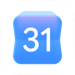 | [Google](google.md) | 21 | 21 | 0 | 28 | 85 |
|      | [Google LLC](google-llc.md) | 21 | 0 | 21 | 27 | 41 |
|     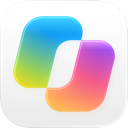 | [Microsoft Corporation](microsoft-corporation.md) | 20 | 8 | 12 | 26 | 249 |
|     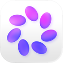 | [Meta Platforms, Inc.](meta-platforms-inc.md) | 6 | 3 | 3 | 11 | 46 |
|      | [Disney](disney.md) | 5 | 2 | 3 | 8 | 139 |
|     | [Uber Technologies, Inc.](uber-technologies-inc.md) | 4 | 2 | 2 | 5 | 144 |
|     | [X Corp.](x-corp.md) | 4 | 3 | 1 | 16 | 160 |
|    | [CBS Interactive, Inc.](cbs-interactive-inc.md) | 3 | 0 | 3 | 4 | 50 |
|    | [Instagram, Inc.](instagram-inc.md) | 3 | 3 | 0 | 4 | 17 |
|    | [Netflix, Inc.](netflix-inc.md) | 3 | 2 | 1 | 3 | 126 |
|    | [TikTok Pte. Ltd.](tiktok-pte-ltd.md) | 3 | 0 | 3 | 3 | 32 |
|   | [Alibaba Mobile](alibaba-mobile.md) | 2 | 0 | 2 | 3 | 31 |
|   | [Alpha Exploration Co.](alpha-exploration-co.md) | 2 | 1 | 1 | 3 | 62 |
|   | [Amazon Mobile LLC](amazon-mobile-llc.md) | 2 | 0 | 2 | 2 | 43 |
|   | [AMZN Mobile LLC](amzn-mobile-llc.md) | 2 | 2 | 0 | 2 | 108 |
|   | [Audible, Inc.](audible-inc.md) | 2 | 1 | 1 | 2 | 68 |
|   | [Bluesky PBLLC](bluesky-pbllc.md) | 2 | 1 | 1 | 4 | 36 |
|   | [BUTTERFLY EFFECT PTE. LTD.](butterfly-effect-pte-ltd.md) | 2 | 1 | 1 | 2 | 90 |
|   | [Bytedance Pte. Ltd.](bytedance-pte-ltd.md) | 2 | 1 | 1 | 3 | 196 |
|   | [Canva](canva.md) | 2 | 1 | 1 | 2 | 94 |
|   | [Crunchyroll, LLC](crunchyroll-llc.md) | 2 | 1 | 1 | 2 | 56 |
|   | [DealSeek LLC](dealseek-llc.md) | 2 | 1 | 1 | 2 | 53 |
|  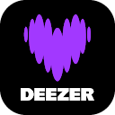 | [Deezer Music](deezer-music.md) | 2 | 0 | 2 | 2 | 25 |
|   | [Deliveroo](deliveroo.md) | 2 | 1 | 1 | 3 | 145 |
|   | [Discord Inc.](discord-inc.md) | 2 | 1 | 1 | 3 | 42 |
|   | [Duolingo](duolingo.md) | 2 | 1 | 1 | 2 | 128 |
|   | [iHeartMedia, Inc.](iheartmedia-inc.md) | 2 | 0 | 2 | 2 | 43 |
|   | [Lowe's Companies, Inc.](lowe-s-companies-inc.md) | 2 | 0 | 2 | 2 | 40 |
|   | [Lyft, Inc.](lyft-inc.md) | 2 | 1 | 1 | 2 | 44 |
|   | [Mercari, Inc](mercari-inc.md) | 2 | 0 | 2 | 3 | 57 |
|   | [Mistral AI](mistral-ai.md) | 2 | 1 | 1 | 2 | 54 |
|   | [Moonshot AI](moonshot-ai.md) | 2 | 1 | 1 | 3 | 107 |
|   | [Pandora](pandora.md) | 2 | 0 | 2 | 2 | 35 |
|   | [reddit Inc.](reddit-inc.md) | 2 | 1 | 1 | 2 | 64 |
|   | [Roadget Business PTE. LTD.](roadget-business-pte-ltd.md) | 2 | 1 | 1 | 2 | 66 |
|   | [Shelgaon Ltd](shelgaon-ltd.md) | 2 | 2 | 0 | 2 | 29 |
|   | [SKYWORK AI PTE.LTD.](skywork-ai-pte-ltd.md) | 2 | 1 | 1 | 2 | 124 |
|   | [Snap Inc](snap-inc.md) | 2 | 1 | 1 | 2 | 35 |
|   | [SpaceX Super Intelligence](spacex-super-intelligence.md) | 2 | 0 | 2 | 4 | 44 |
|   | [Suno, Inc](suno-inc.md) | 2 | 1 | 1 | 2 | 67 |
|   | [Telegram FZ-LLC](telegram-fz-llc.md) | 2 | 1 | 1 | 3 | 24 |
|  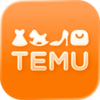 | [Temu](temu.md) | 2 | 1 | 1 | 3 | 50 |
| 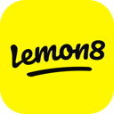  | [TikTok Ltd.](tiktok-ltd.md) | 2 | 2 | 0 | 3 | 153 |
|   | [Twitch Interactive, Inc.](twitch-interactive-inc.md) | 2 | 1 | 1 | 2 | 42 |
|   | [Wayfair, LLC](wayfair-llc.md) | 2 | 0 | 2 | 2 | 45 |
|   | [WhatsApp Inc.](whatsapp-inc.md) | 2 | 2 | 0 | 4 | 6 |
| 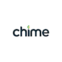 | [Advita Ortho, LLC](advita-ortho-llc.md) | 1 | 0 | 1 | 1 | 24 |
|  | [Affirm Quest](affirm-quest.md) | 1 | 0 | 1 | 1 | 13 |
|  | [Airbnb, Inc.](airbnb-inc.md) | 1 | 1 | 0 | 1 | 23 |
|  | [Alibaba](alibaba.md) | 1 | 1 | 0 | 1 | 61 |
|  | [American Airlines, Inc.](american-airlines-inc.md) | 1 | 0 | 1 | 1 | 32 |
|  | [Anthropic PBC](anthropic-pbc.md) | 1 | 1 | 0 | 4 | 43 |
|  | [Apple](apple.md) | 1 | 1 | 0 | 1 | 1 |
|  | [Astra AI](astra-ai.md) | 1 | 0 | 1 | 1 | 12 |
|  | [Audiomack Music Apps](audiomack-music-apps.md) | 1 | 0 | 1 | 1 | 51 |
| 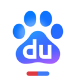 | [Beijing Baidu Netcom Science & Technology Co.,Ltd](beijing-baidu-netcom-science-technology-co-ltd.md) | 1 | 1 | 0 | 1 | 188 |
|  | [Beijing Zhizhetianxia Technology Co., Ltd.](beijing-zhizhetianxia-technology-co-ltd.md) | 1 | 1 | 0 | 1 | 214 |
|  | [Beloud.com](beloud-com.md) | 1 | 0 | 1 | 1 | 28 |
|  | [BENDING SPOONS OPERATIONS SPA](bending-spoons-operations-spa.md) | 1 | 1 | 0 | 2 | 87 |
|  | [BeReal](bereal.md) | 1 | 1 | 0 | 3 | 124 |
|  | [Booking.com Hotels & Vacation Rentals](booking-com-hotels-vacation-rentals.md) | 1 | 0 | 1 | 1 | 45 |
|  | [Burger King, Inc.](burger-king-inc.md) | 1 | 0 | 1 | 2 | 29 |
|  | [CBS Interactive](cbs-interactive.md) | 1 | 1 | 0 | 1 | 30 |
|  | [Character.AI](character-ai.md) | 1 | 1 | 0 | 1 | 74 |
|  | [Chick-fil-A, Inc.](chick-fil-a-inc.md) | 1 | 0 | 1 | 1 | 30 |
|  | [ClassDojo](classdojo.md) | 1 | 0 | 1 | 1 | 47 |
|  | [Cosmic Kettle Software OÜ](cosmic-kettle-software-ou.md) | 1 | 0 | 1 | 1 | 19 |
|  | [Costco Wholesale](costco-wholesale.md) | 1 | 0 | 1 | 1 | 32 |
|  | [Curebase](curebase.md) | 1 | 0 | 1 | 1 | 18 |
|  | [CVS Pharmacy](cvs-pharmacy.md) | 1 | 0 | 1 | 1 | 23 |
|  | [DEEP FLOW SOFTWARE SERVICES](deep-flow-software-services.md) | 1 | 1 | 0 | 1 | 42 |
|  | [DeepSeek](deepseek.md) | 1 | 0 | 1 | 1 | 11 |
|  | [Depop Ltd](depop-ltd.md) | 1 | 1 | 0 | 1 | 344 |
|  | [Domino's Pizza LLC](domino-s-pizza-llc.md) | 1 | 0 | 1 | 1 | 35 |
|  | [DoorDash, Inc.](doordash-inc.md) | 1 | 1 | 0 | 1 | 98 |
|  | [Dropbox, Inc.](dropbox-inc.md) | 1 | 1 | 0 | 2 | 19 |
|  | [DuckDuckGo](duckduckgo.md) | 1 | 0 | 1 | 3 | 18 |
|  | [Dunkin' Brands, Inc.](dunkin-brands-inc.md) | 1 | 0 | 1 | 1 | 33 |
|  | [eBay Mobile](ebay-mobile.md) | 1 | 0 | 1 | 1 | 37 |
| 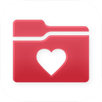 | [Epic](epic.md) | 1 | 1 | 0 | 1 | 0 |
|  | [FIFA](fifa.md) | 1 | 1 | 0 | 1 | 69 |
| 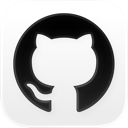 | [GitHub](github.md) | 1 | 1 | 0 | 2 | 65 |
|  | [GOAT](goat.md) | 1 | 0 | 1 | 1 | 34 |
|  | [Gopuff](gopuff.md) | 1 | 0 | 1 | 1 | 46 |
|  | [Grab Holdings](grab-holdings.md) | 1 | 0 | 1 | 1 | 47 |
|  | [Grab.com](grab-com.md) | 1 | 1 | 0 | 1 | 79 |
|  | [Granola inc](granola-inc.md) | 1 | 1 | 0 | 1 | 31 |
|  | [Grubhub](grubhub.md) | 1 | 0 | 1 | 2 | 44 |
|  | [Hilton](hilton.md) | 1 | 0 | 1 | 2 | 29 |
|  | [Hopper Inc.](hopper-inc.md) | 1 | 0 | 1 | 1 | 36 |
|  | [Hotels.com LP](hotels-com-lp.md) | 1 | 0 | 1 | 2 | 43 |
|  | [Hulu, LLC](hulu-llc.md) | 1 | 1 | 0 | 1 | 28 |
|  | [Ideogram](ideogram.md) | 1 | 1 | 0 | 1 | 19 |
|  | [iHeartMedia Management Services, Inc.](iheartmedia-management-services-inc.md) | 1 | 1 | 0 | 1 | 88 |
|  | [Instacart](instacart.md) | 1 | 0 | 1 | 2 | 47 |
|  | [Inter IKEA Systems B.V](inter-ikea-systems-b-v.md) | 1 | 0 | 1 | 2 | 18 |
|  | [Karmalab Inc.](karmalab-inc.md) | 1 | 0 | 1 | 1 | 26 |
|  | [Kohls](kohls.md) | 1 | 0 | 1 | 2 | 40 |
|  | [Koupon Inc.](koupon-inc.md) | 1 | 1 | 0 | 1 | 38 |
|  | [Kuku Technologies Limited](kuku-technologies-limited.md) | 1 | 1 | 0 | 1 | 81 |
|  | [Life360](life360.md) | 1 | 1 | 0 | 1 | 137 |
|  | [LinkedIn Corporation](linkedin-corporation.md) | 1 | 1 | 0 | 1 | 18 |
|  | [Luka, Inc.](luka-inc.md) | 1 | 1 | 0 | 3 | 80 |
|  | [Marriott International](marriott-international.md) | 1 | 0 | 1 | 1 | 25 |
|  | [Mastodon GmbH](mastodon-gmbh.md) | 1 | 1 | 0 | 2 | 14 |
|  | [McDonalds USA, LLC](mcdonalds-usa-llc.md) | 1 | 0 | 1 | 2 | 42 |
|  | [MorelandConnect](morelandconnect.md) | 1 | 0 | 1 | 1 | 28 |
|  | [NBA MEDIA VENTURES, LLC](nba-media-ventures-llc.md) | 1 | 1 | 0 | 1 | 43 |
|  | [New York Road Runners, Inc.](new-york-road-runners-inc.md) | 1 | 1 | 0 | 1 | 32 |
|  | [NewLeaf Publishing](newleaf-publishing.md) | 1 | 1 | 0 | 1 | 84 |
|  | [Nextdoor](nextdoor.md) | 1 | 1 | 0 | 1 | 98 |
| 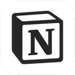 | [Notion Labs, Incorporated](notion-labs-incorporated.md) | 1 | 1 | 0 | 2 | 38 |
|  | [Onskeskyen ApS](onskeskyen-aps.md) | 1 | 1 | 0 | 1 | 45 |
|  | [OpenAI](openai.md) | 1 | 0 | 1 | 1 | 36 |
| 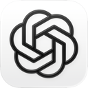 | [OpenAI OpCo, LLC](openai-opco-llc.md) | 1 | 1 | 0 | 3 | 28 |
| 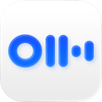 | [Otter.ai, Inc.](otter-ai-inc.md) | 1 | 1 | 0 | 1 | 36 |
|  | [Pandora Media, LLC](pandora-media-llc.md) | 1 | 1 | 0 | 1 | 41 |
|  | [Panera Bread](panera-bread.md) | 1 | 0 | 1 | 1 | 33 |
|  | [Partiful](partiful.md) | 1 | 1 | 0 | 1 | 23 |
|  | [PayPal Mobile](paypal-mobile.md) | 1 | 0 | 1 | 1 | 41 |
| 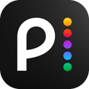 | [Peacock TV LLC](peacock-tv-llc.md) | 1 | 1 | 0 | 1 | 40 |
| 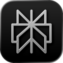 | [Perplexity AI, Inc.](perplexity-ai-inc.md) | 1 | 1 | 0 | 1 | 26 |
|  | [PerplexityAI](perplexityai.md) | 1 | 0 | 1 | 1 | 37 |
|  | [Photoroom](photoroom.md) | 1 | 1 | 0 | 2 | 87 |
|  | [Photoroom AI Photo Editor](photoroom-ai-photo-editor.md) | 1 | 0 | 1 | 1 | 37 |
|  | [PicsArt, Inc.](picsart-inc.md) | 1 | 1 | 0 | 1 | 47 |
|  | [Pinterest](pinterest.md) | 1 | 0 | 1 | 1 | 35 |
|  | [Pinterest, Inc.](pinterest-inc.md) | 1 | 1 | 0 | 1 | 28 |
|  | [Pizza Hut Inc](pizza-hut-inc.md) | 1 | 0 | 1 | 1 | 45 |
|  | [Playful Rewards](playful-rewards.md) | 1 | 1 | 0 | 1 | 44 |
|  | [Plex Inc.](plex-inc.md) | 1 | 1 | 0 | 1 | 38 |
|  | [Pluto, Inc.](pluto-inc.md) | 1 | 0 | 1 | 1 | 33 |
|  | [Pluto.tv](pluto-tv.md) | 1 | 1 | 0 | 1 | 39 |
|  | [Pomegranate Technologies](pomegranate-technologies.md) | 1 | 0 | 1 | 1 | 40 |
|  | [Posh Group Inc.](posh-group-inc.md) | 1 | 1 | 0 | 2 | 32 |
|  | [Posten](posten.md) | 1 | 1 | 0 | 1 | 24 |
|  | [Prisma labs, inc.](prisma-labs-inc.md) | 1 | 1 | 0 | 1 | 68 |
|  | [Qobuz](qobuz.md) | 1 | 0 | 1 | 1 | 24 |
|  | [Quora, Inc.](quora-inc.md) | 1 | 1 | 0 | 1 | 22 |
|  | [Rakuten Group, Inc.](rakuten-group-inc.md) | 1 | 0 | 1 | 1 | 34 |
|  | [Reco Social, Inc.](reco-social-inc.md) | 1 | 1 | 0 | 1 | 80 |
|  | [ROKU INC](roku-inc.md) | 1 | 1 | 0 | 1 | 39 |
|  | [Romangic Lab LLC](romangic-lab-llc.md) | 1 | 1 | 0 | 1 | 59 |
|  | [Sam's Club](sam-s-club.md) | 1 | 0 | 1 | 1 | 37 |
|  | [Signal Foundation](signal-foundation.md) | 1 | 0 | 1 | 2 | 22 |
|  | [Signal Messenger, LLC](signal-messenger-llc.md) | 1 | 1 | 0 | 2 | 9 |
|  | [SINA Corporation](sina-corporation.md) | 1 | 1 | 0 | 1 | 51 |
|  | [Skype Communications S.a.r.l](skype-communications-s-a-r-l.md) | 1 | 1 | 0 | 1 | 76 |
|  | [Skyscanner Ltd](skyscanner-ltd.md) | 1 | 0 | 1 | 1 | 34 |
|  | [Sling TV](sling-tv.md) | 1 | 0 | 1 | 1 | 27 |
|  | [SONY PICTURES NETWORKS INDIA PVT LTD](sony-pictures-networks-india-pvt-ltd.md) | 1 | 1 | 0 | 1 | 53 |
|  | [SoundCloud](soundcloud.md) | 1 | 0 | 1 | 1 | 43 |
|  | [SoundCloud Global Limited & Co KG](soundcloud-global-limited-co-kg.md) | 1 | 1 | 0 | 1 | 51 |
|  | [Southwest Airlines](southwest-airlines.md) | 1 | 0 | 1 | 1 | 35 |
|  | [Speechify Inc.](speechify-inc.md) | 1 | 1 | 0 | 1 | 103 |
|  | [Spotify](spotify.md) | 1 | 1 | 0 | 2 | 22 |
|  | [Spotify AB](spotify-ab.md) | 1 | 0 | 1 | 1 | 35 |
|  | [Starbucks Coffee Company](starbucks-coffee-company.md) | 1 | 0 | 1 | 1 | 28 |
|  | [Strava, Inc.](strava-inc.md) | 1 | 1 | 0 | 1 | 50 |
|  | [SUBWAY Restaurants](subway-restaurants.md) | 1 | 0 | 1 | 1 | 40 |
| 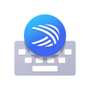 | [SwiftKey](swiftkey.md) | 1 | 1 | 0 | 1 | 46 |
| 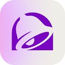 | [Taco Bell Mobile](taco-bell-mobile.md) | 1 | 0 | 1 | 1 | 44 |
|  | [Tapps Games](tapps-games.md) | 1 | 0 | 1 | 1 | 35 |
|  | [Target Corporation](target-corporation.md) | 1 | 0 | 1 | 1 | 37 |
| 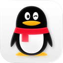 | [Tencent Technology (Shenzhen) Company Limited](tencent-technology-shenzhen-company-limited.md) | 1 | 1 | 0 | 1 | 44 |
|  | [The Clubhouse Gym](the-clubhouse-gym.md) | 1 | 0 | 1 | 1 | 26 |
| 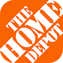 | [The Home Depot, Inc](the-home-depot-inc.md) | 1 | 0 | 1 | 1 | 39 |
|  | [The New York Times Company](the-new-york-times-company.md) | 1 | 1 | 0 | 1 | 30 |
|  | [Trip.com](trip-com.md) | 1 | 0 | 1 | 1 | 37 |
|  | [Trip.com Travel Singapore Pte. Ltd.](trip-com-travel-singapore-pte-ltd.md) | 1 | 1 | 0 | 1 | 71 |
|  | [Tripadvisor](tripadvisor.md) | 1 | 0 | 1 | 1 | 35 |
|  | [Tubi TV](tubi-tv.md) | 1 | 0 | 1 | 1 | 42 |
|  | [Tubi, Inc](tubi-inc.md) | 1 | 1 | 0 | 1 | 40 |
| 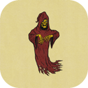 | [Tumblr, Inc.](tumblr-inc.md) | 1 | 1 | 0 | 1 | 60 |
|  | [Tusky Team](tusky-team.md) | 1 | 0 | 1 | 1 | 7 |
|  | [Utility Apps Home](utility-apps-home.md) | 1 | 0 | 1 | 1 | 43 |
|  | [VEVOR STORE LLC](vevor-store-llc.md) | 1 | 0 | 1 | 1 | 46 |
|  | [Viber Media SARL.](viber-media-sarl.md) | 1 | 1 | 0 | 1 | 26 |
|  | [Vinted Limited](vinted-limited.md) | 1 | 1 | 0 | 1 | 82 |
|  | [Walgreens Co](walgreens-co.md) | 1 | 0 | 1 | 1 | 43 |
|  | [Walmart](walmart.md) | 1 | 0 | 1 | 1 | 34 |
|  | [WarnerMedia Global Digital Services, LLC](warnermedia-global-digital-services-llc.md) | 1 | 1 | 0 | 1 | 107 |
|  | [Waze](waze.md) | 1 | 0 | 1 | 1 | 20 |
|  | [Waze Inc.](waze-inc.md) | 1 | 1 | 0 | 1 | 4 |
|  | [WeChat](wechat.md) | 1 | 1 | 0 | 1 | 17 |
|  | [Wendy's Int'l., LLC](wendy-s-int-l-llc.md) | 1 | 0 | 1 | 1 | 31 |
|  | [Whatnot Inc.](whatnot-inc.md) | 1 | 1 | 0 | 3 | 349 |
|  | [WhatsApp LLC](whatsapp-llc.md) | 1 | 0 | 1 | 2 | 24 |
|  | [Wikibuy, LLC](wikibuy-llc.md) | 1 | 1 | 0 | 1 | 22 |
|  | [Xingin](xingin.md) | 1 | 1 | 0 | 1 | 139 |
|  | [Yelp, Inc](yelp-inc.md) | 1 | 0 | 1 | 1 | 32 |
|  | [YENİ MAĞAZACILIK ANONİM ŞİRKETİ](yeni-magazacilik-anonim-sirketi.md) | 1 | 1 | 0 | 1 | 51 |
|  | [Yum Brands Inc - KFC India Division](yum-brands-inc-kfc-india-division.md) | 1 | 0 | 1 | 1 | 45 |
| 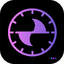 | [Zelle Solutions](zelle-solutions.md) | 1 | 0 | 1 | 1 | 14 |
|  | [Zoom Communications, Inc.](zoom-communications-inc.md) | 1 | 1 | 0 | 1 | 18 |
| 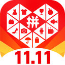 | [上海寻梦信息技术有限公司](shanghai-xunmeng-information-technology-co-ltd.md) | 1 | 1 | 0 | 3 | 71 |
|  | [行吟信息科技(上海)有限公司](xingin-information-technology-shanghai-co-ltd.md) | 1 | 0 | 1 | 1 | 35 |

---

Generated by `scripts/build_readme.py` from the JSON files. Do not edit by hand.
