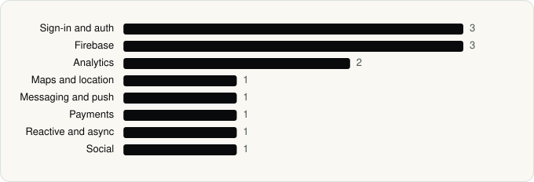

<picture><source media="(prefers-color-scheme: dark)" srcset="../assets/logo/logo-dark.svg"></picture> [Tech Stack](../README.md) / [Companies](README.md) / Affirm Quest

# Affirm Quest

The company name is the developer name on the store listing.

**1** apps (0 iOS, 1 Android) · **1** versions · **13** distinct SDKs across their latest versions

<table>
<tr><td align="center" valign="top" width="16%"> <a href="../apps/android/affirm-quest/affirm-quest/README.md"><b>Affirm Quest</b></a> Android · 13 SDKs</td></tr>
</table>

## Apps

| | App | Platform | Versions | Latest | Analysed | SDKs | Tracked |
|---|---|---|---|---|---|---|---|
|  | [Affirm Quest](../apps/android/affirm-quest/affirm-quest/README.md) | Android | 1 | 1.2.7 | 2026-06-19 | 13 | No |

## SDKs by category

Counted across the latest version of each app.

<picture><source media="(prefers-color-scheme: dark)" srcset="../assets/charts/companies/affirm-quest-dark.svg"></picture>

---

Generated by `scripts/build_readme.py` from the JSON files. Do not edit by hand.
