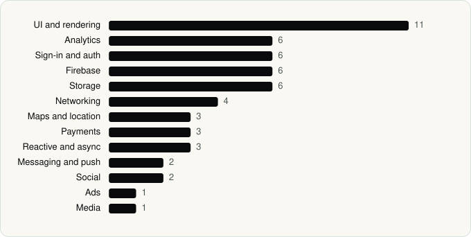

<picture><source media="(prefers-color-scheme: dark)" srcset="../assets/logo/logo-dark.svg"></picture> [Tech Stack](../README.md) / [Companies](README.md) / Alibaba Mobile

# Alibaba Mobile

The company name is the developer name on the store listing.

**2** apps (0 iOS, 2 Android) · **3** versions · **31** distinct SDKs across their latest versions

<table>
<tr><td align="center" valign="top" width="16%"> <a href="../apps/android/alibaba-mobile/alibaba-com/README.md"><b>Alibaba.com</b></a> Android · 29 SDKs</td><td align="center" valign="top" width="16%"> <a href="../apps/android/alibaba-mobile/aliexpress/README.md"><b>AliExpress</b></a> Android · 24 SDKs</td></tr>
</table>

## Apps

| | App | Platform | Versions | Latest | Analysed | SDKs | Tracked |
|---|---|---|---|---|---|---|---|
|  | [Alibaba.com - B2B marketplace](../apps/android/alibaba-mobile/alibaba-com/README.md) | Android | 1 | 26.19.0 | 2026-06-19 | 29 | No |
|  | [AliExpress - Shopping App](../apps/android/alibaba-mobile/aliexpress/README.md) | Android | 2 | 8.180.1 | 2026-11-01 | 24 | No |

## SDKs by category

Counted across the latest version of each app.

<picture><source media="(prefers-color-scheme: dark)" srcset="../assets/charts/companies/alibaba-mobile-dark.svg"></picture>

## SDKs shared across their apps

| SDK | Apps |
|---|---|
| Braintree | 2 of 2 |
| Credential Manager | 2 of 2 |
| Facebook Login | 2 of 2 |
| Facebook SDK | 2 of 2 |
| Facebook Share | 2 of 2 |
| Firebase | 2 of 2 |
| Firebase Analytics | 2 of 2 |
| Firebase Messaging | 2 of 2 |
| Glide | 2 of 2 |
| Google App Measurement | 2 of 2 |
| Google DataTransport | 2 of 2 |
| Google Maps | 2 of 2 |
| Google Play services | 2 of 2 |
| Google Sign-In / Auth | 2 of 2 |
| greenDAO | 2 of 2 |
| Kotlin Coroutines | 2 of 2 |
| Lottie | 2 of 2 |
| Material Components | 2 of 2 |
| OkHttp | 2 of 2 |
| Okio | 2 of 2 |

---

Generated by `scripts/build_readme.py` from the JSON files. Do not edit by hand.
