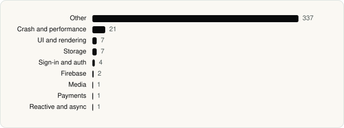

<picture><source media="(prefers-color-scheme: dark)" srcset="../assets/logo/logo-dark.svg"></picture> [Tech Stack](../README.md) / [Companies](README.md) / Alipay (Hangzhou) Technology Co. Ltd

# Alipay (Hangzhou) Technology Co. Ltd

The company name is the developer name on the store listing.

**2** apps (1 iOS, 1 Android) · **2** versions · **381** distinct SDKs across their latest versions

<table>
<tr><td align="center" valign="top" width="16%"> <a href="../apps/android/alipay-hangzhou-technology-co-ltd/alipay/README.md"><b>Alipay</b></a> Android · 8 SDKs</td><td align="center" valign="top" width="16%"> <a href="../apps/ios/alipay-hangzhou-technology-co-ltd/alipay/README.md"><b>Alipay</b></a> iOS · 381 SDKs</td></tr>
</table>

## Apps

| | App | Platform | Versions | Latest | Analysed | SDKs | Tracked |
|---|---|---|---|---|---|---|---|
|  | [Alipay](../apps/android/alipay-hangzhou-technology-co-ltd/alipay/README.md) | Android | 1 | 12.12.16.7200 | 2026-10-24 | 8 | No |
|  | [Alipay - Simplify Your Life](../apps/ios/alipay-hangzhou-technology-co-ltd/alipay/README.md) | iOS | 1 | 12.12.38 | 2026-10-24 | 381 | No |

## SDKs by category

Counted across the latest version of each app.

<picture><source media="(prefers-color-scheme: dark)" srcset="../assets/charts/companies/alipay-hangzhou-technology-co-ltd-dark.svg"></picture>

---

Generated by `scripts/build_readme.py` from the JSON files. Do not edit by hand.
