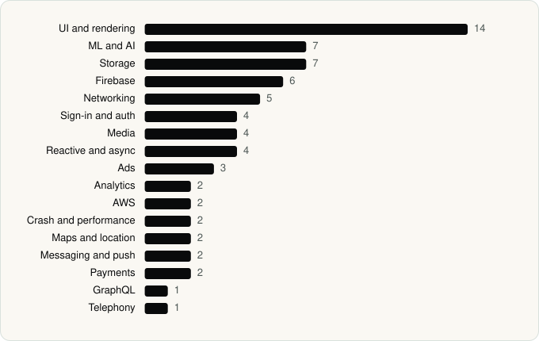

<picture><source media="(prefers-color-scheme: dark)" srcset="../assets/logo/logo-dark.svg"></picture> [Tech Stack](../README.md) / [Companies](README.md) / Amazon Mobile LLC

# Amazon Mobile LLC

The company name is the developer name on the store listing.

**2** apps (0 iOS, 2 Android) · **2** versions · **43** distinct SDKs across their latest versions

<table>
<tr><td align="center" valign="top" width="16%"> <a href="../apps/android/amazon-mobile-llc/amazon-shopping/README.md"><b>Amazon Shopping</b></a> Android · 39 SDKs</td><td align="center" valign="top" width="16%"> <a href="../apps/android/amazon-mobile-llc/prime-video/README.md"><b>Prime Video</b></a> Android · 29 SDKs</td></tr>
</table>

## Apps

| | App | Platform | Versions | Latest | Analysed | SDKs | Tracked |
|---|---|---|---|---|---|---|---|
|  | [Amazon Shopping](../apps/android/amazon-mobile-llc/amazon-shopping/README.md) | Android | 1 | 32.11.0.100 | 2026-06-23 | 39 | Yes |
|  | [Prime Video](../apps/android/amazon-mobile-llc/prime-video/README.md) | Android | 1 | 3.0.456.747 | 2026-06-23 | 29 | Yes |

## SDKs by category

Counted across the latest version of each app.

<picture><source media="(prefers-color-scheme: dark)" srcset="../assets/charts/companies/amazon-mobile-llc-dark.svg"></picture>

## SDKs shared across their apps

| SDK | Apps |
|---|---|
| AWS SDK | 2 of 2 |
| Bugsnag | 2 of 2 |
| Coil | 2 of 2 |
| Credential Manager | 2 of 2 |
| DataStore | 2 of 2 |
| Firebase | 2 of 2 |
| Firebase Analytics | 2 of 2 |
| Firebase Messaging | 2 of 2 |
| Glide | 2 of 2 |
| Google DataTransport | 2 of 2 |
| Google Location | 2 of 2 |
| Google Mobile Ads (AdMob) | 2 of 2 |
| Google Play Billing | 2 of 2 |
| Google Play services | 2 of 2 |
| Google Sign-In / Auth | 2 of 2 |
| Jetpack Compose | 2 of 2 |
| Kotlin Coroutines | 2 of 2 |
| Lottie | 2 of 2 |
| Material Components | 2 of 2 |
| Media3 (ExoPlayer) | 2 of 2 |

---

Generated by `scripts/build_readme.py` from the JSON files. Do not edit by hand.
