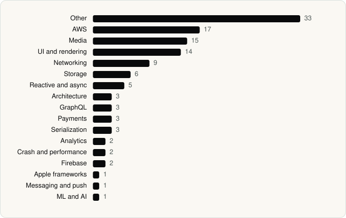

<picture><source media="(prefers-color-scheme: dark)" srcset="../assets/logo/logo-dark.svg"></picture> [Tech Stack](../README.md) / [Companies](README.md) / AMZN Mobile LLC

# AMZN Mobile LLC

The company name is the developer name on the store listing.

**2** apps (2 iOS, 0 Android) · **2** versions · **108** distinct SDKs across their latest versions

<table>
<tr><td align="center" valign="top" width="16%"> <a href="../apps/ios/amzn-mobile-llc/amazon-music/README.md"><b>Amazon Music</b></a> iOS · 72 SDKs</td><td align="center" valign="top" width="16%"> <a href="../apps/ios/amzn-mobile-llc/amazon-prime-video/README.md"><b>Amazon Prime Video</b></a> iOS · 48 SDKs</td></tr>
</table>

## Apps

| | App | Platform | Versions | Latest | Analysed | SDKs | Tracked |
|---|---|---|---|---|---|---|---|
|  | [Amazon Music: Songs & Podcasts](../apps/ios/amzn-mobile-llc/amazon-music/README.md) | iOS | 1 | 26.17.0 | 2026-06-23 | 72 | No |
|  | [Amazon Prime Video](../apps/ios/amzn-mobile-llc/amazon-prime-video/README.md) | iOS | 1 | 10.134 | 2026-06-23 | 48 | No |

## SDKs by category

Counted across the latest version of each app.

<picture><source media="(prefers-color-scheme: dark)" srcset="../assets/charts/companies/amzn-mobile-llc-dark.svg"></picture>

## SDKs shared across their apps

| SDK | Apps |
|---|---|
| AIViOSPlayer | 2 of 2 |
| Alamofire | 2 of 2 |
| AWSAPIGateway | 2 of 2 |
| AWSAuthCore | 2 of 2 |
| AWSCognitoIdentityProvider | 2 of 2 |
| AWSCognitoIdentityProviderASF | 2 of 2 |
| AWSCore | 2 of 2 |
| AWSMobileClient | 2 of 2 |
| FoveaFramework | 2 of 2 |
| IOSPlayerSDKConfig | 2 of 2 |
| Lottie | 2 of 2 |
| Starscream | 2 of 2 |

---

Generated by `scripts/build_readme.py` from the JSON files. Do not edit by hand.
